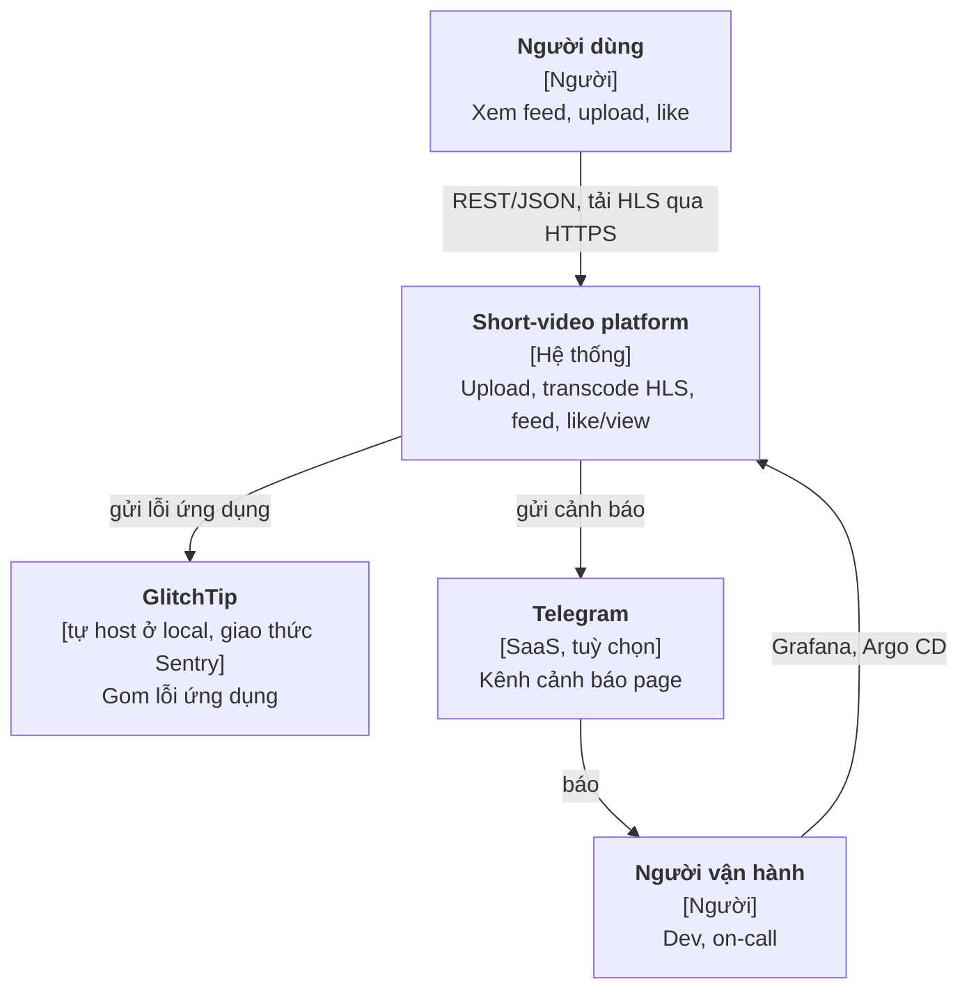
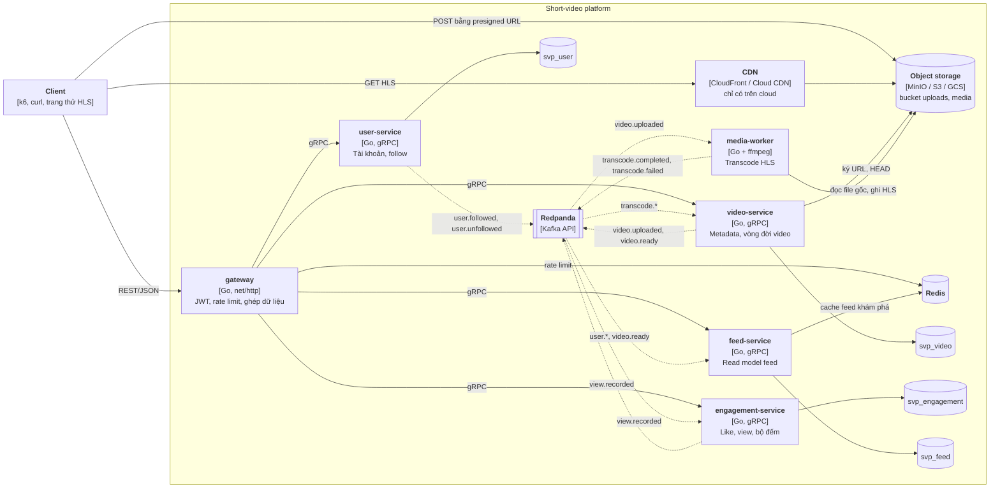
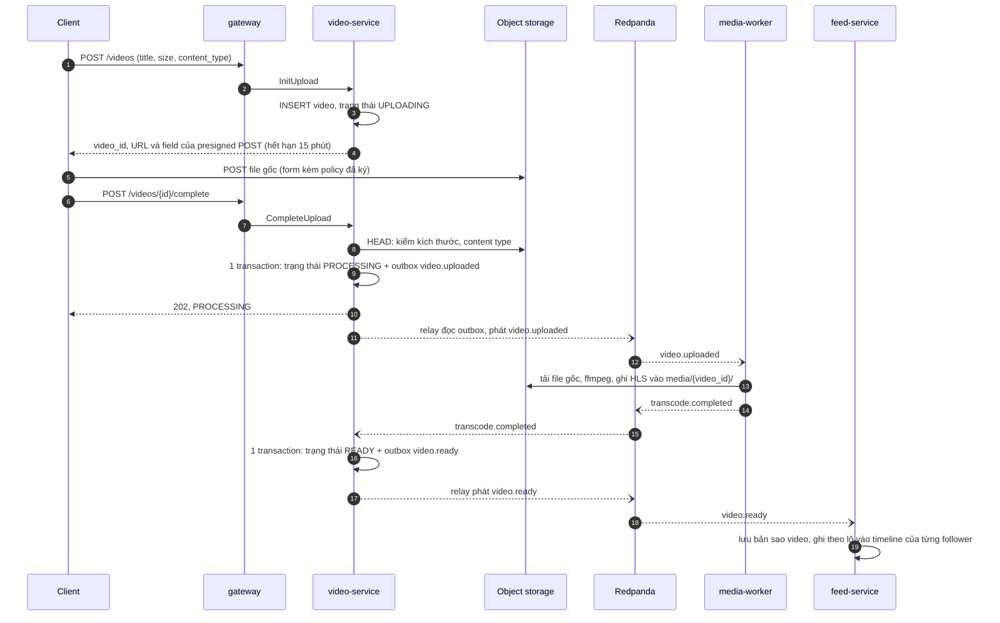
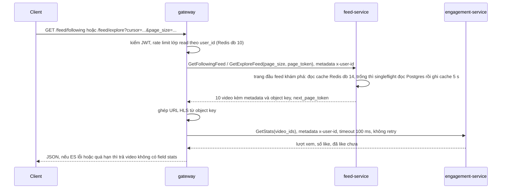

# Kiến trúc short-video platform

> Trạng thái: giai đoạn 0, 1, 2 (2026-10-11) và 3 (2026-10-17) xong. ADR 0001–0012, contract ở [`proto/`](../proto/)
> ([§8](#8-contract)), threat model ở [`threat-model.md`](threat-model.md). `make up` chạy luồng đồng bộ (đăng ký, đăng
> nhập, tạo và đọc video, follow), luồng upload bất đồng bộ (presigned POST lên MinIO, outbox → Redpanda, media-worker
> transcode ra HLS, video `READY` hoặc `FAILED`, job dọn upload bỏ dở), luồng feed (follow qua outbox, feed-service
> fan-out on write, feed following và khám phá có cache trang đầu trong Redis, like, lượt xem gom theo lô ở
> engagement-service), rate limit ở gateway bằng Redis, retry và circuit breaker cho lời gọi gRPC của gateway. Mọi
> service đẩy trace, metric, log qua OpenTelemetry tới Collector; `make up OBS=lgtm` thêm Grafana LGTM, Alertmanager và
> GlitchTip với SLO, cảnh báo burn rate và dashboard ([ADR-0011](adr/0011-observability-stage3.md),
> [§5](#5-c4-mức-container)). Phần còn lại của tài liệu (CDN, k8s, cloud) là thiết kế đích.

Tài liệu này mô tả hệ thống sẽ được xây và lý do. Mỗi quyết định lớn có một ADR trong [`adr/`](adr/); ở đây chỉ tóm tắt
và trỏ tới.

## 1. Phạm vi

**Chức năng (MVP):**

| Mã | Chức năng |
| --- | --- |
| F1 | Đăng ký, đăng nhập bằng email + mật khẩu, nhận JWT |
| F2 | Follow, unfollow người dùng khác |
| F3 | Upload video tối đa 3 phút; hệ thống transcode ra HLS; trạng thái `UPLOADING → PROCESSING → READY` hoặc `FAILED` |
| F4 | Phát video bằng HLS, tự đổi chất lượng theo mạng |
| F5 | Feed "đang theo dõi": video mới nhất của người mình follow, phân trang bằng cursor |
| F6 | Feed "khám phá": video mới nhất toàn hệ thống, cho người chưa follow ai |
| F7 | Like, unlike; ghi lượt xem; hiện số lượt xem, số like và mình đã like chưa |

**Ngoài phạm vi:** app client (vai trò client do k6, curl và một trang HTML thử HLS đảm nhận), comment, tìm kiếm,
gợi ý bằng ML, thông báo, xoá/sửa video, kiểm duyệt nội dung. Thêm sau thì viết ADR.

## 2. Yêu cầu phi chức năng

| Mảng | Yêu cầu | Đo ở đâu |
| --- | --- | --- |
| Độ trễ | Feed p99 < 150 ms tại 1.000 req/s | SLO `feed-latency`: 99% request GET feed ở gateway nằm trong bucket 150 ms của `http_server_request_duration_seconds`, cảnh báo burn rate (giai đoạn 3); tải 1.000 req/s bằng k6 (giai đoạn 6) |
| Sẵn sàng | Khởi tạo upload thành công 99,9%; đọc feed 99,9% | SLO `upload-init-availability`, `feed-availability`: tỉ lệ 5xx trên tổng request ở gateway, cảnh báo burn rate qua Alertmanager (giai đoạn 3) |
| Xử lý video | Video 1 phút sẵn sàng phát p95 < 2 phút kể từ lúc upload xong | Từ `CompleteUpload` tới `READY`: `make measure-ready`; SLO `video-ready-latency`, 95% mẫu `svp_video_ready_duration_seconds` của video-service trong bucket 120 s, `FAILED` luôn tính xấu (giai đoạn 3) |
| Độ tươi | Video `READY` xuất hiện trong feed follower p95 < 10 s | Từ `video.ready` tới dòng timeline cuối cùng: `make measure-freshness`; histogram `svp_feed_freshness_seconds` trên dashboard, chưa thành SLO vì local quá ít event |
| Bền dữ liệu | Video đã `CompleteUpload` thành công thì không mất; event không mất | Diễn tập kill worker (giai đoạn 2) |
| Đúng đắn | Event gửi trùng không làm sai bộ đếm, không transcode hai lần ra kết quả khác | Test gửi trùng (giai đoạn 2) |
| Nhất quán | Số lượt xem trễ tối đa ~1 phút; like của chính mình thấy ngay | — |
| Vận hành | Mọi request có `trace_id`; deploy không downtime; cảnh báo theo SLO | Giai đoạn 3: trace OpenTelemetry mở ở gateway, log có `trace_id`, cảnh báo burn rate của 4 SLO cùng cảnh báo lag, vòng nền, DLQ, breaker, rate limit dự phòng; `make drill-alert-to-sentry`. Deploy không downtime ở giai đoạn 4 |
| Chi phí | Local trước; tài nguyên cloud dựng và xoá trong cùng buổi | Budget alert |

Hai dòng "Độ tươi" và "Nhất quán" không có trong plan gốc; người học đã duyệt ngày 2026-10-11. Hệ thống dùng event nên
dữ liệu nhất quán sau cùng, phải ghi rõ chấp nhận trễ bao nhiêu thì mới thiết kế và đo được.

## 3. Ước lượng quy mô

### 3.1 Giả định

Ba số đầu có trong plan; các số còn lại là giả định của bản thiết kế này, sai thì sửa ở đây rồi tính lại.

| | Giả định |
| --- | --- |
| P1 | 100k người dùng hoạt động mỗi ngày (DAU) |
| P2 | Feed 1.000 request/giây lúc cao điểm |
| P3 | 1.000 video upload mỗi ngày, mỗi video tối đa 3 phút |
| A1 | Mỗi DAU xem 60 video/ngày, trung bình 20 s/video (20 phút/ngày) |
| A2 | Một trang feed 10 video, nên mỗi DAU gọi feed 6 lần/ngày |
| A3 | Cao điểm = 3 × trung bình |
| A4 | 5% lượt xem có like |
| A5 | Video trung bình 60 s; file gốc quay 1080p khoảng 10 Mbps, tức 75 MB |
| A6 | HLS 3 bản: 360p 0,8 Mbps + 720p 2,5 Mbps + 1080p 5 Mbps = 8,3 Mbps (62 MB cho video 60 s); người xem nhận trung bình 2,5 Mbps |
| A7 | 1 triệu tài khoản, mỗi tài khoản follow trung bình 50 người; video upload được fan-out tới trung bình 2.000 follower; tài khoản lớn nhất 200k follower |
| A8 | Một worker 2 vCPU transcode video 60 s ra 3 bản mất khoảng 60 s. Đo 2026-10-11 (local M2, worker giới hạn 2 CPU, preset `veryfast`, video tổng hợp 60 s 1080p `testsrc2`, `make measure-ready N=5`): `CompleteUpload` → `READY` p50 46,8 s, max 47,6 s, gồm tải file gốc, transcode, ghi HLS và hai chặng event |

P1 dùng để ước lượng dung lượng, băng thông, chi phí; P2 là mục tiêu tải cho k6, không suy ra từ P1 (xem 3.3).

Một ngày có 86.400 giây.

### 3.2 Kết quả

| Đại lượng | Cách tính | Kết quả |
| --- | --- | --- |
| Request feed | 100k × 6 / 86.400 | ~7 req/s trung bình, **~21 req/s** cao điểm |
| Lượt xem | 100k × 60 / 86.400 | ~70/s trung bình, ~210/s cao điểm |
| Lượt xem ở mục tiêu tải | 1.000 req/s × 10 video | **~10.000 event/s** |
| Like | 5% × 6 triệu = 300k/ngày | ~10/s cao điểm |
| Upload | 1.000 / 24 × 3 | ~125 video/giờ, khoảng **2 video/phút** cao điểm |
| Băng thông upload | 1.000 × 75 MB = 75 GB/ngày | ~7 Mbps trung bình, ~21 Mbps cao điểm |
| Transcode | 2 video/phút × 60 s/video | ~2 worker bận lúc cao điểm; cần **≥ 3** để chờ ít và giữ p95 < 2 phút; ban đêm gần 0 |
| Lưu trữ video | (75 + 62) MB × 1.000 | ~137 GB/ngày ≈ 4 TB/tháng ≈ **50 TB/năm** (giữ cả file gốc) |
| Egress phát video | 6 triệu × 20 s × 2,5 Mbps | ~37,5 TB/ngày ≈ **1,1 PB/tháng**; ~3,5 Gbps trung bình, ~10 Gbps cao điểm |
| Postgres: follow | 1 triệu × 50 cạnh, ~160 B/cạnh kể cả 2 index | ~8 GB, lưu 2 nơi (user-service và bản sao ở feed-service) |
| Postgres: timeline | 1.000 × 2.000 = 2 triệu dòng/ngày, giữ 30 ngày, ~110 B/dòng | 60 triệu dòng ≈ 7 GB |
| Postgres: video, like | video ~1 KB/dòng; like 300k dòng/ngày | video không đáng kể; like ~15 GB/năm |
| Redpanda: lượt xem | 6 triệu × ~200 B, giữ 7 ngày | ~8 GB |

### 3.3 Rút ra gì

1. **Hai giả định gốc không khớp nhau, và đã chốt cách dùng.** 100k DAU chỉ sinh ~21 req/s feed lúc cao điểm; 1.000 req/s
   tương ứng khoảng 5 triệu DAU với cùng hành vi. P1 (100k DAU) là giả định để ước lượng dung lượng, băng thông, chi phí;
   P2 (1.000 req/s) là **mục tiêu tải** cho k6, khoảng 50 lần cao điểm thật, đặt ra có chủ ý: ở 21 req/s một Postgres
   không cache cũng thừa sức, sẽ không còn gì để học về cache, singleflight, đo p99, gom ghi lượt xem. Không nâng DAU lên
   ~5 triệu cho khớp, vì khi đó egress phình lên ~55 PB/tháng (1,1 PB × 50) và mô hình chi phí ở giai đoạn 9 mất ý nghĩa. Hệ quả:
   ở mục tiêu tải có ~10.000 event lượt xem/giây, lab `hot-counter` đo ở mức này. Các con số còn lại tính theo 100k DAU.
2. **Tiền nằm ở egress, không nằm ở service.** Dữ liệu phát ra mỗi tháng (1,1 PB) lớn gấp khoảng 275 lần dữ liệu lưu
   thêm (4 TB). CDN là bắt buộc; thứ đáng tối ưu nhất là bitrate ladder và tỉ lệ cache hit của CDN, không phải code Go.
   Feed vuốt thường tải trước vài video kế tiếp, nên egress thật còn cao hơn. Quy ra USD để giai đoạn 9.
3. **Đọc metadata nhỏ.** Ngay ở 1.000 req/s, Postgres có index đúng vẫn chịu được. Cache dùng để chống **key nóng**
   (feed khám phá: mọi người đọc cùng một danh sách), không phải vì tổng tải ([ADR-0005](adr/0005-feed-fan-out-on-write.md)).
4. **Ghi nóng nằm ở lượt xem.** ~10.000 event/s ở mục tiêu tải, dồn vào vài video viral: cập nhật từng dòng sẽ tranh
   khoá trên cùng một row. Cần gom ghi theo lô; lab `hot-counter` chọn cách cụ thể.
5. **Transcode ít nhưng nặng và dồn cục.** Tách worker riêng, scale theo độ trễ hàng chờ (KEDA ở giai đoạn 4)
   ([ADR-0001](adr/0001-service-boundaries-and-data-ownership.md)).
6. **Upload nhỏ về băng thông nhưng mỗi kết nối kéo dài.** Không cho file đi qua service; client đẩy thẳng lên object
   storage ([ADR-0004](adr/0004-direct-upload-and-hls.md)).

## 4. C4 mức context



## 5. C4 mức container

Nét liền là gọi đồng bộ, nét đứt là event qua Redpanda.



Local: Postgres và Redis native trên máy (mỗi service một database, xem [`CLAUDE.md`](../CLAUDE.md)), MinIO thay S3, không có
CDN (client đọc thẳng MinIO). Redpanda và MinIO chạy trong compose profile `core`
([ADR-0008](adr/0008-async-upload-pipeline-stage2a.md)):

- **MinIO:** hai bucket `uploads` (riêng tư) và `media` (ẩn danh chỉ đọc từng object, không liệt kê được); video-service và
  media-worker mỗi bên một user với policy theo tiền tố key. Client upload và đọc HLS qua `127.0.0.1:9000`.
- **Redpanda:** một broker; topic và `.dlq` do container init tạo, broker tắt tự tạo topic. Trong compose là
  `redpanda:9092`, từ máy host là `127.0.0.1:19092`.
- **engagement-service và feed-service** ([ADR-0009](adr/0009-engagement-feed-stage2b.md) mục 12): gRPC ở `:9103` và
  `:9104` chỉ trong mạng compose, không publish ra máy (gateway gọi `engagement-service:9103`, `feed-service:9104`); mỗi
  service `mem_limit` 256 MB, database riêng `svp_engagement`, `svp_feed`. Đo 2026-10-11: lúc nghỉ 9–23 MiB mỗi service;
  feed-service đỉnh 82 MiB khi nạp 200.000 follow.
- **Redis** ([ADR-0010](adr/0010-redis-ratelimit-cache-resilience-stage2c.md) mục 1): bản native `127.0.0.1:6379` dùng
  chung với dự án khác, không có container; compose trỏ `REDIS_URL` tới `host.docker.internal:6379/<db>`. Gateway dùng
  db 10, tiền tố khoá `svp:gw:` (rate limit, `svp:gw:rl:<lớp>:<định danh>`); feed-service db 14, tiền tố `svp:feed:`
  (cache trang đầu feed khám phá); test db 15, mỗi test một tiền tố `svp:test:<hex>:`. Mọi khoá có TTL (Redis local
  `maxmemory 0`, `noeviction`). Client có timeout ngắn (dial 100 ms, đọc/ghi 50 ms); service khởi động và vẫn ready khi
  Redis lỗi, vì mọi chỗ dùng Redis đều có đường lui ([§7.2](#72-đọc-feed), [§8.5](#85-rest-ở-gateway)). Đo 2026-10-11 sau
  mọi diễn tập: Redis native dùng 6,9 MB (gồm cả dữ liệu dự án khác), db 10 còn 15 khoá (trung bình 96 B), db 14
  trống.
- **Mạng riêng của media-worker:** worker chạy ffmpeg trên file người dùng tải lên, nên chỉ nằm trong mạng compose `worker`
  (`internal`, không route ra ngoài) cùng Redpanda, MinIO và Collector `otelcol`; nó không tới được gateway, các service
  gRPC, Postgres hay internet. Container chỉ đọc, bỏ mọi capability, giới hạn 2 CPU, 2 GB.
- **Observability** ([ADR-0011](adr/0011-observability-stage3.md), so sánh Elastic ở
  [ADR-0012](adr/0012-elastic-vs-grafana-stage3.md)): mọi service đẩy trace, metric (mỗi 15 s) và log qua OTLP/gRPC tới
  Collector `otelcol` (`otel/opentelemetry-collector-contrib`, nằm ở cả mạng `default` và `worker`, cổng 4317 không
  publish; memory limiter, xoá attribute nhạy cảm, batch, scrape lag Redpanda). Không service nào mở `/metrics` hay pprof.
  Profile `obs` (`make up OBS=lgtm`) thêm `lgtm` (Grafana `127.0.0.1:3000` cùng Prometheus giữ 30 ngày, Loki, Tempo,
  Pyroscope; 5 service đẩy profile tới `lgtm:4040`, media-worker không), `alertmanager` (`127.0.0.1:9093`, gửi
  `severity=page` tới Telegram khi `.env` có bot) và `glitchtip` (`127.0.0.1:8000`, tracker lỗi qua giao thức Sentry,
  database `svp_glitchtip` trên Postgres native). Không có profile `obs`, DNS `otelcol` không tồn tại: SDK bỏ export,
  service vẫn chạy. Đo 2026-10-17 (`docker stats` lúc nghỉ): `otelcol` 64–100 MiB / 256 MiB, `lgtm` 740 MiB sau 3 lượt
  smoke và 1 245 MiB sau mọi diễn tập / 1 536 MiB, `alertmanager` 17–42 MiB / 64 MiB, `glitchtip` 185–232 MiB / 512 MiB;
  cả `core` + `obs` 1,71–2,19 GiB. Overhead của SDK trên 6 service so với tắt telemetry: khoảng +50 MiB RAM và +2% một lõi
  CPU dưới tải smoke, p50/p95 trang khám phá +12/+12 ms (số đo và cách đo ở
  [plan](../plans/261004-devops-sa-roadmap/plan.md), Tiến độ giai đoạn 3). Profile `obs-elastic` (Elasticsearch, Kibana
  `127.0.0.1:5601`, APM Server, `otelcol-elastic` cùng alias `otelcol`) chỉ để so sánh, không chạy cùng `obs`.

## 6. Sở hữu dữ liệu và event

Luật ([ADR-0001](adr/0001-service-boundaries-and-data-ownership.md)): mỗi service chỉ đọc ghi database của mình; event về một thực thể chỉ do service
sở hữu thực thể đó phát.

| Service | Sở hữu | Bản sao (dựng từ event) |
| --- | --- | --- |
| `user-service` | tài khoản, hash mật khẩu, follow | — |
| `video-service` | metadata video, trạng thái, đường dẫn object | — |
| `media-worker` | không có database | — |
| `engagement-service` | like, bộ đếm lượt xem/like | — |
| `feed-service` | timeline | follow, video đã `READY` |
| `gateway` | không có database (Redis cho rate limit) | — |

**Danh mục event v1** (schema Protobuf ở [`proto/`](../proto/), topic và envelope ở [§8](#8-contract)):

| Event | Phát | Key (partition) | Nhận | Để làm gì |
| --- | --- | --- | --- | --- |
| `user.followed` | user-service (outbox) | `follower_id` | feed-service | Thêm cạnh vào bản sao, đưa video gần đây của người được follow vào timeline |
| `user.unfollowed` | user-service (outbox) | `follower_id` | feed-service | Xoá cạnh, bỏ video của người đó khỏi timeline |
| `video.uploaded` | video-service (outbox) | `video_id` | media-worker | Bắt đầu transcode |
| `transcode.completed` | media-worker | `video_id` | video-service | Báo kết quả: các bản HLS, thời lượng, thumbnail |
| `transcode.failed` | media-worker | `video_id` | video-service | Báo lỗi; video-service chuyển `FAILED` và dọn file (bước bù của saga) |
| `video.ready` | video-service (outbox) | `video_id` | feed-service | Video phát hành, kèm đủ metadata để feed không phải gọi lại |
| `view.recorded` | engagement-service (produce thẳng) | `video_id` | engagement-service | Hàng đệm cho lượt xem; consumer gom theo lô rồi cộng vào bộ đếm |

**Khác với bảng Hệ thống trong plan** (đã chốt, lý do ở [ADR-0003](adr/0003-async-events-outbox.md)):

- `video.ready` do **video-service** phát chứ không phải media-worker, vì video-service sở hữu video. media-worker chỉ báo
  kết quả job (`transcode.completed` / `transcode.failed`); video-service quyết định trạng thái rồi mới phát.
- Chưa tạo `video.failed` và `like.toggled`: chưa có service nào cần nhận. Client xem trạng thái `FAILED` qua API; số like
  đọc thẳng từ engagement-service. Thêm event khi có người nhận (ví dụ service thông báo, bảng xu hướng).

## 7. Luồng chính

### 7.1 Upload tới khi vào feed (saga dạng choreography)



Không ai điều phối trung tâm: mỗi service nghe event rồi làm phần của mình (choreography). Nếu transcode lỗi, media-worker
phát `transcode.failed`; video-service chuyển `FAILED` và xoá file dở dang. Mọi bước chịu được việc nhận trùng event:
media-worker ghi vào đường dẫn cố định theo `video_id` nên chạy lại chỉ ghi đè; video-service chỉ chuyển trạng thái theo
một chiều; feed-service ghi timeline với khoá chính chống trùng.

### 7.2 Đọc feed



Gateway ghép dữ liệu từ hai service (vai trò BFF). Số đếm là phần phụ: engagement-service chậm thì feed vẫn trả về, chỉ
thiếu số. Đây là graceful degradation, giữ SLO của feed không phụ thuộc vào service kém quan trọng hơn.

Phần chống quá tải và lỗi lan ([ADR-0010](adr/0010-redis-ratelimit-cache-resilience-stage2c.md) mục 2–4):

- **Rate limit:** lớp `read` 600/phút, burst 200 mỗi `user_id`; Redis lỗi thì route đọc **mở** (cho qua).
- **Cache feed khám phá:** chỉ trang đầu (`page_token` rỗng), khoá `svp:feed:explore:v1:first:<page_size>`, giá trị là
  bytes protobuf của câu trả lời, TTL 5 s, không xoá chủ động khi có video mới (video mới vào khám phá chậm tối đa 5 s).
  Cache trống thì các request đồng thời của một instance chung một lần đọc Postgres (singleflight, hạn riêng 2 s). Redis
  lỗi hay quá 50 ms thì đọc Postgres, không báo lỗi cho client. `make measure-explore-cache N=100` (2026-10-11): 100
  request đồng thời lúc cache trống thì đọc Postgres **1** lần, p50 191 ms, p95 206 ms; 100 request tiếp theo trong TTL
  không đọc lần nào, p50 79 ms, p95 87 ms.
- **Retry và circuit breaker** ở gateway, một breaker cho mỗi service đích: lời gọi idempotent (gồm `GetFollowingFeed`,
  `GetExploreFeed`) được gọi tối đa 3 lần khi gặp `UNAVAILABLE`, trong cùng hạn 3 s; `GetStats` không retry. Breaker mở
  khi 5 lỗi liên tiếp, hoặc ≥ 20 lời gọi với ≥ 50% lỗi trong 10 s; mở 5 s rồi cho một lời gọi thử. Lỗi là `UNAVAILABLE`
  mức kết nối và `DEADLINE_EXCEEDED` (riêng `GetStats` không tính `DEADLINE_EXCEEDED`); mã nghiệp vụ và lỗi phụ thuộc
  của service (`DEPENDENCY_UNAVAILABLE`) không mở breaker. Breaker mở thì lời gọi lỗi ngay, không gọi mạng: feed trả
  trang không `stats` mà không chờ 100 ms, like trả 503.

Diễn tập `make drill-engagement-down` (2026-10-11): tắt engagement-service thì breaker mở sau 6 like (3,4 s); với breaker
mở, 10 lần like trả 503, chậm nhất 8,9 ms; feed following trả 200 trong 0,014 s, khám phá 0,024 s, không item nào có
`stats`; `/readyz` vẫn 200 vì nó không kiểm engagement-service ([ADR-0009](adr/0009-engagement-feed-stage2b.md) mục 9).
Bật lại thì breaker tự đóng, like trả 204 sau 1,1 s và `stats` quay lại.

### 7.3 Ghi lượt xem

Client gọi `POST /videos/{id}/views`; engagement-service phát `view.recorded` lên Redpanda (`acks=all`, hạn 2 s, lỗi thì
503) rồi trả 202, không chạm database. Consumer của chính nó gom lô **tối đa 5.000 record hoặc 1 s** kể từ record đầu,
cộng dồn theo `video_id` trong bộ nhớ, rồi ghi cả lô bằng **một câu** `INSERT ... ON CONFLICT DO UPDATE` (mảng
`video_id` sắp tăng dần) vào `view_counts`. Chống đếm trùng bằng offset lưu trong Postgres: bảng `consumer_offsets` giữ
`next_offset` của từng partition, khoá `FOR UPDATE` và cập nhật trong **cùng transaction** với bộ đếm, nên lô giao lại
chỉ cộng phần chưa cộng; commit offset Kafka chỉ còn để đỡ đọc lại. Record hỏng vào `engagement.views.v1.dlq`; lỗi tạm
thời thì thử lại cả lô không giới hạn. Redpanda vừa là hàng đệm chống dồn tải, vừa giữ lượt xem nếu consumer chết giữa
chừng. Like đi đường khác: bảng `likes` và bộ đếm `like_counts` đổi trong cùng transaction, nên like của chính mình thấy
ngay. Chi tiết và lý do ở [ADR-0009](adr/0009-engagement-feed-stage2b.md) mục 2–5.

### 7.4 Xác thực

user-service cấp JWT ký bằng khoá riêng; gateway kiểm chữ ký bằng khoá công khai, không gọi user-service mỗi request.
Gateway chuyển `user_id` xuống các service qua gRPC metadata. Bên trong cluster tạm thời tin nhau qua mạng; mTLS giữa
các service để giai đoạn 6. Threat model đã xét lại điểm này ở
[mục 4.5 của `threat-model.md`](threat-model.md#45-mức-tin-cậy-giữa-các-service).

## 8. Contract

Contract nội bộ nằm ở [`proto/`](../proto/), quản lý bằng `buf` theo [ADR-0002](adr/0002-sync-rest-edge-grpc-internal.md).
Các quyết định khó đảo ngược (kiểu ID, envelope event, cách chia topic, versioning, bố cục thư mục, danh tính người gọi,
đường dẫn media) và lựa chọn đã cân nhắc ở [ADR-0006](adr/0006-contract-ids-and-event-envelope.md). Mục này tóm tắt chúng,
và ghi hai quyết định đổi được ở một chỗ: cách mã hoá cursor (8.3) và cách đổi mã lỗi sang HTTP (8.4).

### 8.1 Bố cục và quy ước chung

```text
buf.yaml                         v2, module proto, lint STANDARD, breaking FILE, không deps
proto/svp/
├── event/v1/event.proto         EventMeta: envelope chung của mọi event
├── user/v1/                     user_service.proto, events.proto
├── video/v1/                    video_service.proto, events.proto
├── engagement/v1/               engagement_service.proto, events.proto
├── feed/v1/                     feed_service.proto
└── media/v1/events.proto        event của media-worker (không có service gRPC)
```

- Kiểm từ gốc repo: `buf lint` (sạch, không output) và `buf build`. `buf breaking` (luật `FILE`) so với nhánh `main` ở CI.
  Sinh code Go theo [ADR-0007](adr/0007-go-monorepo-toolchain-and-stage1-scope.md): managed mode trong `buf.gen.yaml` (không
  ghi tay `go_package`), code ra ở `gen/go`, và code sinh ra được commit (`make generate`).
- ID là UUIDv7, trong proto là `string` 36 ký tự chữ thường, trong Postgres là `uuid`, sinh ở code Go.
- Người gọi không nằm trong request: gateway đặt `user_id` đã xác thực vào gRPC metadata `x-user-id` ([§7.4](#74-xác-thực)).
- API và event mang object key (`uploads/<video_id>`, `media/<video_id>/master.m3u8`), không mang URL; gateway ghép URL
  công khai từ cấu hình của môi trường. Ngoại lệ: `upload_url` của presigned POST.
- Mỗi RPC có comment ghi ngữ nghĩa, idempotency và các mã lỗi chính.

### 8.2 Topic

Một topic cho một luồng thực thể của một producer, không phải cho mỗi loại event, để mọi event của một thực thể giữ thứ
tự trên một partition. Mỗi topic có một message bọc: field 1 là `svp.event.v1.EventMeta meta` (`event_id` UUIDv7,
`occurred_at`), sau đó `oneof event` với mỗi loại event của [danh mục §6](#6-sở-hữu-dữ-liệu-và-event) là một nhánh.

| Topic | Message bọc | Event (nhánh `oneof`) | Phát | Key |
| --- | --- | --- | --- | --- |
| `user.follows.v1` | `svp.user.v1.FollowEvent` | `user.followed` (`UserFollowed`), `user.unfollowed` (`UserUnfollowed`) | user-service | `follower_id` |
| `video.lifecycle.v1` | `svp.video.v1.VideoEvent` | `video.uploaded` (`VideoUploaded`), `video.ready` (`VideoReady`) | video-service | `video_id` |
| `media.transcodes.v1` | `svp.media.v1.TranscodeEvent` | `transcode.completed` (`TranscodeCompleted`), `transcode.failed` (`TranscodeFailed`) | media-worker | `video_id` |
| `engagement.views.v1` | `svp.engagement.v1.ViewEvent` | `view.recorded` (`ViewRecorded`) | engagement-service | `video_id` |

- DLQ: `<topic>.dlq` ([ADR-0003](adr/0003-async-events-outbox.md)).
- Trace context (`traceparent`) đi trong header Kafka theo quy ước OpenTelemetry, không nằm trong proto.
- Thêm loại event = thêm một nhánh `oneof`; consumer gặp nhánh chưa biết thì bỏ qua và commit offset.

### 8.3 Phân trang feed

Field theo Google AIP-158: request có `page_size`, `page_token`; response có `next_page_token`.

- `page_size` 0 thì dùng mặc định 10; lớn hơn 50 thì hạ về 50; số âm thì `INVALID_ARGUMENT`.
- `next_page_token` rỗng nghĩa là hết trang.
- `page_token` **mờ** với client và gateway: gateway chuyển nguyên giá trị (query `?cursor=`), không đọc, không tự tạo.
- Bên trong, token là base64url không padding của bytes protobuf gồm (`published_at`, `video_id`) của item cuối trang,
  đúng cursor keyset của [ADR-0005](adr/0005-feed-fan-out-on-write.md): field 1 `published_at` varint int64 micro giây
  Unix, field 2 `video_id` 16 byte, khoảng 36 ký tự. feed-service mã hoá tay bằng gói `protowire`, không có file
  `.proto` ([ADR-0009](adr/0009-engagement-feed-stage2b.md) mục 8); token **không** nằm trong `proto/` vì không phải
  contract công khai, và đổi được bất cứ lúc nào (token cũ không giải mã được thì client tải lại từ trang đầu).
- Token dài quá **64 ký tự** bị từ chối trước khi giải mã. Token hỏng (không phải base64url, giải mã lỗi, thiếu field,
  sai kiểu wire, `video_id` không đủ 16 byte) thì `INVALID_ARGUMENT`, reason `INVALID_PAGE_TOKEN`; field lạ bỏ qua.
  `page_size` âm thì reason `INVALID_PAGE_SIZE`.
- **Không ký HMAC.** Token chỉ lọc trong timeline của chính người gọi (`user_id` lấy từ metadata, không từ token), hoặc
  trong feed khám phá vốn công khai; sửa token chỉ đổi vị trí đọc trong dữ liệu mình vốn được xem. Lựa chọn khác: ký HMAC
  để phát hiện sửa (thêm quản lý khoá, không chặn được gì thêm); dùng `OFFSET` (bị lệch trang khi có video mới, ADR-0005).

### 8.4 Mã lỗi gRPC sang HTTP ở gateway

Service trả mã gRPC chuẩn, kèm lý do máy đọc được bằng `google.rpc.ErrorInfo.reason` trong status details (dạng
`UPPER_SNAKE_CASE`, ví dụ `VIDEO_NOT_FOUND`; gắn bằng gói Go `errdetails`, proto không cần import `google/rpc`). Gateway đổi
theo bảng:

| Mã gRPC | HTTP |
| --- | --- |
| `OK` | 200 |
| `INVALID_ARGUMENT` | 400 |
| `FAILED_PRECONDITION` | 400 |
| `OUT_OF_RANGE` | 400 |
| `UNAUTHENTICATED` | 401 |
| `PERMISSION_DENIED` | 403 |
| `NOT_FOUND` | 404 |
| `ALREADY_EXISTS` | 409 |
| `ABORTED` | 409 |
| `RESOURCE_EXHAUSTED` | 429 |
| `CANCELLED` | 499 (client đóng kết nối, mã không chuẩn theo nginx; client thường không nhận được) |
| `UNKNOWN` | 500 |
| `INTERNAL` | 500 |
| `DATA_LOSS` | 500 |
| `UNIMPLEMENTED` | 501 |
| `UNAVAILABLE` | 503 |
| `DEADLINE_EXCEEDED` | 504 |

Thân lỗi theo RFC 9457 (`Content-Type: application/problem+json`):

```json
{
  "type": "about:blank",
  "title": "Not Found",
  "status": 404,
  "detail": "video not found",
  "code": "VIDEO_NOT_FOUND",
  "trace_id": "4bf92f3577b34da6a3ce929d0e0e4736"
}
```

- `type` là `about:blank` và `title` là tên chuẩn của mã HTTP; `detail` là message của service; `code` là
  `ErrorInfo.reason`, không có thì là tên mã gRPC (`NOT_FOUND`); `trace_id` để tra log và trace.
- `trace_id` là trace ID của span OpenTelemetry mà gateway mở cho request, luôn là trace gốc mới (`traceparent` của
  client bị bỏ qua, [ADR-0011](adr/0011-observability-stage3.md) §3); cùng giá trị với trace trong Tempo, field
  `trace_id` của log và tag `trace_id` của event lỗi. `/healthz`, `/readyz` không có span, nên problem của chúng (503
  `NOT_READY`) có `trace_id` rỗng.
- Với mã 5xx, gateway **không** trả message gốc và lý do của service (tránh lộ chi tiết nội bộ): `detail` bỏ trống, `code`
  là tên mã gRPC, chỉ `trace_id` để tra.
- Lỗi do chính gateway sinh (JWT sai hoặc hết hạn: 401; vượt rate limit: 429) dùng cùng định dạng.
- Vượt rate limit ([ADR-0010](adr/0010-redis-ratelimit-cache-resilience-stage2c.md) mục 2): 429, `code` `RATE_LIMITED`,
  `detail` `"too many requests"`, header `Retry-After` tính bằng giây (làm tròn lên, tối thiểu 1). Khác với 429 do service
  trả qua `RESOURCE_EXHAUSTED` (`TOO_MANY_UPLOADS` của `POST /videos`, `SERVER_BUSY` của login): những lỗi đó không có
  `Retry-After`.
- Circuit breaker của service đích đang mở ([§7.2](#72-đọc-feed)): gateway không gọi mạng mà trả ngay `UNAVAILABLE`, tức
  503 với `code` `UNAVAILABLE`, `detail` rỗng, như mọi 5xx. Service báo phụ thuộc của nó chết (`UNAVAILABLE` kèm reason
  `DEPENDENCY_UNAVAILABLE`, ví dụ `RecordView` khi Redpanda chết, `CompleteUpload` khi MinIO chết) cũng là 503 không lộ
  reason.
- Lỗi từ engagement-service khi ghép feed **không** đi qua bảng này: gateway nuốt lỗi và trả feed không kèm số đếm
  (graceful degradation, [§7.2](#72-đọc-feed)).

### 8.5 REST ở gateway

REST ở biên được viết tay trong [`services/gateway/openapi.yaml`](../services/gateway/openapi.yaml) (OpenAPI 3.1, lý do ở
mục 8 của ADR-0007); file đó là nguồn của danh sách route, schema và mã lỗi từng route. JSON dùng `snake_case`, khớp tên
field trong proto; thời gian theo RFC 3339, UTC. Route đã có (giai đoạn 1 và 2):

| Route | Xác thực | Việc |
| --- | --- | --- |
| `POST /auth/register`, `POST /auth/login` | không | đăng ký; đổi email và mật khẩu lấy access token |
| `PUT` / `DELETE /me/following/{user_id}` | Bearer JWT | follow, unfollow |
| `POST /videos` | Bearer JWT | tạo video `UPLOADING`, trả form presigned POST: `upload_url`, `form_fields`, `expires_at` (15 phút) |
| `POST /videos/{video_id}/complete` | Bearer JWT | báo upload xong: video-service `HEAD` object, chuyển `PROCESSING`, trả 202; gọi lại khi đã `PROCESSING` hay `READY` thì trả video hiện tại |
| `GET /videos/{video_id}` | Bearer JWT | đọc một video; có `playlist_url`, `thumbnail_url` khi video đã `READY` |
| `GET /feed/following` | Bearer JWT | feed đang theo dõi (30 ngày); query `cursor`, `page_size`; trả `items` (kèm `stats` nếu engagement-service trả kịp 100 ms) và `next_cursor` |
| `GET /feed/explore` | Bearer JWT | feed khám phá, mọi video `READY`; cùng query và dạng trả như feed following |
| `PUT` / `DELETE /videos/{video_id}/like` | Bearer JWT | like, unlike; idempotent, trả 204 |
| `POST /videos/{video_id}/views` | Bearer JWT | ghi một lượt xem, trả 202; số lượt xem cập nhật sau vài giây |
| `GET /healthz`, `GET /readyz` | không | liveness, readiness |

`playlist_url`, `thumbnail_url` là `MEDIA_PUBLIC_BASE_URL` + `/` + object key, ở cả item của feed. Path hay query không
phải UTF-8 hợp lệ thì gateway trả 400 `INVALID_UTF8` ở mọi route, không gọi service.

Chi tiết hiện thực của luồng upload chốt ở [ADR-0008](adr/0008-async-upload-pipeline-stage2a.md):

- object key trong contract là nguyên văn key trong bucket, bucket chọn theo tiền tố `uploads/` hay `media/` (mục 4);
- storage có hai endpoint: nội bộ cho service gọi API S3, công khai cho URL ký trả client (mục 3);
- mỗi service chỉ một relay outbox chạy tại một thời điểm, khoá bằng `pg_try_advisory_xact_lock`, để event cùng key giữ
  thứ tự (mục 7; chỉnh câu `FOR UPDATE SKIP LOCKED` của [ADR-0003](adr/0003-async-events-outbox.md)).

Chi tiết hiện thực của luồng feed, like và lượt xem chốt ở [ADR-0009](adr/0009-engagement-feed-stage2b.md):

- follow, unfollow phát `user.followed` / `user.unfollowed` qua outbox của user-service, chỉ khi cạnh thật sự đổi
  (mục 1);
- feed-service giữ bản sao `follows`, `videos` và `timeline`; mọi thao tác của một tác giả khoá `pg_advisory_xact_lock`
  theo tác giả; `video.ready` fan-out bằng một câu `INSERT ... SELECT`; follow mới đưa tối đa 20 video trong 30 ngày vào
  timeline; job mỗi giờ dọn dòng quá 30 ngày (mục 6, 7);
- gateway ghép `stats` bằng một `GetStats` cho cả trang, timeout 100 ms, không retry (mục 9).

Rate limit, cache, timeout/retry/circuit breaker và job dọn upload chốt ở
[ADR-0010](adr/0010-redis-ratelimit-cache-resilience-stage2c.md):

- mọi route trừ `/healthz`, `/readyz` có rate limit GCRA bằng một Lua script trong Redis db 10 (mục 2): `register` theo
  IP 60/giờ, burst 20; `login` theo IP 60/phút, burst 30, và theo cặp (IP, email) 10/giờ, burst 5 (khoá chứa SHA-256 của
  email, không có email thô); `POST /videos` 30/giờ, burst 10; route ghi 120/phút, burst 60; route đọc 600/phút, burst
  200, ba lớp sau theo `user_id`. Mọi lần gọi đều được đếm. IP lấy từ địa chỉ kết nối, bỏ qua `X-Forwarded-For` (RL-1;
  đọc header của proxy tin cậy là việc của giai đoạn 4);
- Redis lỗi hay quá 50 ms thì `register`, `login`, `POST /videos` **đóng mềm** (bộ đếm trong bộ nhớ của từng instance,
  ngưỡng bằng nửa), route ghi và đọc **mở**; gateway log WARN `rate limit store unavailable, using fallback` tối đa một
  dòng mỗi 10 s (RL-2);
- lượt xem thứ hai của cùng cặp (`user_id`, `video_id`) trong 60 s vẫn nhận 202 nhưng không được đếm (RL-3, khoá
  `SET NX PX 60000`); chuyển tiếp `RecordView` lỗi thì xoá khoá đó để lần thử lại được đếm;
- mỗi user tối đa 3 video `UPLOADING` có form còn hạn (tạo trong 15 phút gần nhất); quá thì 429 `TOO_MANY_UPLOADS`
  (UP-7, đếm ở video-service dưới advisory lock theo tác giả, mục 5);
- video-service chạy job dọn upload bỏ dở mỗi 5 phút, một instance một lúc nhờ `pg_try_advisory_xact_lock`: video
  `UPLOADING` quá 1 giờ bị xoá object `uploads/<video_id>` rồi chuyển `FAILED`, lô 100 video, hạn 30 s mỗi lô (mục 5);
- mọi lời gọi gRPC của gateway có deadline (3 s, `GetStats` 100 ms); hạn của lời gọi ngoài gRPC (Postgres trong vòng nền
  và consumer, produce Kafka, S3) chốt ở [ADR-0011](adr/0011-observability-stage3.md) §11.

## 9. Quyết định

Danh sách ADR và trạng thái: [`adr/README.md`](adr/README.md).

## 10. Câu hỏi mở

- **Giữ file gốc bao lâu** (50 hay ~25 TB/năm): chốt ở giai đoạn 7 (lifecycle S3) và mô hình chi phí ở giai đoạn 9.
- **Trên cloud dùng chung một instance Postgres cho mọi service hay tách:** chốt ở giai đoạn 7.
- **Số hop proxy tin cậy khi đọc `X-Forwarded-For`** (RL-1): gateway hiện lấy IP từ địa chỉ kết nối, chỉ đúng ở compose;
  chốt ở giai đoạn 4 (Envoy Gateway) trước khi đưa gateway ra sau proxy, xem lại theo môi trường ở giai đoạn 7.
