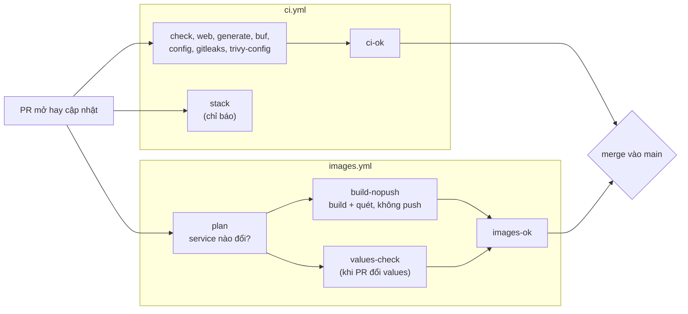
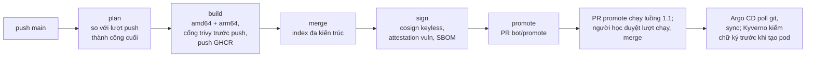
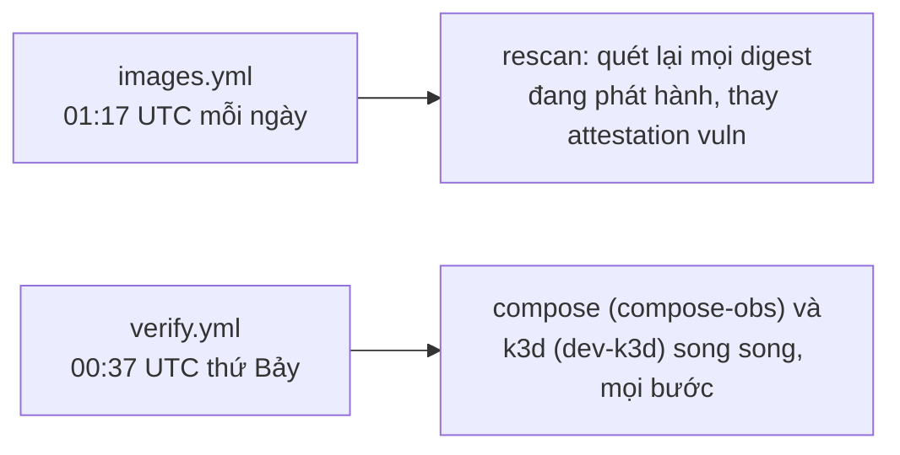
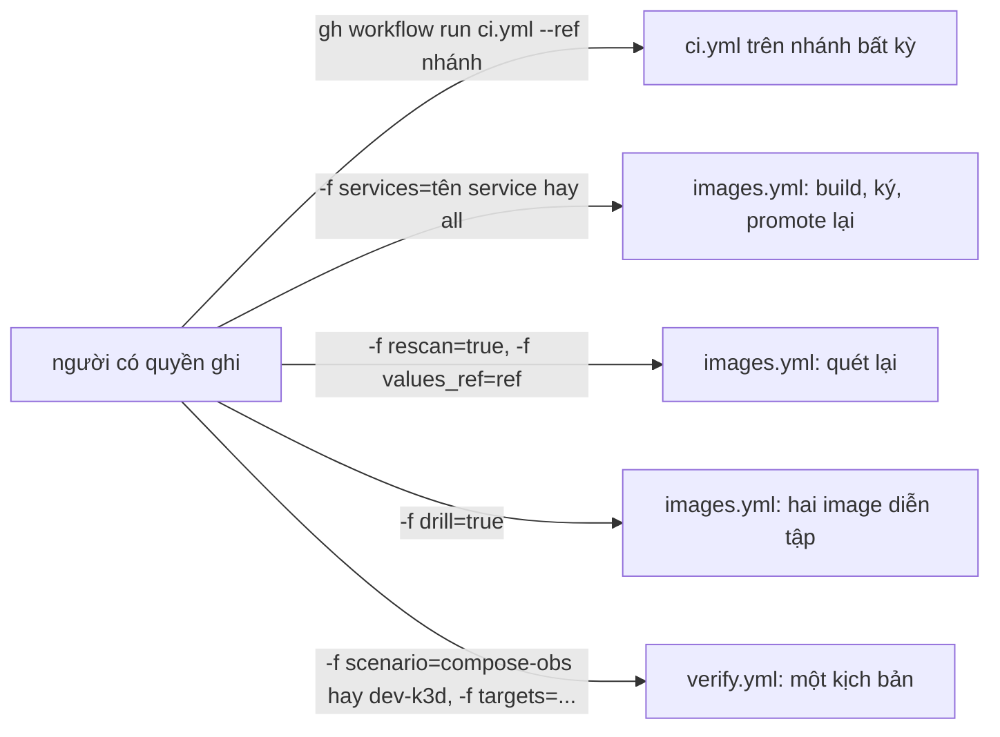

# CI/CD: luồng, job và cách đọc một lượt chạy

Tài liệu cho người mới mở trang lượt chạy của GitHub Actions mà chưa rõ job nào chạy khi nào, vì sao có job bị bỏ qua (skip),
và đọc kết quả ở đâu. Luồng kể bằng khái niệm chung của mọi hệ CI (pipeline, job, điều kiện chạy, check bắt buộc, artifact);
tên workflow và job của GitHub ghi kèm. Bảng tương ứng với GitLab ở
[ADR-0023](adr/0023-ci-platform-neutral.md) (mục "Bảng ánh xạ CI: GitHub Actions ↔ GitLab CI"), không chép lại ở đây.

Repo có ba workflow, mỗi file nối các bước, logic nằm ở `Makefile` và `deploy/ci/*.sh` (chạy được cả trên máy):

| Workflow | Việc | Quyết định |
| --- | --- | --- |
| `.github/workflows/ci.yml` | Kiểm code của mọi PR và mọi push `main`: Go, web, code sinh, contract, cấu hình, bí mật, misconfig, stack đầu-cuối | [ADR-0015](adr/0015-cicd-devsecops-stage5.md) §1, §2; [ADR-0020](adr/0020-reliability-stage6.md) §15 (job `stack`) |
| `.github/workflows/images.yml` | Image của bảy service: build, quét, push GHCR, ký, attestation, PR promote, quét lại hằng ngày | ADR-0015 §3–§9 |
| `.github/workflows/verify.yml` | Kiểm chứng trên runner những gì máy 16 GB không chạy nổi (stack có observability, cluster k3d nặng) | [ADR-0021](adr/0021-deferred-verification-stage6b.md) |

Mọi chỗ script đọc ngữ cảnh CI hay gọi API của GitHub (output, summary, mask, link lượt chạy, PR, dispatch) đi qua adapter
`deploy/ci/platform.sh` (ADR-0023), nên chuyển sang CI khác là viết thêm một nhánh ở đó, không sửa từng script.

## 1. Bốn luồng

### 1.1 Pull request

Mỗi lần mở hay cập nhật PR, `ci.yml` và `images.yml` cùng chạy trên code của PR, chỉ với quyền đọc repo. Merge được khi hai check
tổng `ci-ok` và `images-ok` xanh (ruleset của `main`).

- `stack` dựng cả stack compose và chạy smoke, e2e web, k6, Lighthouse, nhưng không nằm trong `ci-ok`: đỏ thì người đọc PR thấy,
  không chặn merge.
- `build-nopush` chỉ có khi PR đổi đường dẫn của ít nhất một image; PR chỉ sửa tài liệu thì `plan` báo không có image và các
  job build đều skip, `images-ok` vẫn xanh.

### 1.2 Push hay merge vào `main`

`ci.yml` chạy lại toàn bộ trên `main` (thêm job `sarif` tải báo cáo lên tab Security). `images.yml` build bản phát hành rồi mở
một PR "promote" ghi digest mới vào `deploy/k8s/values/services/`; người học duyệt và merge PR đó, Argo CD của cluster GitOps
thấy commit và triển khai.

- PR promote do `GITHUB_TOKEN` mở nên GitHub không tự chạy workflow cho nó: người học bấm "Approve workflows to run" trên PR,
  rồi merge khi `ci-ok`, `images-ok` xanh (ADR-0015 §9, §11).
- Rollback là PR revert, đi lại đúng luồng này.

### 1.3 Theo lịch

- Rescan giữ attestation `vuln` không quá 72 giờ tuổi, ngưỡng Kyverno chấp nhận; CRITICAL mới thì job đỏ và GitHub gửi mail.
- Lượt lịch của `verify.yml` chạy trên commit mới nhất của `main`, không có input. GitHub có thể trễ hay bỏ lượt lịch lúc tải cao
  và tắt lịch sau 60 ngày repo không hoạt động (bật lại ở tab Actions). Lịch này mới thêm ngày 2026-10-25, chỉ kiểm được sau khi
  merge vào `main`.

### 1.4 Chạy tay (dispatch)

- `rescan` và `drill` chỉ chạy trên `main` và không chạy cùng lượt; `plan` từ chối (lượt đỏ) thay vì đoán.
- `verify.yml` nhận `--ref main` hay nhánh `feat/stage6b-*`, ref khác dừng ở bước đầu; `targets` rỗng là mọi bước, bước dựng
  (`up`, `k8s-up`) luôn chạy. Lệnh đầy đủ ở [`CLAUDE.md`](../CLAUDE.md#kiểm-tra).

## 2. Job theo từng workflow

"Chặn merge" nghĩa là job nằm trong check tổng mà ruleset của `main` đòi. Điều kiện chạy chép từ `if:` của YAML.

### `ci.yml`

Trigger: `pull_request`, `push` vào `main`, `workflow_dispatch`. Không trigger nào có bộ lọc `paths:`.

| Job | Làm gì | Chạy khi | Skip khi, vì sao | Chặn merge |
| --- | --- | --- | --- | --- |
| `check` | `make check-go` (gofmt, vet, golangci-lint, actionlint, buf lint, Go test với Postgres, Redis là service container) | Mọi lượt | Không bao giờ | Có (`ci-ok`) |
| `web` | `make web-install`, `make web-check`, `make web-generate-check`, `make web-lockfile-scan` (trivy trên `web/pnpm-lock.yaml`, gồm dev dependency vì chúng chạy trong CI và tạo ra bundle: CRITICAL làm job đỏ, HIGH trở xuống chỉ vào summary và SARIF; bỏ qua chỉ qua `.trivyignore.yaml`, mỗi mục đúng gói@version (`purls`), tối đa 30 ngày; bước này chạy cả khi bước trước đỏ) | Mọi lượt | Không bao giờ | Có |
| `generate` | `make generate-check`: code sinh đã commit khớp | Mọi lượt | Không bao giờ | Có |
| `buf` | `buf breaking` so với base | Mọi lượt | Không skip; push tạo nhánh mới thì bước in "buf breaking skipped" (không có gì để so) và xanh | Có |
| `config` | Quy tắc hai tệp bỏ qua của trivy, `platform-guard.sh`, `platform-test.sh`, `verify-collect-test.sh`, rule Prometheus, Collector, compose, chart, digest bên thứ ba, k6, manifest cloud | Mọi lượt | Không bao giờ | Có |
| `gitleaks` | Quét bí mật toàn lịch sử, `--redact` | Mọi lượt | Không bao giờ | Có |
| `trivy-config` | Quét misconfig, chỉ báo (phát hiện không làm job đỏ; trừ các mục có hạn của `deploy/ci/trivy-config-ignore.yaml`) | Mọi lượt | Không bao giờ | Có (chỉ khi lệnh lỗi, không khi có phát hiện) |
| `stack` | Stack compose đầu-cuối: smoke, e2e Chromium và WebKit, k6 `ci`, Lighthouse | Mọi lượt | Không bao giờ | Không |
| `sarif` | Tải SARIF lên tab Security | `always() && github.event_name != 'pull_request' && github.ref == 'refs/heads/main'` | PR và nhánh khác `main`: quyền `security-events: write` chỉ cho code đã qua review | Không |
| `ci-ok` | Đỏ trừ khi đủ bảy job trên `success` | `always()` | Không bao giờ | Là check bắt buộc |

### `images.yml`

Trigger: `pull_request`, `push` vào `main`, `schedule` hằng ngày, `workflow_dispatch` (`services`, `rescan`, `values_ref`,
`drill`). `plan` chọn **chế độ**: `rescan` khi lịch hay `rescan=true`, `drill` khi `drill=true`, còn lại `build`. "Trên `main`"
dưới đây là `github.ref == 'refs/heads/main'` và sự kiện không phải `pull_request`.

| Job | Làm gì | Chạy khi | Skip khi, vì sao | Chặn merge |
| --- | --- | --- | --- | --- |
| `last-success` | Đọc commit của lượt push `main` thành công cuối (base để so), job duy nhất có `actions: read` | `push` vào `main` | Mọi sự kiện khác: chỉ push cần base này | Có (`images-ok` tính skip này là đúng) |
| `plan` | Chế độ, base, danh sách image, ma trận chân build (`deploy/ci/plan.sh`, `changed-services.sh`) | Trừ khi lượt bị huỷ | — | Có |
| `build-nopush` | Build, quét, cổng trivy từng image × kiến trúc, không push | Chế độ `build`, có image, PR hay ref khác `main` | Không image nào đổi; hay đang trên `main` (job `build` làm) | Có |
| `values-check` | Digest PR ghi vào values đã ký đúng identity, attestation ≤ 48 giờ | PR hay ref khác `main` có đổi `deploy/k8s/values/services/` | PR không đổi values | Có |
| `build` | Như `build-nopush` rồi push GHCR đúng bản đã quét | Chế độ `build`, có image, trên `main` | PR, nhánh khác, hay không image nào đổi | Có |
| `merge` | Ghép hai chân thành index đa kiến trúc | Như `build` | Như `build` | Có |
| `sign` | Ký keyless, attestation `vuln` và SBOM | Như `build` | Như `build` | Có |
| `promote` | Dựng lại `bot/promote`, mở hay cập nhật PR promote | Như `build` | Như `build` | Có |
| `rescan` | Quét lại mọi digest phát hành, thay attestation `vuln` | Chế độ `rescan`, trên `main` | Mọi chế độ khác | Có |
| `drill-build`, `drill-merge`, `drill-sign` | Hai image diễn tập `drill-vulnerable` (có CRITICAL, ký) và `drill-unsigned` (không ký), cùng các bước của bản phát hành | Chế độ `drill`, trên `main` | Mọi chế độ khác, nên luôn skip ở PR và push | Có |
| `sarif` | Tải SARIF của build và rescan trên `main` | Trên `main`, chế độ `rescan` hay `build` có image | PR, nhánh khác, không image | Không |
| `images-ok` | Xanh khi mỗi job `success`, hay `skipped` vì đúng lý do mà job này tính lại từ sự kiện, ref, output của `plan` | `always()` | Không bao giờ | Là check bắt buộc |

### `verify.yml`

Trigger: `workflow_dispatch` (input `scenario`, `targets`) và `schedule` hằng tuần. Không check nào của ruleset đòi workflow này.

| Job | Làm gì | Chạy khi | Skip khi |
| --- | --- | --- | --- |
| `compose` | Kịch bản `compose-obs`: `make up OBS=lgtm`, smoke, `drill-obs-threats`, `load-local` dưới quan sát Alertmanager, Lighthouse ×3, `drill-alert-to-sentry`; hạn 120 phút | `github.event_name == 'schedule' \|\| inputs.scenario == 'compose-obs'` | Dispatch `dev-k3d` |
| `k3d` | Kịch bản `dev-k3d`: `make k8s-up`, smoke, RAM nghỉ, diễn tập threat model, PDB, canary, source map, e2e web, `drill-k8s-web-obs`, KEDA và RAM đỉnh, backup hai chế độ; hạn 330 phút | `github.event_name == 'schedule' \|\| inputs.scenario == 'dev-k3d'` | Dispatch `compose-obs` |

Mỗi job: kiểm ref, cài công cụ, `make env`, `deploy/ci/verify-mask.sh`, `verify-host.sh`, `verify-sample.sh start`, bước
"Scenario" (`verify-run.sh`), rồi các bước `if: always()` dừng sampler, lọc và tải artifact `verify-<kịch bản>`, gỡ stack hay
cluster. Một lượt dispatch chạy đúng một job, job kia skip; lượt lịch chạy cả hai.

## 3. Vì sao thiết kế như vậy

- **Lượt PR không secret, chỉ `contents: read`, không push hay ký.** Repo public: PR từ fork chạy code của chính nó trước khi ai
  đọc, kể cả PR Renovate đổi SHA action. Mọi job của lượt PR chỉ đọc repo; job nào cần ghi (`packages`, `id-token`, `contents`,
  `pull-requests`, `security-events`) là job riêng chỉ chạy trên `main` với code đã qua PR và check. Vì vậy đường PR và đường
  `main` của build là hai job (`build-nopush`, `build`) gọi chung một script, không phải một job có bước push bị tắt. Không
  `pull_request_target`, `workflow_run`. Chi tiết: ADR-0015 §1; [`threat-model.md`](threat-model.md) SC-2, SC-10, SC-11.
- **Chỉ build service đổi** (`deploy/ci/changed-services.sh`, ADR-0015 §3). Mỗi service có tập đường dẫn của image (`image_paths`
  của `deploy/k8s/lib.sh`); đổi đường build, quét, ký (`images.yml`, `deploy/ci/`, ghim `TRIVY_IMAGE`/`SYFT_IMAGE`/`COSIGN_IMAGE`)
  thì cả bảy, trừ các file của `deploy/ci/` không job image nào đọc (tệp bỏ qua misconfig, script của `verify.yml`, test và guard
  của adapter). Base của push `main` là lượt push thành công cuối chứ không phải commit ngay trước, để thay đổi của một lượt đỏ
  hay bị thay trong hàng chờ không bị bỏ sót. Không dùng `paths:` ở trigger vì check bắt buộc của workflow không chạy thì không
  bao giờ được báo, PR treo chờ mãi.
- **Check tổng** (`ci-ok`, `images-ok`). Ruleset chỉ cần hai tên ổn định, thêm hay đổi tên job không đụng ruleset. GitHub coi
  check bắt buộc bị skip là đạt, và job đỏ không tự làm job phụ thuộc đỏ, nên check tổng chạy `always()` và tự quyết: `ci-ok` đòi
  đủ bảy job `success`; `images-ok` tính lại từ sự kiện, ref và output của `plan` xem mỗi job skip có đúng không (skip vì `if:`
  sai là đỏ).
- **Action ghim SHA commit đầy đủ**, chỉ action của GitHub và `sigstore/cosign-installer`; trivy, syft, cosign chạy bằng image ghim
  digest. Tag của action có thể bị đẩy sang code khác (các vụ tj-actions, trivy-action), SHA thì không; Renovate cập nhật SHA.
  ADR-0015 §1, §10.
- **Job `stack` chỉ báo.** Stack đầy đủ với hai trình duyệt trên runner dùng chung có lúc đỏ vì môi trường, không vì code; nếu
  nằm trong `ci-ok` thì một lần chập chờn chặn merge. Xem lại khi 20 lượt liên tiếp xanh, không lượt đỏ do môi trường (ADR-0020
  §15).
- **Vì sao job `drill-*` nằm trong `images.yml` dù luôn skip ở PR và push.** Ký keyless không có khoá: danh tính ký là chứng chỉ
  Fulcio cấp cho đúng file workflow và ref đang chạy (SAN là `server_url` + `job_workflow_ref`, ADR-0015 §7), và Kyverno chỉ tin
  `.github/workflows/images.yml@refs/heads/main` (`deploy/helm/svp-policy/values.yaml`). Diễn tập phải chứng minh Kyverno từ chối
  `drill-vulnerable` **vì CRITICAL**: nếu image đó được ký ở workflow khác thì Kyverno từ chối vì sai danh tính, phép thử không
  còn chứng minh gì về rule CRITICAL; còn thêm danh tính thứ hai vào policy là nới niềm tin của cluster cho một workflow chỉ phục
  vụ diễn tập. Ở cùng file, drill đi đúng các bước của bản phát hành (alias YAML `*release-leg`, `*merge`, `*sign`), nên khác nhau
  duy nhất là CRITICAL hay chữ ký. Cái giá: ba job luôn hiện "skipped" trên trang lượt chạy, và `images-ok` phải biết skip đó là
  đúng.
- **Phương án workflow con (reusable workflow, `workflow_call`) và vì sao chưa chọn.** Có thể tách build, ghép, ký vào một file
  workflow con, `images.yml` và một workflow diễn tập cùng gọi nó: một định nghĩa bước, `images.yml` ngắn hơn. Chưa chọn vì
  (1) alias YAML đã cho một định nghĩa bước trong cùng file; (2) thêm một file workflow, tên job lồng `<job> / <job con>` mà
  `images-ok` phải đọc; (3) với workflow con, `job_workflow_ref` (nên danh tính ký) là file workflow con, không còn là
  `images.yml`: policy Kyverno và mọi phép kiểm chữ ký phải đổi theo, và mọi workflow trên `main` gọi được file đó đều ký ra cùng
  danh tính, nên phải kiểm thêm workflow gọi (điểm này suy từ cách GitHub định nghĩa claim `job_workflow_ref`, chưa thử trong
  repo). ADR-0015 §1 đã cân nhắc phương án này cho việc tách quyền PR/`main`. Xem lại khi có workflow thứ hai cần ký image.

## 4. Đọc một lượt chạy

Trang một lượt chạy (Actions → chọn lượt) có đồ thị job, danh sách annotation, summary của từng job và artifact ở cuối trang.

- **Đồ thị job:** xanh `success`, đỏ `failure`, xám gạch là `skipped`. Job skip là bình thường khi điều kiện ở mục 2 không đúng
  cho sự kiện này (ví dụ cả nhóm `build`, `sign`, `promote`, `drill-*` ở lượt PR). Muốn biết skip có đúng không, mở log job
  `images-ok`: mỗi job một dòng `ok    <job> skipped: not part of this run`, hay `::error::<job> was skipped, but this run needed
  it`.
- **Summary của job** (cuộn xuống dưới đồ thị), từ hai nguồn. Script ghi qua `ci_summary` của adapter: bảng cổng lockfile
  CRITICAL/HIGH/MEDIUM/LOW của `web` và bảng cổng của mỗi chân build của `images.yml` (số lỗ hổng theo mức và bí mật), cả hai của
  `scan-gate.sh`; `plan` (chế độ, base, image được chọn và lý do); `promote` (service nào không được promote); `values-check` (lệnh
  làm mới khi đỏ); `rescan.sh` của lượt quét lại hằng ngày hay dispatch `rescan=true` (service chưa phát hành bị bỏ qua, hay không
  có digest đã phát hành nào để quét). Chính YAML của `ci.yml` ghi thẳng `$GITHUB_STEP_SUMMARY`: bảng SARIF (mức, rule, vị trí
  mỗi phát hiện, tối đa 50 dòng) của golangci-lint ở `check`, lockfile ở `web` (sau bảng cổng), `gitleaks`, `trivy-config`, và
  dòng "buf breaking skipped" của `buf` khi bỏ qua; khi chuyển nền tảng, các bước này viết lại cùng YAML
  ([ADR-0023](adr/0023-ci-platform-neutral.md)). Vitest, Playwright, k6 không ghi summary: kết quả ở
  log của bước tương ứng (`make web-check`, `make web-e2e`, `make load-ci`).
- **Annotation:** dòng `::warning::`/`::error::` của script hiện ở đầu trang, kèm job. Ví dụ: `last-success` cảnh báo khi API
  không trả lời (lượt build cả bảy), `verify-collect.sh` cảnh báo khi bỏ một file khỏi artifact vì nghi có bí mật (không in đoạn
  khớp), `images-ok` báo job skip sai.
- **Bước đỏ trong job xanh:** bước có `continue-on-error: true` đỏ mà job vẫn xanh. Ở repo này là `make web-lighthouse` của job
  `stack`: Lighthouse một lượt mỗi trang trên runner dùng chung là nhiễu, nên vượt ngưỡng LCP/TBT không làm job đỏ; mở log bước
  đó để đọc số. Ngược lại, bước `make web-lockfile-scan` của job `web` có `if: !cancelled()`: nó vẫn chạy và in kết quả cổng khi
  `make web-check` đã đỏ.
- **Log:** `gh run view <id> --log-failed` chỉ in bước đỏ; `gh run view <id> --log` in tất cả. Log công khai: script không in
  giá trị bí mật, giá trị đã mask hiện là `***`.
- **Artifact** (cuối trang, hay `gh run download <id> -n <tên>`): `sarif-*` (báo cáo quét, `sarif` của `main` tải lên tab
  Security), `lighthouse` và `k6-summary` của job `stack`, `verify-<kịch bản>` của `verify.yml` (giữ 30 ngày). Với `verify`, đọc
  trước:
  - `runner.txt`: runner có "đủ" không (đĩa trống thấp nhất, `MemAvailable` thấp nhất, swap, OOM, restart của k3s server, node
    `NotReady`, bước bị cắt vì hạn): lượt đỏ vì runner thiếu hay vì code;
  - `results.tsv`: mỗi bước một dòng, `ok`, `fail`, `timeout`, `skipped` hay `cancelled`, exit status, số giây, ghi chú (ví dụ
    `infrastructure step failed`, `not in targets`, `deadline`);
  - `files.txt`: file nào được giữ, file nào bị bỏ và theo luật nào; rồi `logs/<NN>-<bước>.log` của bước đỏ và JSON của diễn tập.
- **Chạy lại:** "Re-run failed jobs" tạo một lần chạy mới (attempt) của cùng lượt; mỗi attempt có log và artifact riêng.

## 5. Chạy lại một job trên máy

Lệnh tương đương từng job, chạy từ gốc repo, ở mục "Chạy lại một job trên máy" của [`CLAUDE.md`](../CLAUDE.md#kiểm-tra). Script
của `deploy/ci/` chạy trên máy ở chế độ `local` của adapter: không gọi API nào của GitHub, không push lên origin mạng.

## 6. Thời gian điển hình

Đo bằng `gh run list` và `gh run view --json jobs` (đọc ngày 2026-10-25), tính từ lúc tạo lượt tới lúc job xong.

| Phần | Thời gian | Lượt (ngày) |
| --- | --- | --- |
| PR, phần chặn merge của `ci.yml` (tới `ci-ok`) | 4 phút 49 s; 5 phút 31 s | [40157835981](https://github.com/anhnvcoder/short-video-platform/actions/runs/40157835981), [40151451875](https://github.com/anhnvcoder/short-video-platform/actions/runs/40151451875) (2026-10-25) |
| PR, `images.yml` (tới `images-ok`) | 1 phút 41 s khi chỉ build `web` (2 chân); 2 phút 45 s khi build cả bảy (14 chân) | [40160528825](https://github.com/anhnvcoder/short-video-platform/actions/runs/40160528825) (2026-10-25), [40127811785](https://github.com/anhnvcoder/short-video-platform/actions/runs/40127811785) (2026-10-24) |
| PR, job `stack` | 13 phút 19 s; 15 phút 42 s | 40151451875, 40157835981 (2026-10-25) |
| Sau merge: bảy image build, ký, tới lúc PR promote mở | 4 phút 32 s (push 20:17:13 UTC → PR #19 mở 20:21:45 UTC) | [40129094574](https://github.com/anhnvcoder/short-video-platform/actions/runs/40129094574) (2026-10-24) |
| Sau khi merge PR promote: Argo CD sync, pod mới Ready | push → sync 109 s → pod cuối Ready 240 s (cluster GitOps trên máy, hai pause 60 s của canary) | [ADR-0014](adr/0014-kubernetes-local-stage4.md), mục Kiểm chứng |
| `verify.yml` `compose-obs`, mọi bước | 54 phút | [40132157276](https://github.com/anhnvcoder/short-video-platform/actions/runs/40132157276) (2026-10-24) |
| `verify.yml` `dev-k3d`, mọi bước | 70 phút (hai lượt) | [40145677985](https://github.com/anhnvcoder/short-video-platform/actions/runs/40145677985), [40151447243](https://github.com/anhnvcoder/short-video-platform/actions/runs/40151447243) (2026-10-25) |
| `verify.yml` `dev-k3d`, chọn bước | 25 phút (`k8s-smoke drill-k8s-threats`); 31 phút (`drill-k8s-keda ram-peak`) | [40157833740](https://github.com/anhnvcoder/short-video-platform/actions/runs/40157833740), [40160414327](https://github.com/anhnvcoder/short-video-platform/actions/runs/40160414327) (2026-10-25) |

Thời gian của runner dùng chung thay đổi theo tải của GitHub và cache (cache Go, pnpm, DB của trivy, build cache Docker); số trên
là mốc để biết lượt nào chậm bất thường, không phải cam kết.
