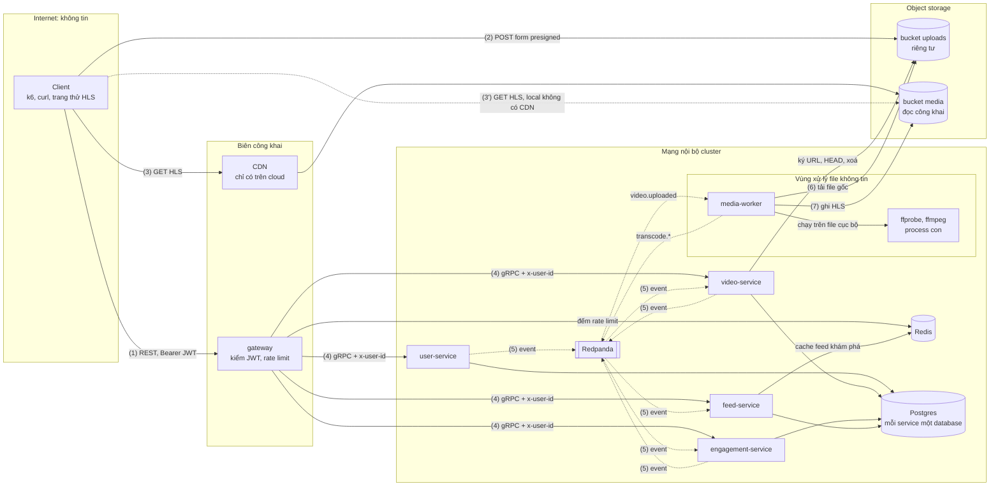

# Threat model (STRIDE, bản nhẹ)

> Trạng thái: giai đoạn 0, viết ngày 2026-10-11 cho thiết kế ở [`architecture.md`](architecture.md) và ADR 0001–0006.
> Cập nhật ngày 2026-10-17 theo giai đoạn 3 (observability, [ADR-0011](adr/0011-observability-stage3.md)): JWT-8, UP-8,
> RL-2, OPS-1, OPS-2, FF-5 và hàng giai đoạn 3 ở [mục 5](#5-tổng-hợp-theo-giai-đoạn).
> Cập nhật ngày 2026-10-19 theo giai đoạn 4 (Kubernetes local trên k3d, [ADR-0014](adr/0014-kubernetes-local-stage4.md)):
> FF-3 tới FF-6, IN-2, IN-4, IN-7, IN-9, RL-1, OPS-2, hàng giai đoạn 4 ở mục 5 và các dòng mới ở
> [mục 6](#6-rủi-ro-chấp-nhận).
> Cập nhật và xét lại ngày 2026-10-21 theo giai đoạn 5 (CI/CD và chuỗi cung ứng,
> [ADR-0015](adr/0015-cicd-devsecops-stage5.md)): FF-8, SC-1, SC-2, SEC-1, SEC-2, JWT-10, bề mặt mới SC-3 tới SC-9 ở
> [4.8](#48-bề-mặt-khác), hàng giai đoạn 5 ở mục 5 và các dòng mới ở mục 6. Phần chạy trên GitHub (workflow, chữ ký thật,
> cài đặt repo) và cluster GitOps ghi "kiểm sau push".
> Xét lại ở giai đoạn 6 (reliability, mTLS) và 9 (review bảo mật).

## 1. Phạm vi và cách làm

**STRIDE** là sáu loại mối đe doạ, mỗi loại ứng với một tính chất cần giữ:

| Chữ | Loại | Tính chất bị phá | Ví dụ trong hệ thống này |
| --- | --- | --- | --- |
| S | Spoofing: giả danh | Xác thực | Tự ký JWT, tự đặt `x-user-id` khi gọi thẳng gRPC |
| T | Tampering: sửa dữ liệu | Toàn vẹn | Thay file gốc sau khi đã `CompleteUpload`, phát event giả |
| R | Repudiation: chối bỏ | Truy vết được | Không có log nào cho biết ai đã upload một video |
| I | Information disclosure: lộ thông tin | Bí mật | Email trong log, dò email đã đăng ký |
| D | Denial of service: làm ngừng dịch vụ | Sẵn sàng | File video "bom" làm treo worker, spam đăng nhập |
| E | Elevation of privilege: leo quyền | Phân quyền | Khai thác lỗi ffmpeg để lấy credential của worker |

**"Nhẹ" nghĩa là:** xét theo **bề mặt** (chỗ dữ liệu đi qua một ranh giới tin cậy), không xét từng hàm; mỗi bề mặt liệt kê
các mối đe doạ thấy rõ, biện pháp, giai đoạn sẽ làm và mức ưu tiên. Không chấm điểm định lượng (DREAD, CVSS).

**Cách đọc bảng:**

- **GĐ:** giai đoạn trong [plan](../plans/261004-devops-sa-roadmap/plan.md) sẽ viết code hoặc cấu hình cho biện pháp đó.
  Biện pháp đã có trong thiết kế vẫn ghi giai đoạn hiện thực nó, không ghi 0. Nhiều số nghĩa là làm dần qua các giai đoạn.
- **Ưu tiên:** **Cao** = khai thác dễ, hoặc hậu quả là chiếm tài khoản, lộ dữ liệu cá nhân, chạy code lạ; phải có trước khi
  hệ thống nhận request từ internet (giai đoạn 7). **Vừa** = cần làm nhưng hậu quả có giới hạn. **Thấp** = phòng thêm.
- Dòng ghi **Chấp nhận** là rủi ro không xử lý (hoặc chỉ giảm bớt); lý do và lúc xem lại ở [mục 6](#6-rủi-ro-chấp-nhận).
- Câu "vì sao" của các biện pháp quan trọng nằm ngay dưới mỗi bảng.

## 2. Luồng dữ liệu và ranh giới tin cậy

Dựa trên C4 container ([architecture §5](architecture.md)). Mỗi `subgraph` là một vùng tin cậy; mũi tên đi qua viền
vùng là chỗ phải kiểm.

| Chỗ vượt ranh giới | Ai bên kia | Kiểm ở đâu |
| --- | --- | --- |
| (1) Internet → gateway | Bất kỳ ai | gateway: JWT, rate limit, giới hạn kích thước và thời gian request ([4.1](#41-jwt-và-đăng-nhập), [4.4](#44-rate-limit-ở-gateway)) |
| (2) Internet → bucket `uploads` | Ai đang giữ form presigned | Chính storage, theo policy đã ký ([4.2](#42-presigned-post-và-bucket)) |
| (3) Internet → bucket `media` | Bất kỳ ai | Không kiểm: nội dung công khai, chỉ cho đọc từng object ([4.2](#42-presigned-post-và-bucket)) |
| (4) gateway → service | Hiện tại: mọi thứ vào được mạng nội bộ | `x-user-id` do gateway đặt; NetworkPolicy, mTLS ([4.5](#45-mức-tin-cậy-giữa-các-service)) |
| (5) Service ↔ Redpanda | Hiện tại: mọi thứ vào được mạng nội bộ | ACL theo service; consumer kiểm event ([4.5](#45-mức-tin-cậy-giữa-các-service)) |
| (6), (7) File người dùng → ffmpeg | Nội dung do người dùng tạo | ffprobe, giới hạn định dạng, giao thức, tài nguyên, quyền ([4.3](#43-ffmpeg-đọc-file-người-dùng)) |

## 3. Tài sản cần bảo vệ

| Tài sản | Nằm ở đâu | Tính chất cần giữ | Mất thì sao |
| --- | --- | --- | --- |
| **Khoá ký JWT** (khoá riêng) | Chỉ user-service | Bí mật | Ai có khoá là ký được token của **mọi** người dùng. Tài sản giá trị nhất |
| Hash mật khẩu và email (dữ liệu cá nhân) | `svp_user` | Bí mật | Lộ email là lộ dữ liệu cá nhân; hash bị bẻ offline nếu thuật toán yếu |
| Credential của service (database, object storage, Redpanda) | Biến môi trường, sau là secret store | Bí mật | Mở đường đi tắt qua mọi kiểm tra của API |
| File gốc trong `uploads` | Object storage | Bí mật, toàn vẹn | File chưa phát hành, có thể chứa metadata riêng (vị trí GPS, thiết bị) |
| Bản HLS trong `media` | Object storage, CDN | Toàn vẹn | Công khai theo thiết kế; bị ghi đè là video của người khác bị thay |
| Bộ đếm lượt xem, like | `svp_engagement` | Toàn vẹn | Số sai làm sai mọi thứ xếp hạng dựa trên nó về sau |
| Tính sẵn sàng của feed và upload | gateway, feed-service, video-service | Sẵn sàng | Vi phạm SLO 99,9% ([architecture §2](architecture.md)) |

## 4. Mối đe doạ theo bề mặt

### 4.1 JWT và đăng nhập

**Lựa chọn (quyết định của threat model):**

- **Thuật toán ký: EdDSA với Ed25519** (`alg: "EdDSA"`). user-service giữ khoá riêng, gateway chỉ có khoá công khai
  ([architecture §7.4](architecture.md)).
  - Không chọn **HS256**: khoá đối xứng, bên nào kiểm được token thì cũng ký được token, nên gateway (bề mặt lộ ra internet
    nhiều nhất) sẽ giữ quyền ký cho mọi người dùng.
  - Không chọn **RS256**: chạy được, nhưng chữ ký 2048 bit dài 256 byte làm token phình, ký chậm hơn hẳn.
  - **ES256** là lựa chọn dự phòng, nhưng ECDSA cần số ngẫu nhiên tốt cho từng chữ ký (dùng lại nonce là lộ khoá riêng,
    một lớp lỗi kinh điển). Ed25519 có chữ ký tất định nên không có lớp lỗi đó, khoá 32 byte, chữ ký 64 byte, chỉ có một
    đường cong nên không có tham số để chọn sai, và có sẵn trong thư viện chuẩn Go (`crypto/ed25519`). Nếu về sau phải ký
    bằng dịch vụ quản lý khoá trên cloud mà dịch vụ đó không hỗ trợ Ed25519 thì đổi sang ES256: chỉ đổi cấu hình hai đầu,
    không đổi contract.
- **Claim:** `iss = "svp-user"`, `aud = "svp-api"`, `sub = user_id`, `iat`, `exp`, `jti` (UUIDv7, chưa dùng, để dành cho
  danh sách thu hồi). Header có `kid` để đổi khoá không gián đoạn. **Không** đặt email hay dữ liệu cá nhân vào token.
- **Thời hạn: 1 giờ**, lệch đồng hồ cho phép 30 giây. MVP không có refresh token
  ([ADR-0006](adr/0006-contract-ids-and-event-envelope.md)): hạn ngắn hơn (15 phút) buộc client gửi lại mật khẩu
  thường hơn, tức thêm tải hash và thêm lần mật khẩu đi trên đường truyền; hạn dài hơn kéo dài thời gian một token bị lộ còn
  dùng được. 1 giờ đủ cho một lượt k6 bình thường; bài soak dài hơn thì k6 đăng nhập lại.
- **Hash mật khẩu: argon2id**, chuỗi lưu theo định dạng PHC (gồm tham số và salt 16 byte ngẫu nhiên riêng từng người), tham
  số theo khuyến nghị OWASP hiện hành và đo thời gian hash trên máy ở giai đoạn 1. Không chọn bcrypt dù cũng chấp nhận được:
  bcrypt chỉ dùng 72 byte đầu của mật khẩu và không tốn bộ nhớ, nên bẻ bằng GPU rẻ hơn; argon2id tốn cả CPU lẫn RAM theo tham
  số chỉnh được. Cái giá: thêm dependency `golang.org/x/crypto` (ghi lý do khi thêm ở giai đoạn 1), và mỗi lần hash ngốn vài
  chục MiB RAM (xem JWT-9).

| ID | Thành phần | STRIDE | Kịch bản | Biện pháp | GĐ | Ưu tiên |
| --- | --- | --- | --- | --- | --- | --- |
| JWT-1 | gateway kiểm JWT | S, E | Token có `alg: none`, hoặc `alg: HS256` dùng chính khoá công khai làm khoá HMAC (nhầm thuật toán): gateway chấp nhận token tự ký, kẻ tấn công thành người dùng bất kỳ | Gateway chỉ chấp nhận đúng `EdDSA`, khoá lấy theo `kid` từ cấu hình cục bộ, `kid` lạ thì từ chối; bỏ qua `jku`, `x5u`, `jwk` trong header; test cho từng kiểu token giả | 1 | Cao |
| JWT-2 | gateway kiểm JWT | S | Token đúng chữ ký nhưng hết hạn, hoặc của hệ thống khác dùng chung khoá (`iss`/`aud` khác) | Bắt buộc có và kiểm `exp`, `iss`, `aud`; thiếu claim là từ chối | 1 | Cao |
| JWT-3 | Token đã cấp | S | Token bị lộ (log, máy người dùng) còn dùng được tới hết hạn; đổi mật khẩu hay đăng xuất không làm token cũ mất hiệu lực | Hạn 1 giờ; token chỉ đi trong header `Authorization`, không bao giờ trong query string. Refresh token + danh sách thu hồi theo `jti` là việc của giai đoạn sau. **Chấp nhận** phần còn lại | 1; chấp nhận, xem lại ở 9 | Vừa |
| JWT-4 | `Login` | S | Dò mật khẩu: thử hàng loạt mật khẩu cho một email, hoặc một mật khẩu phổ biến cho nhiều email | Rate limit theo IP và theo cặp (IP, email) ở route login; **không** khoá tài khoản sau N lần sai | 2 | Cao |
| JWT-5 | `Login` | I | Phân biệt "email không tồn tại" với "sai mật khẩu" qua message hoặc qua thời gian phản hồi | Hai trường hợp cùng `UNAUTHENTICATED`, cùng `reason` `INVALID_CREDENTIALS`, cùng message ([ADR-0006](adr/0006-contract-ids-and-event-envelope.md), `proto/svp/user/v1/user_service.proto`); email không tồn tại vẫn chạy so hash với một hash giả để thời gian như nhau | 1 | Vừa |
| JWT-6 | `Register` | I | Gọi `Register` với email người khác, nhận `ALREADY_EXISTS` là biết email đó có tài khoản | Rate limit theo IP ở route register. **Chấp nhận** ở MVP | 2; chấp nhận | Thấp |
| JWT-7 | `svp_user` | I | Database bị lộ (backup, SQL injection): bẻ hash offline | argon2id có salt riêng; lưu tham số trong chuỗi hash để tăng tham số về sau mà không bắt mọi người đổi mật khẩu (hash lại lúc đăng nhập); mọi câu SQL tham số hoá qua `sqlc` | 1 | Cao |
| JWT-8 | Log, trace, tracker lỗi (GlitchTip, giao thức Sentry) | I | Mật khẩu, token, email bị ghi vào log, attribute của span hay báo lỗi gửi tracker | Log `user_id` thay cho email; kiểu riêng cho mật khẩu và token tự che giá trị khi log; access log không ghi header `Authorization`. Giai đoạn 3 ([ADR-0011](adr/0011-observability-stage3.md) §2, §4, §7): span HTTP không có header, thân hay query; span SQL không có tham số, lỗi Postgres trong span chỉ còn mức và SQLSTATE; span Redis không có lệnh, khoá; span consumer chỉ ghi kiểu lỗi và mã an toàn. Collector xoá `http.request.header.authorization`, `http.request.header.cookie`, `user.email`, `user.name` ở cả attribute và resource (lớp phụ). Tracker chỉ nhận bản ghi ERROR: message hằng trong danh sách cho phép, attribute trong danh sách cho phép, exception chỉ kiểu lỗi và mã an toàn (không `err.Error()`), bỏ `Request`, user chỉ `id`; regex che email và JWT là lớp phụ; tracker chạy local, đổi sang Sentry SaaS chỉ bằng DSN và vẫn giữ các lớp này | 1, 3 | Cao |
| JWT-9 | user-service | D | Spam đăng nhập: mỗi lần hash argon2id tốn vài chục MiB, vài trăm request cùng lúc làm user-service hết RAM | Rate limit login (JWT-4); giới hạn số phép hash chạy cùng lúc bằng semaphore (bulkhead), quá thì trả `RESOURCE_EXHAUSTED`; giới hạn độ dài mật khẩu (8–128 ký tự) | 1, 2 | Vừa |
| JWT-10 | Khoá ký JWT | I, E | Khoá riêng lộ (commit nhầm, nằm trong image, log): ký được token cho mọi người | Xem [4.7](#47-bí-mật): chỉ user-service đọc được; đổi khoá theo `kid` (gateway giữ cùng lúc khoá cũ và mới trong lúc chuyển). Giai đoạn 5: khoá bị commit thì gitleaks toàn lịch sử của CI làm PR đỏ (SEC-1), file khoá chép vào image thì trivy chặn trước push (SEC-2); khoá nhúng vào binary Go chỉ gitleaks bắt được, ở mã nguồn | 1, 5, 7 | Cao |

**Vì sao:**

- **JWT-1:** chữ ký chỉ có nghĩa khi bên kiểm tự quyết thuật toán. Nếu gateway đọc `alg` từ chính token rồi làm theo, kẻ tấn
  công chọn `none` (không cần chữ ký) hoặc `HS256` với khoá công khai (vốn ai cũng có) làm khoá bí mật. Đây là lỗi thật đã
  xảy ra ở nhiều thư viện JWT; cách chặn duy nhất là cấu hình cứng một thuật toán ở bên kiểm.
- **JWT-4, không khoá tài khoản:** khoá tài khoản sau N lần sai biến chống dò mật khẩu thành công cụ DoS: ai biết email
  của bạn là khoá được bạn khỏi tài khoản. Rate limit theo (IP, email) chặn dò một tài khoản mà không chặn chủ thật đăng nhập
  từ IP khác.
- **JWT-5, so hash giả:** nếu email không tồn tại mà trả lời ngay, còn email có thật mất thêm thời gian hash, thì đo thời gian
  phản hồi là biết email nào đã đăng ký, dù message giống nhau.
- **JWT-8, không đặt email vào token:** JWT chỉ được ký, không được mã hoá; phần payload là base64, ai cầm token cũng đọc
  được.

### 4.2 Presigned POST và bucket

Thiết kế ở [ADR-0004](adr/0004-direct-upload-and-hls.md): video-service ký form POST cho key cố định `uploads/<video_id>`,
policy ép `content-length-range` tối đa 500 MB và content type, hết hạn sau 15 phút; `CompleteUpload` thì `HEAD` kiểm lại.

| ID | Thành phần | STRIDE | Kịch bản | Biện pháp | GĐ | Ưu tiên |
| --- | --- | --- | --- | --- | --- | --- |
| UP-1 | Form presigned | T, D | Client sửa form để ghi vào key khác (đè file người khác), gửi file vượt 500 MB, hoặc đổi content type | Policy ký điều kiện **khớp chính xác** key `uploads/<video_id>`, `content-length-range` [1, `size` đã khai], `Content-Type` đúng giá trị đã khai; storage tự từ chối nếu sai | 2 | Cao |
| UP-2 | Form presigned | T | Form lộ (log proxy, máy người dùng): trong 15 phút ai cũng gửi được file vào key đó, kể cả **sau** khi tác giả đã `CompleteUpload`, nên file worker đọc có thể khác file đã `HEAD` | Hạn 15 phút; không log URL và field của form; `CompleteUpload` chỉ chuyển trạng thái từ `UPLOADING`. Phần còn lại **chấp nhận** (xem đề xuất ở [mục 7](#7-đề-xuất-xem-lại)) | 2; chấp nhận | Thấp |
| UP-3 | `CompleteUpload`, `GetVideo` | S, I | Người dùng A gọi `CompleteUpload` hoặc `GetVideo` với `video_id` của B | video-service so `x-user-id` với `author_id`: `CompleteUpload` của người khác bị từ chối; `GetVideo` video chưa `READY` mà không phải tác giả thì `NOT_FOUND` ([ADR-0006](adr/0006-contract-ids-and-event-envelope.md), `proto/svp/video/v1/video_service.proto`) | 1, 2 | Cao |
| UP-4 | Credential ký URL | E | Lỗi trong code ký (key ghép từ input) sinh được form ghi vào `media/` hoặc key tuỳ ý | Form presigned mang quyền của credential đã ký nó: credential của video-service chỉ được `PutObject` dưới `uploads/*`, đọc `HEAD`, và xoá (dọn upload bỏ dở, video `FAILED`); key luôn ghép từ `video_id` do server sinh | 2, 7 | Vừa |
| UP-5 | Bucket `uploads` | I | Bucket để lộ công khai, file chưa phát hành bị tải về | Bucket riêng tư, chặn truy cập công khai ở mức bucket; MinIO local tạo user riêng cho từng service, không dùng tài khoản root trong service | 2, 7 | Cao |
| UP-6 | Bucket `media` | I | Ai có link đều xem được video; cho phép `ListBucket` thì liệt kê được mọi video, kể cả bản HLS ghi dở của video chưa `READY` hoặc `FAILED` | Đọc công khai là **chấp nhận** (nền tảng công khai, chưa có video riêng tư hay xoá video). Chỉ mở đọc từng object, **không** mở liệt kê; trên cloud chỉ CDN đọc được bucket; video `FAILED` bị dọn file (ADR-0004) | 2, 7; chấp nhận | Vừa |
| UP-7 | `InitUpload` | D | Một tài khoản gọi `InitUpload` liên tục, mỗi lần được quyền đẩy 500 MB: đầy storage, tốn tiền | Rate limit theo user ở route init upload; mỗi user tối đa vài video `UPLOADING` cùng lúc; job dọn upload bỏ dở quá 1 giờ (ADR-0004) | 2 | Vừa |
| UP-8 | Upload | R | Video vi phạm được đưa lên, không ai biết ai upload | `author_id` gắn với video từ `InitUpload`; log có cấu trúc ghi `user_id`, `video_id`, `trace_id` ở `InitUpload`, `CompleteUpload` (video-service `video created`, `upload completed`); access log của gateway cùng `trace_id` ghi `user_id`. Giai đoạn 3: log đi OTLP vào Loki, tra theo `trace_id` | 1, 3 | Thấp |

**Vì sao:**

- **UP-1:** giới hạn phải nằm ở chỗ nhận file. Kiểm `size` ở `InitUpload` chỉ là kiểm con số client khai; chính policy đã ký
  mới buộc storage từ chối byte thứ 500 MB + 1. Content type trong policy chỉ giữ metadata nhất quán, **không** chứng minh
  file là video: nội dung thật chỉ được kiểm ở worker bằng `ffprobe` (FF-1).
- **UP-4:** URL presigned không có quyền riêng, nó mượn quyền của credential đã ký. Credential có quyền ghi cả bucket thì một
  lỗi ghép key là đủ để ghi đè video công khai của người khác.
- **UP-6, không mở liệt kê:** đọc công khai từng object chỉ lộ video mà người xem đã biết `video_id`; mở liệt kê thì lộ toàn bộ,
  kể cả thứ chưa phát hành.

### 4.3 ffmpeg đọc file người dùng

Bề mặt tấn công lớn nhất ([ADR-0004](adr/0004-direct-upload-and-hls.md)): một chương trình C rất lớn, hàng trăm demuxer và
decoder, chạy trên byte do người lạ chọn. Coi như **sẽ có** lỗi bị khai thác; thiết kế để khi đó thiệt hại nhỏ nhất.

| ID | Thành phần | STRIDE | Kịch bản | Biện pháp | GĐ | Ưu tiên |
| --- | --- | --- | --- | --- | --- | --- |
| FF-1 | ffprobe, ffmpeg | E | File được dựng để khai thác lỗi bộ nhớ trong demuxer hoặc decoder ít dùng, chạy code trong container worker | `ffprobe` (cũng chạy trong vùng cô lập) kiểm trước: chỉ nhận container MP4/MOV, WebM/Matroska và codec trong danh sách; ffmpeg chỉ mở demuxer và decoder trong danh sách (tuỳ chọn whitelist định dạng và codec của ffmpeg, tên chính xác kiểm ở giai đoạn 2); file khác thì `transcode.failed` | 2 | Cao |
| FF-2 | ffmpeg | I, S | File là playlist hoặc định dạng tham chiếu tới file/URL khác (HLS, concat và họ hàng): ffmpeg đọc file cục bộ (vd. `/proc/self/environ` chứa credential) hoặc gọi URL nội bộ (SSRF), rồi **nhúng nội dung vào video đầu ra** vốn công khai | Worker tải file gốc về file tạm rồi chạy ffmpeg trên đường dẫn cục bộ, chỉ mở giao thức `file` (whitelist giao thức); các demuxer playlist/tham chiếu không có trong whitelist ở FF-1; ffmpeg chạy với biến môi trường rỗng | 2 | Cao |
| FF-3 | ffmpeg | D | "Bom" tài nguyên: độ phân giải khổng lồ, thời lượng dài hơn 3 phút trong file nhỏ, frame rate hay số stream bất thường; worker treo hoặc hết RAM, hàng chờ nghẽn, SLO 2 phút vỡ cho mọi người | `ffprobe` kiểm cạnh dài, thời lượng ≤ 180 s (có dung sai), frame rate, số stream; ffmpeg vẫn ép `-t` vì metadata thời lượng có thể nói dối; timeout thời gian thực cho cả job (`exec.CommandContext`); giới hạn CPU/RAM của container (compose ở 2; k3d ở 4: media-worker `limits` 2 CPU / 2 GiB, mọi container của project có `requests`/`limits`, kubelet `pod-max-pids=512` cho mọi pod thay `pids_limit` của compose, [ADR-0014](adr/0014-kubernetes-local-stage4.md) §2, §10) | 2, 4 | Cao |
| FF-4 | Container worker | E | Đã chạy được code trong worker (FF-1): đọc credential, lấn sang node, gọi service khác | Chạy không phải root, root filesystem chỉ đọc (thư mục tạm riêng), bỏ mọi capability, cấm leo quyền, seccomp mặc định; credential object storage chỉ đọc `uploads/*`, ghi `media/*`; không gọi gRPC, không có Postgres hay Redis. k3d: namespace `svp` enforce PSA `restricted` v1.36 (API server từ chối pod chạy root, privileged, có hostPath hay host namespace), không mount token ServiceAccount, user Kafka riêng có ACL (IN-4) | 2, 4 | Cao |
| FF-5 | Mạng của worker | E, I | Code lạ trong worker quét mạng nội bộ, gọi gRPC giả `x-user-id`, gửi dữ liệu ra internet | NetworkPolicy egress: worker chỉ tới object storage, Redpanda, Collector telemetry và DNS; trên cloud object storage nằm ngoài cluster nên chặn theo VPC endpoint hoặc dải địa chỉ, chốt ở giai đoạn 7. Compose (giai đoạn 3, [ADR-0011](adr/0011-observability-stage3.md) §1, §7): mạng `worker` internal, không route ra ngoài, chỉ có Redpanda, MinIO và Collector `otelcol` (nhận OTLP gRPC ở 4317, không làm proxy hay router); worker không gửi lỗi tới GlitchTip, không đẩy profile. k3d (giai đoạn 4, [ADR-0014](adr/0014-kubernetes-local-stage4.md) §3): NetworkPolicy `default-deny` hai chiều ở `svp`, egress của media-worker chỉ tới MinIO 9000, Redpanda 9092, Collector 4317 và DNS, không pod nào vào được worker. Rule NetworkPolicy của kube-router chỉ chặn kết nối mới, kết nối mở trước khi siết policy vẫn đi tiếp (thấy ở diễn tập canary chặn Prometheus): siết policy trên pod đang chạy thì restart pod đó | 3, 4, 7 | Cao |
| FF-6 | Worker → Redpanda | T | Worker bị chiếm phát `transcode.completed` giả cho video khác, trỏ playlist tới key tuỳ ý | video-service chỉ nhận `transcode.*` cho video đang `PROCESSING`, chỉ chấp nhận key nằm dưới `media/<video_id>/`; ACL Redpanda (IN-4): ở k3d user `svp-media-worker` chỉ ghi `media.transcodes.v1` và `video.lifecycle.v1.dlq`, ghi `video.lifecycle.v1` hay `user.follows.v1` bị broker từ chối; compose không có ACL | 2, 4 | Vừa |
| FF-7 | Bản HLS | I | Metadata của file gốc (vị trí GPS, thiết bị, tên người quay) bị chép sang bản HLS công khai | Bỏ metadata khi transcode (`-map_metadata -1`); luôn mã hoá lại, không chép thẳng stream (`-c copy`) từ file gốc | 2 | Vừa |
| FF-8 | Image ffmpeg | E | Bản ffmpeg trong image có lỗ hổng đã công bố | trivy quét image trong CI, chặn lỗ hổng nghiêm trọng; Renovate cập nhật base image; Kyverno chỉ cho chạy image đã quét và ký. Giai đoạn 5 ([ADR-0015](adr/0015-cicd-devsecops-stage5.md) §4, §6–8): trivy quét từng kiến trúc (amd64, arm64) trên tar cục bộ, CRITICAL (kể cả chưa có bản vá) chặn push, ký và promote, HIGH chỉ báo (SARIF, job summary); rescan hằng ngày bằng DB mới ghi lại attestation `vuln`, nên CRITICAL công bố sau khi phát hành cũng chặn pod mới; Kyverno ở `svp` từ chối pod có CRITICAL trong attestation hay attestation quá 72 giờ; ngoại lệ chỉ qua `.trivyignore.yaml` có lý do, tối đa 30 ngày, kiểm ở mọi PR; base image ghim digest, Renovate đề xuất bản mới; gói `ffmpeg` của Alpine không ghim version nên build lại (dispatch `services`) lấy bản vá | 5 | Cao |
| FF-9 | Transcode trên cloud | E | Như FF-1 nhưng trên EKS/GKE | Trên cloud media-worker gọi MediaConvert / Transcoder API (ADR-0004) để transcode. **FF-3 vẫn phải giữ phần thời lượng:** cả hai dịch vụ tính tiền theo phút đầu ra, file nhỏ mà thời lượng thật hàng giờ sẽ thành hoá đơn. **Bắt buộc** kiểm thời lượng trước khi tạo job, theo một trong hai nhánh. (a) Dùng thời lượng đầu vào nhà cung cấp báo: file người dùng không chạy trong cluster của mình nữa, rủi ro FF-1, FF-2, FF-4, FF-5 chuyển sang nhà cung cấp; worker chỉ còn quyền gọi dịch vụ đó. (b) Dùng `ffprobe` trong cluster: worker vẫn đọc file người dùng, nên vẫn cần quyền đọc `uploads/*` và vẫn gánh FF-1 tới FF-4 cho bước này (whitelist định dạng và giao thức, giới hạn tài nguyên, container không quyền). Chọn (a) nếu dịch vụ có báo thời lượng đầu vào, không thì (b); kiểm điều đó ở giai đoạn 7. Quá 3 phút thì `transcode.failed` với lý do `DURATION_EXCEEDED` (`proto/svp/media/v1/events.proto`), giống local. Cấu hình job cắt đầu vào tại 3 phút giữ lại làm **trần chi phí** phòng khi kiểm sai (metadata thời lượng có thể nói dối), không phải biện pháp chính | 7, 8 | Vừa |

**Vì sao:**

- **FF-1, kiểm trước bằng `ffprobe` và whitelist:** phần lớn lỗ hổng của ffmpeg nằm ở demuxer và decoder ít ai dùng; video
  từ điện thoại chỉ cần vài định dạng. Mỗi định dạng bỏ khỏi danh sách là một khối code kẻ tấn công không chạm tới được.
  `ffprobe` cũng đọc file nên cũng là bề mặt tấn công: nó chạy với cùng giới hạn như ffmpeg, chỉ khác là dừng sớm hơn.
- **FF-2, file cục bộ + chỉ giao thức `file`:** lỗi kinh điển của ffmpeg là playlist trong file upload trỏ tới file cục bộ
  hoặc URL nội bộ, nội dung đọc được bị vẽ vào khung hình video, và video đó lại được phát công khai. Đưa ffmpeg một file cục
  bộ và chỉ mở giao thức `file` cắt đường gọi ra mạng; bỏ demuxer playlist cắt đường đọc file khác; môi trường rỗng làm
  `/proc/self/environ` của process ffmpeg không chứa credential. Lớp cuối này chỉ phụ: process cha (worker) cùng user vẫn
  có `/proc/<pid>/environ` của nó, nên lớp chính vẫn là hai whitelist.
- **FF-3, ép `-t` dù đã kiểm:** thời lượng `ffprobe` báo đọc từ header, header do người upload viết. Giới hạn phải áp lên
  việc thật sự xảy ra (số giây được giải mã, thời gian chạy, RAM), không áp lên lời khai.
- **FF-4, FF-5:** lớp phòng thủ khi FF-1 thất bại. Credential của worker được giới hạn tới mức tệ nhất chỉ là đọc file gốc và
  ghi đè HLS; không có đường mạng thì không lấn sang service khác được.
- **FF-7, luôn mã hoá lại:** chép thẳng stream đưa nguyên byte do người lạ chọn tới trình phát của người xem; mã hoá lại thì
  thứ người xem nhận là byte do encoder của mình sinh ra.

### 4.4 Rate limit ở gateway

Ngưỡng cụ thể chốt bằng đo ở lab `rate-limiter` (giai đoạn 2). Lab đó không làm: ngưỡng chốt ở
[ADR-0010](adr/0010-redis-ratelimit-cache-resilience-stage2c.md) mục 2, chọn bằng lập luận, xem lại bằng k6 ở giai đoạn 6.
Route chưa đăng nhập giới hạn theo IP; route đã đăng nhập giới hạn theo `user_id`, nên k6 chạy từ một máy phải dùng nhiều
tài khoản thử, không phải nới ngưỡng theo IP.

| Loại route | Khoá đếm | Redis lỗi thì | Lý do |
| --- | --- | --- | --- |
| `login`, `register` | IP; login thêm cặp (IP, email) | **Đóng mềm:** chuyển sang bộ đếm trong bộ nhớ của từng instance gateway, ngưỡng thấp hơn | Thứ cần bảo vệ là mật khẩu; không bao giờ để route này không giới hạn. Đếm cục bộ chỉ lỏng đi N lần (N = số instance) nhưng người dùng thật vẫn đăng nhập được |
| `POST /videos` (init upload) | `user_id` | **Đóng mềm**, như trên | Mỗi lần gọi mở quyền ghi 500 MB vào storage (UP-7); vẫn phải giữ SLO khởi tạo upload 99,9% nên không chặn hẳn |
| Ghi lượt xem, like | `user_id`; lượt xem thêm cặp (`user_id`, `video_id`) | **Mở** | Tệ nhất là bộ đếm bị đẩy lên trong lúc Redis lỗi; like vốn idempotent; chặn thì người dùng thật mất chức năng vì lỗi của mình |
| Đọc (feed, video, số đếm) | `user_id` | **Mở** | Feed là SLO quan trọng nhất; chống quá tải ở đây do timeout, bulkhead và cache, không do rate limit |

| ID | Thành phần | STRIDE | Kịch bản | Biện pháp | GĐ | Ưu tiên |
| --- | --- | --- | --- | --- | --- | --- |
| RL-1 | Rate limit theo IP | S, D | Kẻ tấn công tự đặt header `X-Forwarded-For` khác nhau ở mỗi request, mỗi lần được tính là một IP mới, vượt mọi giới hạn | Chỉ đọc IP client từ header do proxy tin cậy đặt (Envoy Gateway ở 4, load balancer ở 7), lấy đúng một bước; local dùng địa chỉ kết nối. Số hop proxy tin cậy khi đọc `X-Forwarded-For` phụ thuộc môi trường: có L7 load balancer đứng trước Envoy Gateway thì là 2. Đếm thiếu hop thì mọi client chung một bucket IP (địa chỉ của load balancer); đếm thừa hop thì đọc phải phần client tự ghi vào `X-Forwarded-For`, tức giả mạo IP quay lại; chốt theo môi trường ở giai đoạn 7. Gateway đọc `TRUSTED_PROXY_HOPS`, `TRUSTED_PROXY_CIDRS`: compose 0 hop (địa chỉ kết nối, mặc định); k3d 1 hop, chỉ tin kết nối từ dải pod `10.42.0.0/16` (Envoy). Ở k3d, Envoy thấy địa chỉ mạng pod của node nhận kết nối (serverlb và svclb đổi nguồn), nên mọi client trên máy rơi vào tối đa hai bucket ([ADR-0014](adr/0014-kubernetes-local-stage4.md) §9): **chấp nhận** ở local, diễn tập chỉ kiểm được "`X-Forwarded-For` giả không đổi bucket" | 2, 4, 7; bucket chung ở k3d chấp nhận | Cao |
| RL-2 | Redis của rate limit | D | Redis lỗi: hoặc mọi request bị chặn (feed sập theo Redis), hoặc mọi giới hạn biến mất | Theo bảng trên, chốt từng loại route; metric và cảnh báo khi gateway đang chạy bộ đếm dự phòng: counter `svp_ratelimit_decisions_total` có label `store="redis\|fallback"`, cảnh báo `RateLimitFallbackActive` (page) khi phần `fallback` tăng ([ADR-0011](adr/0011-observability-stage3.md) §5, §8) | 2, 3 | Vừa |
| RL-3 | Lượt xem | T | Một tài khoản gọi ghi lượt xem liên tục cho một video, đẩy số xem lên | Mỗi cặp (`user_id`, `video_id`) chỉ được tính một lượt trong một khoảng thời gian (khoá đếm riêng ở gateway). Nhiều tài khoản giả cùng đẩy: **chấp nhận** | 2; chấp nhận | Thấp |
| RL-4 | gateway HTTP | D | Request thân rất lớn, hoặc client gửi header thật chậm giữ kết nối (slowloris) | `http.Server` đặt `ReadHeaderTimeout`, `ReadTimeout`, `WriteTimeout`, `IdleTimeout`; `http.MaxBytesReader` cho thân request (JSON nhỏ, file không đi qua gateway) | 1 | Cao |
| RL-5 | Giai đoạn 1 | S, D | Giai đoạn 1 đã có login nhưng chưa có rate limit | Giai đoạn 1 chỉ chạy local, không mở ra internet: **chấp nhận** khoảng trống tới giai đoạn 2 | 1; chấp nhận | Thấp |
| RL-6 | Ghi like, lượt xem | D | `Like` / `RecordView` nhận `video_id` bất kỳ: engagement-service không sở hữu video và không kiểm video có tồn tại (comment đầu `proto/svp/engagement/v1/engagement_service.proto`). Gửi id ngẫu nhiên tạo dòng like và bộ đếm mới mỗi lần, chỉ bị chặn bởi rate limit theo user (mà route này fail **mở** khi Redis lỗi, bảng trên), nên `svp_engagement` phình dần | Rate limit theo `user_id` ở route ghi (bảng trên), rate limit register làm tạo tài khoản chậm. Phần còn lại **chấp nhận** có điều kiện, xem lại trước khi mở ra internet ở giai đoạn 7 | 2; chấp nhận, xem lại ở 7 | Thấp |

**Vì sao:**

- **RL-1:** `X-Forwarded-For` là header client tự viết được. Chỉ phần do proxy của mình nối thêm mới đáng tin, nên gateway
  phải biết trước có bao nhiêu proxy đứng trước nó và lấy đúng địa chỉ do proxy gần nhất ghi.
- **RL-4:** `http.Server` của Go mặc định **không có** timeout nào (giá trị 0 nghĩa là chờ mãi). Đây là chỗ khác NestJS/Node,
  nơi server có sẵn timeout mặc định: trong Go phải tự đặt.
- **RL-6, chấp nhận thay vì kiểm video tồn tại:** muốn từ chối `video_id` lạ, engagement-service có hai cách. Một là dựng
  bản sao danh sách video từ `video.ready` (thêm consumer, đổi contract và danh mục event ở architecture §6); job dọn dòng của
  video không tồn tại cũng cần chính bản sao đó. Hai là gọi đồng bộ `GetVideo` của video-service để kiểm video tồn tại
  (CLAUDE.md cho phép gọi API của service khác), cái giá là thêm một lời gọi đồng bộ trên đường ghi nóng của lượt xem: độ
  trễ cộng thêm và lượt xem lỗi theo video-service. Cách hai còn nới ranh giới tin cậy ở §4.5: IN-2, IN-3 hiện chỉ cho
  gateway gọi cổng gRPC, nay phải mở cổng gRPC của video-service cho engagement-service, và engagement-service phải tự đặt
  `x-user-id`. NetworkPolicy (IN-2) mở theo cổng, không theo method, nên engagement-service bị chiếm là gọi được **mọi**
  RPC của video-service dưới danh tính bất kỳ, không chỉ `GetVideo`: `InitUpload` (tạo form upload 500 MB, bỏ qua rate
  limit ở gateway, xem UP-7) và `CompleteUpload` video của người khác. Chỉ AuthorizationPolicy theo method (IN-3, tuỳ chọn
  ở giai đoạn 6) mới thu hẹp được về `GetVideo`. Rate limit theo user không phải lúc nào cũng chặn: route like/view fail
  **mở** khi Redis lỗi (bảng ở đầu mục), nên trong lúc Redis lỗi id ngẫu nhiên không bị giới hạn. Vẫn giữ mức
  Thấp vì hậu quả chỉ là database lớn dần, không lộ hay sai dữ liệu người khác: id lạ chỉ tạo bộ đếm không feed nào đọc.
  Lúc còn chạy local thì cái giá của cả hai cách đều không đáng. Nếu sau này phải chặn id lạ thì **ưu tiên cách một**
  (bản sao từ `video.ready`): event đi qua Redpanda đã có ACL (IN-4), nên không thêm đường gọi gRPC nào ngoài gateway và
  ranh giới tin cậy giữ nguyên.

### 4.5 Mức tin cậy giữa các service

Quyết định ở [ADR-0006](adr/0006-contract-ids-and-event-envelope.md) mục 5: gRPC request không mang danh tính người gọi;
gateway đặt `user_id` đã xác thực vào metadata `x-user-id`, service tin giá trị đó. Hệ quả: **ai gửi được gRPC tới service
là giả được bất kỳ người dùng nào**. An toàn của cả hệ thống dựa vào việc chỉ gateway tới được cổng gRPC.

| ID | Thành phần | STRIDE | Kịch bản | Biện pháp | GĐ | Ưu tiên |
| --- | --- | --- | --- | --- | --- | --- |
| IN-1 | gateway → service | S | Client gửi header `x-user-id` (hoặc header bất kỳ) mong gateway chuyển nguyên xuống metadata | gateway dựng metadata gRPC từ đầu, chỉ gồm giá trị nó đặt; không chép header của client sang metadata; test: request có header `x-user-id` giả vẫn mang `user_id` từ JWT | 1 | Cao |
| IN-2 | Cổng gRPC | S, E | Thứ gì đó trong mạng nội bộ (pod bị chiếm, worker ở FF-4) gọi thẳng gRPC với `x-user-id` của nạn nhân | Local: cổng gRPC không publish ra máy (compose chỉ publish gateway; chạy native thì bind `127.0.0.1`). k3d ([ADR-0014](adr/0014-kubernetes-local-stage4.md) §3): NetworkPolicy `default-deny` cả Ingress lẫn Egress ở `svp`, `svp-data`, `svp-obs`, `svp-edge`, mỗi luồng một policy theo label pod; chỉ gateway (cả pod canary) vào được cổng gRPC 9101–9104, chỉ Envoy vào được cổng 8080 của gateway. Thiếu hoặc sai `x-user-id` thì `UNAUTHENTICATED` | 1, 4 | Cao |
| IN-3 | gateway → service | S, T | Như IN-2 nhưng kẻ tấn công đứng được ở chỗ NetworkPolicy cho phép, hoặc nghe lén mạng nội bộ | mTLS bằng Istio ambient + AuthorizationPolicy theo danh tính service (chỉ service account của gateway gọi được). Nếu giai đoạn 6 bỏ phần tuỳ chọn này: **chấp nhận**, NetworkPolicy là lớp duy nhất | 6; chấp nhận nếu bỏ | Vừa |
| IN-4 | Redpanda | S, T | Ai vào được Redpanda là produce được vào mọi topic: `transcode.completed` giả đánh video `READY`, `video.ready` giả chèn video vào feed mọi người, `view.recorded` giả, `user.followed` giả làm sai bản sao follow | SASL (SCRAM) cho từng service; ACL: chỉ service sở hữu event được ghi topic của nó (ADR-0001 luật 3), consumer chỉ đọc topic mình nghe; NetworkPolicy chỉ cho các service liên quan tới cổng Redpanda. k3d ([ADR-0014](adr/0014-kubernetes-local-stage4.md) §5): SASL SCRAM-SHA-256 mỗi service một user (`KAFKA_SASL_USERNAME`/`KAFKA_SASL_PASSWORD`), ACL `literal`: ghi topic mình sở hữu và DLQ của topic mình đọc, đọc topic và group của mình, KEDA chỉ `DESCRIBE` topic và group của media-worker; superuser duy nhất `svp-admin` chỉ Job init dùng; Admin API bắt buộc xác thực (`admin_api_require_auth`); cổng 9092 chỉ mở cho 5 service có Kafka, KEDA và Job init. Compose không bật SASL: **chấp nhận** ở local (broker trong mạng compose, publish chỉ trên `127.0.0.1:19092`). Trên cloud dùng quyền IAM của dịch vụ tương ứng | 4, 7, 8; compose chấp nhận | Vừa |
| IN-5 | Consumer | D, T | Event hỏng hoặc sai schema (poison pill) làm consumer lỗi mãi, chặn cả partition | Consumer parse và kiểm field bắt buộc, lỗi vĩnh viễn thì sang DLQ (ADR-0003); kiểm ngữ nghĩa (FF-6) | 2 | Vừa |
| IN-6 | Postgres | E | Service bị chiếm đọc database của service khác, hoặc chạy lệnh quản trị | Mỗi service một role Postgres chỉ có quyền trên database của mình (ADR-0001), không dùng superuser trong service; migration chạy bằng role riêng | 1, 7 | Vừa |
| IN-7 | Redis | E, T | Số db của Redis (10–14) **không** phải ranh giới quyền: client nào kết nối được cũng `SELECT` sang db khác, kể cả xoá bộ đếm rate limit | Local: **chấp nhận** (một máy, một người), cả Redis native của compose lẫn Valkey trong cluster k3d (không mật khẩu; NetworkPolicy chỉ cho gateway và feed-service vào 6379, nên chỉ hai service đó với tới db của nhau). Cloud: tách instance hoặc ACL của Redis theo tiền tố key | 7, 8; chấp nhận ở local | Thấp |
| IN-8 | Lỗi trả về client | I | Message lỗi nội bộ (câu SQL, tên host, stack) lộ ra client | Với mã 5xx gateway không trả message gốc, chỉ `trace_id` ([architecture §8](architecture.md)) | 1 | Vừa |
| IN-9 | Postgres local | S, E | `pg_hba` của Postgres native là `trust` cho `127.0.0.1`/`::1`, và container tới Postgres được thấy như loopback: container bị chiếm đăng nhập được `postgres` (superuser) không cần mật khẩu, vượt qua IN-6, đọc được cả database của project khác trên cùng máy | Local: **chấp nhận** (Postgres dùng chung với project khác, không sửa cấu hình; compose chỉ publish gateway, IN-2). Giai đoạn 4 ([ADR-0014](adr/0014-kubernetes-local-stage4.md) §4): k3d dùng Postgres trong cluster (CloudNativePG `svp-pg`, không đụng Postgres native); mọi rule TCP của `pg_hba` là `scram-sha-256` hay `cert`, không `trust` (cả loopback trong pod); role ứng dụng không CONNECT được `postgres`, `app`, `template1` hay database của service khác; NetworkPolicy chỉ cho 4 service có database, Job migrate, GlitchTip và Job init vào 5432. Compose vẫn **chấp nhận** như trên. Giai đoạn 7: RDS, xác thực thật | 4, 7; chấp nhận ở compose | Thấp |

**Vì sao:**

- **IN-1, dựng metadata từ đầu:** cách an toàn là danh sách cho phép (chỉ gửi những gì mình đặt), không phải danh sách chặn
  (xoá `x-user-id` rồi chép phần còn lại). Danh sách chặn hỏng ngay khi có header mới mà mình quên chặn, hoặc khác chữ
  hoa/thường.
- **IN-2 trước IN-3:** NetworkPolicy chặn **đường đi**, mTLS chứng minh **ai** đang gọi. Với hệ thống nhỏ, chặn đường đi đã bỏ
  phần lớn rủi ro, nên nó bắt buộc còn mTLS là lớp thêm. Cách khác đã cân nhắc: gateway chuyển nguyên JWT xuống để từng service
  tự kiểm. Không chọn vì mọi service phải giữ khoá công khai và code kiểm JWT, mà vẫn không chặn được kẻ đã lấy được một token
  hợp lệ; mTLS giải quyết cho mọi đường gọi một lần.
- **IN-4:** luật "event về một thực thể chỉ do service sở hữu nó phát" (ADR-0001) đang chỉ là quy ước trong code. ACL của
  Redpanda biến quy ước đó thành thứ broker ép buộc.

### 4.6 Phân trang

`page_token` ([architecture §8](architecture.md)) là base64url của (`published_at`, `video_id`) của item cuối trang,
**không ký**.

| ID | Thành phần | STRIDE | Kịch bản | Biện pháp | GĐ | Ưu tiên |
| --- | --- | --- | --- | --- | --- | --- |
| PG-1 | `page_token` | T | Client sửa token để đọc thứ không được đọc | **Không phải mối đe doạ:** feed "đang theo dõi" luôn lọc theo `user_id` lấy từ metadata, không lấy từ token; feed khám phá là danh sách công khai. Sửa token chỉ đổi vị trí đọc trong dữ liệu người gọi vốn được xem | 2 | Thấp |
| PG-2 | `page_token` | D | Token hỏng, quá dài hoặc giải mã ra giá trị vô lý | Giới hạn độ dài trước khi giải mã; token hỏng → `INVALID_ARGUMENT`; `page_size` tối đa 50 nên mỗi request đọc có giới hạn | 2 | Thấp |

**Vì sao không ký:** ký HMAC chỉ cần khi token mang thứ quyết định **quyền** (ví dụ `user_id` của timeline). Ở đây token chỉ
mang vị trí. Nếu sau này token mang bộ lọc hay danh tính, phải ký và ghi lại ở đây.

### 4.7 Bí mật

| ID | Thành phần | STRIDE | Kịch bản | Biện pháp | GĐ | Ưu tiên |
| --- | --- | --- | --- | --- | --- | --- |
| SEC-1 | Repo | I | Khoá ký JWT, mật khẩu database, key object storage bị commit | Local đọc từ `.env` (đã gitignore), `.env.example` chỉ có tên biến; gitleaks trong CI và git hook. Giai đoạn 5: job `gitleaks` của `ci.yml` quét **toàn lịch sử** mọi ref ở mọi PR và push `main` (`--redact`: log và SARIF của repo public không chứa giá trị), phát hiện nào cũng đỏ, phát hiện giả chỉ loại bằng allowlist hẹp có lý do; `pre-commit` quét thay đổi đã stage; secret scanning + push protection của GitHub chặn ngay lúc push (người học bật, kiểm sau push) | 1, 5 | Cao |
| SEC-2 | Image | I | Bí mật bị chép vào image lúc build | Bí mật chỉ đưa vào lúc chạy (biến môi trường, file mount), không có trong Dockerfile hay build arg; trivy quét bí mật trong image. Giai đoạn 5 (ADR-0015 §4, §6): trivy `--scanners secret` trên tar cục bộ **trước** push, mọi phát hiện chặn ở mọi severity, không đường bỏ qua (`.trivyignore.yaml` chỉ nhận lỗ hổng), vì package public và chữ ký không thu hồi được thứ đã đẩy lên; rescan gặp bí mật thì không attest; báo cáo chỉ có mã quy tắc, file, dòng. trivy bỏ qua file nhị phân, khoá nhúng vào binary Go do gitleaks bắt ở mã nguồn | 1, 5 | Cao |
| SEC-3 | Cloud | I, E | Bí mật để trong manifest, Helm values hoặc biến môi trường cố định | AWS Secrets Manager + External Secrets; GCP Secret Manager; quyền cloud của pod qua Pod Identity / Workload Identity (credential ngắn hạn, không có key dài hạn) | 7, 8 | Cao |
| SEC-4 | Khoá ký JWT | I | Khoá dùng mãi, lộ lúc nào không biết | Đổi khoá theo `kid`: user-service ký bằng khoá mới, gateway chấp nhận cả hai trong một khoảng bằng thời hạn token rồi bỏ khoá cũ; quy trình viết thành runbook | 6, 7 | Vừa |

### 4.8 Bề mặt khác

| ID | Thành phần | STRIDE | Kịch bản | Biện pháp | GĐ | Ưu tiên |
| --- | --- | --- | --- | --- | --- | --- |
| SC-1 | Chuỗi cung ứng | T, E | Image bị thay trên registry, hoặc chạy image không rõ nguồn trong cluster | SBOM bằng syft, ký image bằng cosign, Kyverno chỉ cho chạy image đã ký và không có lỗ hổng nghiêm trọng; Renovate cập nhật dependency; `go.sum` khoá checksum module. Giai đoạn 5 ([ADR-0015](adr/0015-cicd-devsecops-stage5.md) §5, §7, §8): image 6 service build trên runner GitHub, ký keyless bằng cosign (OIDC → Fulcio, ghi Rekor, không khoá dài hạn) theo digest index với identity `images.yml@refs/heads/main`, attestation `vuln` gộp kết quả quét hai nền tảng, SBOM SPDX mỗi nền tảng; values và Pod trỏ digest, không tag. Kyverno `ImageValidatingPolicy` cho Pod ở `svp` (containers, initContainers, ephemeralContainers, CREATE và UPDATE): chỉ prefix GHCR của repo có digest, chữ ký và attestation đúng identity, đủ hai nền tảng, không CRITICAL, không quá 72 giờ; Enforce + `failurePolicy: Fail` trên đường GitOps, Audit trên đường dev. Image bên thứ ba ghim digest, kiểm tĩnh trong CI (`deploy/k8s/check-image-digests.sh`) | 5 | Vừa |
| SC-2 | CI | E | Action bên thứ ba bị chiếm, đọc được secret của CI | Ghim action theo commit SHA; quyền `GITHUB_TOKEN` tối thiểu; đăng nhập cloud bằng OIDC, không lưu key cloud trong CI. Giai đoạn 5 (ADR-0015 §1, §11): mọi `uses:` ghim SHA commit, nền tảng ép thêm (`sha_pinning_required`, `allowed_actions: selected` chỉ action của GitHub và `sigstore/cosign-installer`, người học bật, kiểm sau push); không action tiện ích bên thứ ba, trivy và syft chạy bằng image ghim digest; `permissions: {}` ở đầu mỗi workflow, quyền khai theo job; repo không có secret nào cho CI đọc (ký keyless, GHCR bằng `GITHUB_TOKEN`); `persist-credentials: false` trừ job promote; cosign tải qua installer có kiểm sha256 và chữ ký | 5, 7 | Vừa |
| SC-3 | Workflow chạy code của PR | E, I | PR từ fork (hay PR Renovate đổi SHA action) chạy code và script của chính nó trong job trước khi ai đọc; tiêu đề PR, tên nhánh, input dispatch được chèn vào lệnh shell (script injection, như vụ nx 8/2025) để lấy token | Mọi job của lượt `pull_request` chỉ `contents: read`, GitHub không truyền secret và cho token chỉ đọc với PR từ fork; không `pull_request_target`, `workflow_run`; workflow của PR từ mọi người ngoài chờ duyệt (`all_external_contributors`, kiểm sau push); input không tin cậy chỉ vào script qua `env:`, không nội suy `${{ }}` trong `run:`; `actionlint` trong `make check` | 5 | Cao |
| SC-4 | Job có quyền ghi | T, E | Code chạy trong job `build`, `merge`, `sign`, `rescan`, `promote` (`packages: write`, `id-token: write`, `contents: write`) bị đổi: đẩy image lạ lên GHCR, ký nó bằng identity của repo, ghi digest lạ vào nhánh promote | Job ghi chỉ chạy trên `refs/heads/main` khi sự kiện khác `pull_request`, nên chỉ chạy code đã qua PR có `ci-ok`, `images-ok` (ruleset, không ai bypass, cấm force push và xoá `main`; kiểm sau push); code Go và lệnh `RUN` chạy trong BuildKit, không thấy token; promote chỉ ghi nhánh `bot/promote` (`--force-with-lease`), không `actions: write`, không tự duyệt lượt chạy; digest chỉ tới cluster sau khi người học duyệt và merge PR promote | 5 | Cao |
| SC-5 | Cache của Actions | T | Lượt PR ghi cache (module Go, GOBIN, DB trivy) để lượt `main` đọc lại: công cụ hay DB lạ trong job build hoặc quét | Cache do lượt PR tạo chỉ nằm ở ref `refs/pull/.../merge`, lượt `main` không đọc được; job có `id-token` (ký, rescan, ký image diễn tập) không dùng cache nào; GOBIN cache khoá theo hash của `Makefile`; trivy tải DB mới khi DB trong cache cũ, không tải được thì job đỏ | 5 | Vừa |
| SC-6 | GHCR | T, I, D | Tag bị đẩy lại sang nội dung khác, package bị xoá; package public cho ai cũng kéo image về đọc | Mọi chỗ triển khai trỏ digest (`image.digest` trong values; Kyverno từ chối image không digest), tag chỉ để người đọc; image không chứa bí mật (SEC-2) nên public không lộ gì ngoài code vốn public; package bị xoá thì pod mới không kéo được image và `make k8s-gitops-up` dừng trước khi tạo cluster | 5 | Vừa |
| SC-7 | Sigstore công khai (Fulcio, Rekor, TUF) | D, S | Sigstore không tới được: không ký được, Kyverno không xác minh được; gốc tin cậy TUF bị chiếm thì chữ ký giả được nhận | Đóng khi lỗi: ký lỗi thì không phát hành gì; Kyverno `Deny` + `Fail` từ chối pod `svp` mới khi không tới được TUF hay GHCR (namespace khác không qua webhook); kết quả xác minh cache 60 phút giảm số lần gọi; gốc tin cậy là TUF của Sigstore (rủi ro chung của mọi người dùng Sigstore) | 5 | Vừa |
| SC-8 | GitHub App Renovate | T, E | App bên thứ ba có quyền ghi nội dung, PR, workflow bị chiếm, hoặc bản dependency vừa phát hành bị chiếm: PR đổi SHA action, digest, version sang bản độc hại | App chỉ cài cho repo này; không automerge, PR qua `ci-ok`, `images-ok` và người học review rồi merge; `minimumReleaseAge` 3 ngày (bản bị chiếm thường bị gỡ trong vài giờ); App không bypass ruleset; tag action đẩy lại vẫn đổi SHA nên PR lộ ra | 5 | Vừa |
| SC-9 | Repo public | I | Mọi thứ được commit, log, artifact, SARIF của mọi lượt Actions ai cũng đọc; bí mật bị commit hay push lên | gitleaks toàn lịch sử ở mọi PR (SEC-1), `--redact` cho log và SARIF; secret scanning + push protection của GitHub (kiểm sau push); `.env` gitignore, `make env` sinh secret ngẫu nhiên trên máy; `.env` của job `config` sinh trên runner, không in, không upload; trivy che giá trị bí mật trong báo cáo | 5 | Cao |
| OPS-1 | Cổng debug và metric | I, D | `net/http/pprof` gắn vào mux mặc định nên lộ ra cùng cổng API qua gateway; `/metrics` lộ thông tin nội bộ | Không service nào import `net/http/pprof` hay có `/metrics`: metric đẩy OTLP qua Collector, profile đẩy tới Pyroscope bằng `pyroscope-go`, nên không cần cổng quản trị ([ADR-0011](adr/0011-observability-stage3.md) §5, §6); không dùng `http.DefaultServeMux` cho API; `/debug/pprof/` và `/metrics` qua gateway trả 404 | 1, 3 | Vừa |
| OPS-2 | Grafana, Alertmanager, GlitchTip, Kibana, Argo CD | S, E | Giao diện vận hành mở ra ngoài với mật khẩu mặc định | Local (giai đoạn 3): Grafana (anonymous Admin của image LGTM), Alertmanager, GlitchTip (admin mật khẩu ngẫu nhiên, tắt tự đăng ký) và Kibana (security tắt) chỉ publish trên `127.0.0.1`; Collector, Prometheus, Tempo, Loki, Pyroscope không publish. k3d (giai đoạn 4, ADR-0014 §11): không HTTPRoute, Ingress, LoadBalancer hay NodePort nào cho UI, chỉ `kubectl port-forward` trên `127.0.0.1` (`make k8s-ui-*`) trong lúc lệnh chạy; Grafana tắt anonymous, đăng nhập `admin` với mật khẩu ngẫu nhiên từ `.env`; GlitchTip admin như compose; Argo CD (đường GitOps) `admin` với mật khẩu khởi tạo ngẫu nhiên; Prometheus và Alertmanager không có đăng nhập, chỉ tới được khi forward đang chạy. Trên cloud không mở công khai, có đăng nhập | 3, 4, 7 | Vừa |
| OPS-3 | Dữ liệu chữ của người dùng | T | `title` chứa HTML/script, trang thử HLS hiển thị như HTML | Giới hạn độ dài `title` ở video-service; trang thử chỉ gán bằng text, không gán HTML | 1, 2 | Thấp |

**Vì sao OPS-1:** chỉ cần import gói `net/http/pprof` là nó tự đăng ký handler vào `http.DefaultServeMux`. Nếu API cũng dùng
mux mặc định thì endpoint profiling (lộ cấu trúc bộ nhớ, và chạy profile tốn CPU theo yêu cầu) ra internet mà không ai viết
dòng nào cho nó.

**Vì sao SC-3, SC-4 tách đường PR và đường `main`:** quyền của `GITHUB_TOKEN` khai tĩnh theo job, không theo bước. Một job
build chung cho PR và `main` mà chỉ bỏ qua bước push ở PR vẫn chạy code của PR với token ghi được mọi package của repo (đẩy
lại tag, đè attestation bằng kết quả quét cũ). Vì vậy đường PR và đường `main` là hai job khác nhau gọi chung một script,
và quyền ghi chỉ tới tay code đã được review và merge.

**Vì sao SC-7 đóng khi lỗi:** mở khi lỗi nghĩa là ai làm Sigstore hay GHCR không tới được (chặn mạng, DNS) là chạy được
image chưa xác minh. Cái giá là trong lúc đó pod `svp` mới (scale, restart, rollout) không lên; pod đang chạy không bị đụng.

## 5. Tổng hợp theo giai đoạn

Dùng làm checklist: tới giai đoạn nào thì mở mục đó, mỗi biện pháp có test hoặc lệnh kiểm.

| GĐ | Biện pháp | Kiểm bằng |
| --- | --- | --- |
| 1 | JWT-1, JWT-2 (EdDSA, kiểm `exp`/`iss`/`aud`, `kid`), JWT-3 (hạn 1 giờ, chỉ header), JWT-5, JWT-7 (argon2id), JWT-8 (log không có mật khẩu/token/email), JWT-9 (semaphore hash, độ dài mật khẩu), JWT-10, UP-3 (`GetVideo`), UP-8 (log), RL-4 (timeout server, giới hạn thân), RL-5 (chỉ chạy local, chưa rate limit), IN-1, IN-2 (chỉ publish gateway), IN-6 (role Postgres riêng), IN-8, SEC-1, SEC-2, OPS-1, OPS-3 | Test: token `alg: none`, `HS256` bằng khoá công khai, hết hạn, sai `aud` đều bị từ chối; header `x-user-id` giả bị bỏ; login sai email và sai mật khẩu cùng `UNAUTHENTICATED`, cùng `reason` `INVALID_CREDENTIALS`, cùng message; grep log test không có mật khẩu/email |
| 2 | JWT-4, JWT-6, JWT-9 (rate limit login/register), UP-1 tới UP-7 (presigned, bucket, quyền ký), FF-1 tới FF-3, FF-4 (image không root), FF-6, FF-7, RL-1 tới RL-3, RL-6 (rate limit ghi like/xem theo user), IN-5, PG-1, PG-2, OPS-3 (trang thử HLS hiển thị `title` chỉ bằng text, không HTML) | Test: form bị sửa key/kích thước bị storage từ chối; file không phải video, playlist trỏ file cục bộ, video quá dài đều thành `transcode.failed` trong thời hạn; Redis tắt thì login vẫn bị giới hạn, feed vẫn chạy |
| 3 | JWT-8 (span, log OTLP, tracker lỗi GlitchTip), UP-8 (log có `user_id`, `video_id`, `trace_id`), RL-2 (metric và cảnh báo bộ đếm dự phòng), OPS-1 (không pprof, không `/metrics`, Pyroscope đẩy), OPS-2 (UI chỉ trên loopback), FF-5 (mạng worker chỉ thêm Collector) | `make drill-obs-threats` trên stack `make up OBS=lgtm`: trace (Tempo), mọi dòng log (Loki) và event GlitchTip của đăng ký, login, feed có token, login sai mật khẩu, và login, follow có token lúc user-service tắt (5xx) không có email, hai mật khẩu, access token, header `Authorization` hay `Bearer`; log `video created`, `upload completed` có `user_id`, `video_id`, `trace_id`; `/debug/pprof/`, `/metrics` qua gateway trả 404 và project publish đúng 7 cổng `127.0.0.1`; gateway trỏ Redis không tới được thì counter `store="fallback"` > 0 và cảnh báo `RateLimitFallbackActive` trong 4 phút. Test gateway kiểm 404 của pprof/metrics, test `internal/sentryx` kiểm event không lộ mật khẩu, email, JWT, header |
| 4 | FF-3 (resource limit, `pod-max-pids`), FF-4 (securityContext, PSA `restricted`), FF-5, FF-6, IN-2 (NetworkPolicy), IN-4 (SASL + ACL Redpanda, Admin API bắt buộc xác thực), IN-9 (Postgres trong cluster, không `trust`), RL-1 (một hop tin cậy), OPS-1 (qua Envoy), OPS-2 (port-forward, đăng nhập); thêm RBAC của ServiceAccount và mức PSA mặc định của cluster | `make drill-k8s-threats` (mỗi mục có ca đối chứng), 10/10 mục PASS ở hai lượt liên tiếp ngày 2026-10-19: IN-2/IN-4 (pod thử ở namespace `svp-probe` không mở được 4 cổng gRPC, gateway, Redpanda 9092 và 9644, Postgres, Valkey, MinIO, trong khi phân giải được cả 10 tên), IN-4/FF-6 (mỗi user Kafka chỉ ghi topic của mình và DLQ, không đọc được group của service khác, Admin API không thông tin đăng nhập trả 403), FF-5 (media-worker không tới `1.1.1.1`, `example.com`, gateway, gRPC, Postgres, Valkey, API server; tới MinIO, Redpanda, Collector), FF-3/FF-4 (mọi container của `svp` có `requests`/`limits`, non-root, root fs chỉ đọc, drop ALL, không token; pod chạy root bị PSA từ chối; kubelet `podPidsLimit` 512), IN-9 (không rule `trust`, đăng nhập không mật khẩu bị từ chối cả trên loopback trong pod), RBAC (814 lần kiểm: không ServiceAccount nào của `svp` đọc Secret hay pod ở namespace nào; CloudNativePG, Envoy Gateway chỉ có quyền ở namespace đã thu hẹp), OPS-1 (`/debug/pprof/`, `/metrics` qua Envoy 404), OPS-2 (chỉ HTTPRoute `api`, `s3`, một Service LoadBalancer của Envoy, Grafana không đăng nhập 401), RL-1 (40 login với `X-Forwarded-For` giả: 31 qua, 9 bị 429, một bucket của địa chỉ node, không bucket nào cho địa chỉ giả), PSA-platform (pod privileged bị từ chối ở `default`, `kube-public`, `kube-node-lease`). Canary của gateway không lên 100% khi controller Rollouts không tới được Prometheus |
| 5 | FF-8, SC-1, SC-2, SEC-1 (gitleaks), SEC-2 (trivy quét bí mật), JWT-10 (gitleaks, trivy bắt khoá ký trong repo và image). **Xét lại threat model**: SC-3 tới SC-9 (code của PR, job có quyền ghi, cache Actions, GHCR, Sigstore, App Renovate, repo public) | Cluster từ chối image chưa ký hoặc có lỗ hổng nghiêm trọng (tiêu chí xong của giai đoạn 5). **CI** (`ci.yml`, `images.yml`, kiểm sau push): job `gitleaks` toàn lịch sử đỏ khi có phát hiện (SEC-1, JWT-10); cổng trivy chặn bí mật và CRITICAL trước push ở từng kiến trúc, rescan hằng ngày (FF-8, SEC-2); chữ ký, attestation `vuln` và SBOM đọc lại ẩn danh bằng `cosign verify`, `verify-attestation` với đúng identity (SC-1); quyền của token ở đầu log từng job, lượt PR chỉ `contents: read`, check bắt buộc của ruleset (SC-2 tới SC-4). **`make drill-k8s-supplychain`** trên cluster GitOps (kiểm sau push): bản phát hành đã ký, sạch được nhận; chưa ký, CRITICAL, ngoài prefix, không digest, attestation quá hạn, ephemeral container và UPDATE sang image chưa ký bị từ chối, mỗi ca đúng message của rule; Kyverno không lịch được thì pod `svp` bị từ chối, namespace khác vẫn tạo được. **Trước push** (2026-10-21): mọi lệnh của `ci.yml` chạy trên máy đều xanh (`make check`, ba lượt `make test TESTFLAGS=-count=1`, `make generate-check`, `buf breaking`, `slo-check`, `otelcol-validate`, `compose-config`, `helm-check`, `check-image-digests.sh`: 38/38 image bên thứ ba ghim digest), logic `ci-ok`, `images-ok` đúng 19/19 ca giả; trên cluster dev với policy Enforce tạm, mọi ca chạy được trước push PASS: image registry k3d, Docker Hub và image không digest bị từ chối trong < 100 ms, ephemeral container và UPDATE sang image registry k3d bị từ chối, admission controller không lịch được thì pod `svp` bị từ chối còn pod ở `svp-probe` được nhận, đường keyless với image đã ký của nhà cung cấp khác nhận đúng identity và từ chối sai subject; `make drill-k8s-threats` vẫn 10/10 khi đã có Kyverno |
| 6 | IN-3 (Istio ambient, tuỳ chọn), SEC-4 (runbook đổi khoá). **Xét lại threat model** | Gọi gRPC từ pod không phải gateway bị từ chối dù NetworkPolicy cho qua; diễn tập đổi khoá JWT không ai bị đăng xuất |
| 7 | JWT-10 (khoá ký trong secret store, chỉ user-service đọc được), FF-5 (egress tới S3), FF-9 (MediaConvert; bắt buộc kiểm thời lượng trước khi tạo job, quá 3 phút thì `DURATION_EXCEEDED`; job cắt đầu vào tại 3 phút làm trần chi phí; nếu kiểm bằng `ffprobe` thì giữ FF-1 tới FF-4 cho bước `ffprobe`), UP-4, UP-5, UP-6 (quyền IAM, chặn công khai, chỉ CDN đọc `media`), RL-1 (load balancer; chốt số hop `X-Forwarded-For` theo môi trường), RL-6 (xem lại trước khi mở internet), IN-4, IN-6, IN-7, IN-9 (RDS, xác thực thật), SEC-3, SEC-4, SC-2 (OIDC), OPS-2 | Đọc thẳng bucket `media` không qua CDN bị từ chối; pod không có key cloud dài hạn; upload file dài hơn 3 phút thì `transcode.failed` với `DURATION_EXCEEDED`, không có job transcode nào được tạo; file có metadata khai thời lượng ngắn nhưng thật dài hơn 3 phút thì đầu ra không quá 3 phút (lớp cắt, trần chi phí); request có `X-Forwarded-For` giả vẫn bị đếm theo IP thật |
| 8 | FF-9 (Transcoder API; bắt buộc kiểm thời lượng trước khi tạo job, quá 3 phút thì `DURATION_EXCEEDED`; job cắt đầu vào tại 3 phút làm trần chi phí; nếu kiểm bằng `ffprobe` thì giữ FF-1 tới FF-4 cho bước `ffprobe`), IN-4, IN-7, SEC-3 | Như giai đoạn 7, trên GCP |
| 9 | Xét lại mọi rủi ro chấp nhận ở mục 6, trong đó JWT-3 (refresh token, thu hồi theo `jti`). **Xét lại threat model** | Review bảo mật của capstone |

## 6. Rủi ro chấp nhận

| Rủi ro | ID | Vì sao chấp nhận | Xem lại khi |
| --- | --- | --- | --- |
| Dò email đã đăng ký qua `Register` (`ALREADY_EXISTS`) | JWT-6 | MVP không có xác thực email; trả "thành công" giả cho email trùng sẽ cần gửi mail. Rate limit theo IP làm việc dò chậm | Có người dùng thật, hoặc thêm xác thực email (khi đó `Register` luôn trả như nhau và gửi mail) |
| Token không thu hồi được trước hạn | JWT-3 | Không có refresh token ([ADR-0006](adr/0006-contract-ids-and-event-envelope.md)); hạn 1 giờ chặn thời gian một token lộ còn dùng được | Thêm đăng xuất, đổi mật khẩu, hoặc app client thật: refresh token + thu hồi theo `jti`; giai đoạn 9 |
| Ai có link đều xem được video | UP-6 | Nền tảng công khai; chưa có video riêng tư, chưa có xoá video | Thêm video riêng tư hoặc xoá video: chuyển sang URL ký có hạn hoặc cookie ký của CDN |
| Form presigned lộ thì file gốc bị thay trong 15 phút | UP-2 | Form chỉ trả cho tác giả qua HTTPS; hậu quả giới hạn ở một video; người thay file cũng phải qua toàn bộ kiểm tra của worker | Thấy dấu hiệu bị lạm dụng, hoặc làm đề xuất ở mục 7 |
| Nhiều tài khoản giả cùng đẩy lượt xem | RL-3 | Lượt xem chưa gắn với tiền hay xếp hạng; rate limit register làm tạo tài khoản chậm | Lượt xem dùng để xếp hạng (feed gợi ý, xu hướng) |
| Không có mTLS nếu bỏ Istio ở giai đoạn 6 | IN-3 | NetworkPolicy + ACL Redpanda đã chặn đường đi; mTLS là lớp thêm | Giai đoạn 9, hoặc cluster dùng chung với hệ thống khác |
| Số db Redis không cách ly ở local (Redis native của compose, Valkey không mật khẩu ở k3d) | IN-7 | Một máy, một người dùng; ở k3d chỉ gateway và feed-service tới được Valkey | Lên cloud (giai đoạn 7, 8) |
| Postgres native `trust` cho loopback ở compose: container bị chiếm đăng nhập được superuser không mật khẩu | IN-9 | Postgres native dùng chung với project khác nên không sửa cấu hình; một máy, một người dùng; cổng gRPC và database không mở ra ngoài máy. k3d đã đóng ở giai đoạn 4: Postgres trong cluster, SCRAM, không `trust` | Giai đoạn 7 (RDS, xác thực thật) |
| Redpanda của compose không xác thực, không ACL | IN-4 | Dev nhanh, diễn tập giai đoạn 2–3 giữ nguyên; broker chỉ trong mạng compose và publish trên `127.0.0.1:19092`; k3d có SASL + ACL | Compose chạy ở máy dùng chung hay ngoài máy cá nhân |
| Ở k3d mọi client trên máy chung tối đa hai bucket rate limit theo IP | RL-1 | Load balancer và svclb của k3d đổi địa chỉ nguồn thành địa chỉ mạng pod của node; một máy, một người; `X-Forwarded-For` giả vẫn không đổi bucket | Lên cloud (giai đoạn 7): load balancer có proxy protocol hay L7, số hop theo môi trường |
| Controller cert-manager tạo được pod ở mọi namespace, `kube-system` miễn trừ PSA: token của nó bị lấy thì chạy được pod privileged ở `kube-system`, tới root trên node | — (nền tảng, [ADR-0014](adr/0014-kubernetes-local-stage4.md) §3, §12) | `kube-system` phải miễn trừ vì pod `svclb-*` cần `NET_ADMIN`; quyền tạo pod là của solver ACME trong chart; lab không có tenant khác | Trước giai đoạn 7, hoặc khi cluster dùng chung: bỏ quyền tạo pod của controller (RBAC tự viết không có solver) hay ValidatingAdmissionPolicy chặn pod do ServiceAccount đó tạo |
| Argo CD ở đường GitOps có quyền trên mọi resource, kể cả Secret | — (nền tảng, ADR-0014 §12) | Nó áp mọi chart của `components.json`; AppProject `svp` khoá repo và đích, AppProject `default` khoá rỗng; deploy key chỉ đọc | Thêm người hay repo vào GitOps: tách AppProject platform khỏi ứng dụng |
| Siết NetworkPolicy không cắt kết nối đang mở | IN-2, FF-5 | `default-deny` có từ wave 1, trước mọi workload, nên luồng bị chặn chưa từng được mở; chỉ đáng kể khi siết policy trên pod đang chạy | Siết policy trên cluster đang chạy: restart pod liên quan |
| Like, lượt xem cho `video_id` không tồn tại làm `svp_engagement` phình dần | RL-6 | Chặn cần bản sao video ở engagement-service (thêm consumer, đổi contract) hoặc gọi đồng bộ video-service trên đường ghi lượt xem (thêm độ trễ, và phải mở cổng gRPC của video-service cho engagement-service, nới IN-2/IN-3: engagement-service tự đặt `x-user-id`, mà NetworkPolicy mở theo cổng chứ không theo method nên engagement-service bị chiếm gọi được mọi RPC của video-service dưới danh tính bất kỳ, kể cả `InitUpload` (form upload 500 MB, bỏ qua rate limit ở gateway, UP-7) và `CompleteUpload` video của người khác; chỉ AuthorizationPolicy theo method ở IN-3, tuỳ chọn ở giai đoạn 6, mới thu hẹp được về `GetVideo`); hậu quả chỉ là dung lượng database; rate limit theo user giới hạn tốc độ, trừ lúc Redis lỗi (route này fail **mở**, §4.4) thì id ngẫu nhiên không bị giới hạn | Trước khi mở ra internet (giai đoạn 7), hoặc khi số dòng của video không tồn tại đo được là đáng kể; khi phải chặn thì ưu tiên bản sao từ `video.ready` vì không nới ranh giới tin cậy (§4.4) |
| Giai đoạn 1 có login mà chưa có rate limit | RL-5 | Chỉ chạy local | Tự hết ở giai đoạn 2 |
| Môi trường local: HTTP không TLS ở compose, MinIO mở đọc `media`, credential trong `.env`, Grafana anonymous Admin, Elasticsearch và Kibana không đăng nhập; ở k3d Prometheus và Alertmanager không đăng nhập | OPS-2 | Chỉ chạy trên máy cá nhân, không mở ra mạng; mọi cổng chỉ publish trên `127.0.0.1`; ở k3d UI chỉ tới được qua port-forward trên loopback, Grafana, GlitchTip và Argo CD có đăng nhập | Bất kỳ khi nào một cổng local được mở ra ngoài máy; lên cloud (giai đoạn 7): mọi UI vận hành sau đăng nhập |
| Không có audit log chống sửa | UP-8 | Log có cấu trúc kèm `user_id` và `trace_id` đủ để truy vết ở quy mô lab | Có kiểm duyệt nội dung hoặc yêu cầu pháp lý |
| Chữ ký của nhà cung cấp image bên thứ ba (operator, dữ liệu, observability, Argo CD, Kyverno) chưa kiểm | SC-1 | Mọi image đó ghim digest và kiểm tĩnh trong CI, nên nội dung cố định từ lúc ghim; kiểm chữ ký ở admission cần một identity hay khoá theo từng nhà cung cấp và từng version, và thêm phụ thuộc Sigstore lúc platform khởi động ([ADR-0015](adr/0015-cicd-devsecops-stage5.md) §8, §12) | Lên cluster cloud (giai đoạn 7) hay review bảo mật giai đoạn 9 |
| Kyverno một replica, chỉ kiểm namespace `svp` | SC-1, SC-7 | Kyverno chết (crash, không lịch được, mất node) thì webhook `Fail` từ chối mọi pod `svp` mới tới khi nó lên lại; namespace khác không qua webhook nên platform không phụ thuộc Kyverno; một replica cho vừa RAM của máy. Ngược lại, scale admission controller về 0 hay gỡ Kyverno thì Kyverno v1.19.1 tự xoá webhook (`IsGoingDown`) và pod `svp` được nhận không kiểm: chỉ ai sửa được Deployment ở namespace `kyverno` (cluster-admin, Argo CD) làm được, và trên đường GitOps Argo CD self-heal trả `replicas` về | Lên cloud (giai đoạn 7): 2 replica trở lên với PDB; cluster dùng chung: policy cho namespace platform |
| Identity ký nhận mọi trigger của `images.yml` trên `main` | SC-1, SC-4 | Push, lịch (rescan) và dispatch trên `main` có cùng subject `images.yml@refs/heads/main`; chỉ chạy được code đã qua PR và ruleset, và chỉ người có quyền ghi repo dispatch được; lượt PR không có `id-token` | Có thêm người có quyền ghi, hay cần tách quyền phát hành khỏi rescan (workflow riêng cho từng việc) |
| Image diễn tập công khai trên GHCR | — (ADR-0015 §7) | `drill-vulnerable` (CRITICAL thật, `ENTRYPOINT /bin/false`) và `drill-unsigned` chỉ để chứng minh cluster từ chối chúng; không chart nào trỏ tới; package đã public thì không đổi lại private được | Xoá hai package khi giai đoạn 5 xong (người học) |
| GitHub tắt `schedule` sau 60 ngày repo không hoạt động | SC-1, FF-8 | Khi đó rescan hằng ngày dừng, attestation `vuln` quá 72 giờ và mọi pod `svp` mới (scale KEDA, restart, `make k8s-gitops-up`) bị từ chối tới khi bật lại workflow (`gh workflow enable images.yml`) và dispatch rescan (`gh workflow run images.yml --ref main -f rescan=true`); đóng khi lỗi, không chạy image chưa quét lại | Repo không còn được làm hằng tuần |
| Kyverno không tự đối chiếu hai digest con trong predicate `vuln` với index | SC-1 | Hai digest con nằm bất biến trong index đã ký, predicate do chính workflow ký sau khi kiểm index có đúng hai manifest đó; ai cũng đối chiếu lại được bằng cosign | Kyverno có cách đối chiếu trong policy, hay review bảo mật giai đoạn 9 |
| Kết quả xác minh của Kyverno được cache 60 phút | SC-1, SC-7 | Attestation được nhận có thể cũ tới 72 giờ + 60 phút, và Sigstore lỗi sau khi kết quả đã vào cache vẫn nhận pod tới hết hạn cache; đổi lại mỗi pod mới không phải gọi TUF và GHCR | Hạ ngưỡng tuổi hay TTL khi cần chặt hơn |

## 7. Đề xuất xem lại

- **Không ADR nào cần đổi.** Các biện pháp ở trên khớp với ADR 0001–0006 và contract ở [architecture §8](architecture.md).
- **Giai đoạn 5 (2026-10-21):** xét lại theo bề mặt mới (CI, GHCR, Sigstore, Renovate, repo public), không ADR nào cần
  đổi; các biện pháp khớp với [ADR-0015](adr/0015-cicd-devsecops-stage5.md). Việc để sau đã có lịch ở ADR-0015 §12: kiểm
  chữ ký nhà cung cấp image bên thứ ba, SLSA provenance, lint bảo mật workflow (zizmor), đăng nhập cloud bằng OIDC (SC-2
  phần cloud, giai đoạn 7). Đề xuất (không bắt buộc) trước giai đoạn 7: Kyverno 2 replica có PDB (dòng Kyverno ở mục 6),
  vì một replica vừa là điểm từ chối mọi pod `svp` mới khi nó chết, vừa tắt được bằng một lệnh scale.
- **Đề xuất (không bắt buộc), giai đoạn 2:** thêm `etag` (hoặc checksum) của file gốc vào `VideoUploaded`, lấy từ lần `HEAD`
  ở `CompleteUpload`; worker tải file với điều kiện `If-Match` theo giá trị đó. Đóng được UP-2 (file bị thay giữa lúc kiểm và
  lúc đọc). Đây là thêm field nên không phá contract (quy tắc versioning ở
  [ADR-0006](adr/0006-contract-ids-and-event-envelope.md) mục 4); chỉ làm nếu UP-2 được đánh giá lại lên mức Vừa.
