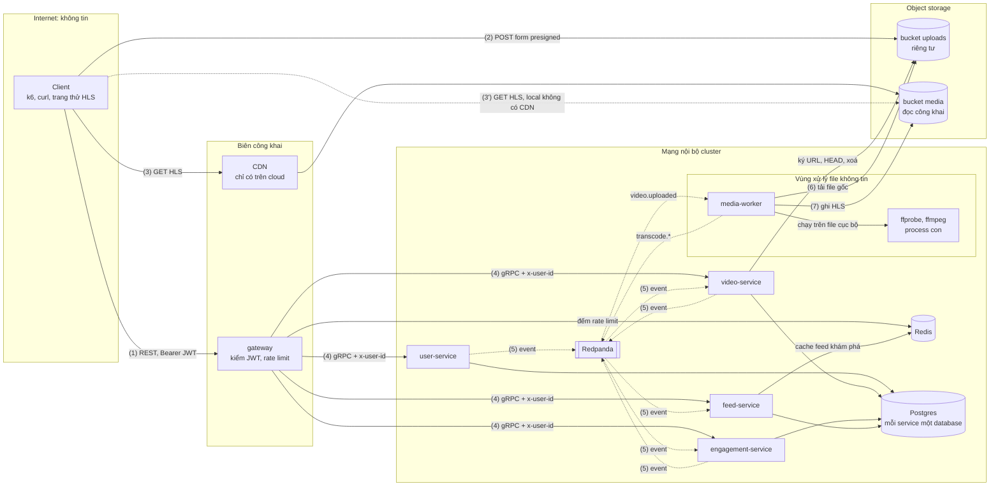

# Threat model (STRIDE, bản nhẹ)

> Trạng thái: giai đoạn 0, viết ngày 2026-10-11 cho thiết kế ở [`architecture.md`](architecture.md) và ADR 0001–0006.
> Xét lại ở giai đoạn 5 (DevSecOps), 6 (reliability, mTLS) và 9 (review bảo mật).

## 1. Phạm vi và cách làm

**STRIDE** là sáu loại mối đe doạ, mỗi loại ứng với một tính chất cần giữ:

| Chữ | Loại | Tính chất bị phá | Ví dụ trong hệ thống này |
| --- | --- | --- | --- |
| S | Spoofing: giả danh | Xác thực | Tự ký JWT, tự đặt `x-user-id` khi gọi thẳng gRPC |
| T | Tampering: sửa dữ liệu | Toàn vẹn | Thay file gốc sau khi đã `CompleteUpload`, phát event giả |
| R | Repudiation: chối bỏ | Truy vết được | Không có log nào cho biết ai đã upload một video |
| I | Information disclosure: lộ thông tin | Bí mật | Email trong log, dò email đã đăng ký |
| D | Denial of service: làm ngừng dịch vụ | Sẵn sàng | File video "bom" làm treo worker, spam đăng nhập |
| E | Elevation of privilege: leo quyền | Phân quyền | Khai thác lỗi ffmpeg để lấy credential của worker |

**"Nhẹ" nghĩa là:** xét theo **bề mặt** (chỗ dữ liệu đi qua một ranh giới tin cậy), không xét từng hàm; mỗi bề mặt liệt kê
các mối đe doạ thấy rõ, biện pháp, giai đoạn sẽ làm và mức ưu tiên. Không chấm điểm định lượng (DREAD, CVSS).

**Cách đọc bảng:**

- **GĐ:** giai đoạn trong [plan](../plans/261004-devops-sa-roadmap/plan.md) sẽ viết code hoặc cấu hình cho biện pháp đó.
  Biện pháp đã có trong thiết kế vẫn ghi giai đoạn hiện thực nó, không ghi 0. Nhiều số nghĩa là làm dần qua các giai đoạn.
- **Ưu tiên:** **Cao** = khai thác dễ, hoặc hậu quả là chiếm tài khoản, lộ dữ liệu cá nhân, chạy code lạ; phải có trước khi
  hệ thống nhận request từ internet (giai đoạn 7). **Vừa** = cần làm nhưng hậu quả có giới hạn. **Thấp** = phòng thêm.
- Dòng ghi **Chấp nhận** là rủi ro không xử lý (hoặc chỉ giảm bớt); lý do và lúc xem lại ở [mục 6](#6-rủi-ro-chấp-nhận).
- Câu "vì sao" của các biện pháp quan trọng nằm ngay dưới mỗi bảng.

## 2. Luồng dữ liệu và ranh giới tin cậy

Dựa trên C4 container ([architecture §5](architecture.md)). Mỗi `subgraph` là một vùng tin cậy; mũi tên đi qua viền
vùng là chỗ phải kiểm.

| Chỗ vượt ranh giới | Ai bên kia | Kiểm ở đâu |
| --- | --- | --- |
| (1) Internet → gateway | Bất kỳ ai | gateway: JWT, rate limit, giới hạn kích thước và thời gian request ([4.1](#41-jwt-và-đăng-nhập), [4.4](#44-rate-limit-ở-gateway)) |
| (2) Internet → bucket `uploads` | Ai đang giữ form presigned | Chính storage, theo policy đã ký ([4.2](#42-presigned-post-và-bucket)) |
| (3) Internet → bucket `media` | Bất kỳ ai | Không kiểm: nội dung công khai, chỉ cho đọc từng object ([4.2](#42-presigned-post-và-bucket)) |
| (4) gateway → service | Hiện tại: mọi thứ vào được mạng nội bộ | `x-user-id` do gateway đặt; NetworkPolicy, mTLS ([4.5](#45-mức-tin-cậy-giữa-các-service)) |
| (5) Service ↔ Redpanda | Hiện tại: mọi thứ vào được mạng nội bộ | ACL theo service; consumer kiểm event ([4.5](#45-mức-tin-cậy-giữa-các-service)) |
| (6), (7) File người dùng → ffmpeg | Nội dung do người dùng tạo | ffprobe, giới hạn định dạng, giao thức, tài nguyên, quyền ([4.3](#43-ffmpeg-đọc-file-người-dùng)) |

## 3. Tài sản cần bảo vệ

| Tài sản | Nằm ở đâu | Tính chất cần giữ | Mất thì sao |
| --- | --- | --- | --- |
| **Khoá ký JWT** (khoá riêng) | Chỉ user-service | Bí mật | Ai có khoá là ký được token của **mọi** người dùng. Tài sản giá trị nhất |
| Hash mật khẩu và email (dữ liệu cá nhân) | `svp_user` | Bí mật | Lộ email là lộ dữ liệu cá nhân; hash bị bẻ offline nếu thuật toán yếu |
| Credential của service (database, object storage, Redpanda) | Biến môi trường, sau là secret store | Bí mật | Mở đường đi tắt qua mọi kiểm tra của API |
| File gốc trong `uploads` | Object storage | Bí mật, toàn vẹn | File chưa phát hành, có thể chứa metadata riêng (vị trí GPS, thiết bị) |
| Bản HLS trong `media` | Object storage, CDN | Toàn vẹn | Công khai theo thiết kế; bị ghi đè là video của người khác bị thay |
| Bộ đếm lượt xem, like | `svp_engagement` | Toàn vẹn | Số sai làm sai mọi thứ xếp hạng dựa trên nó về sau |
| Tính sẵn sàng của feed và upload | gateway, feed-service, video-service | Sẵn sàng | Vi phạm SLO 99,9% ([architecture §2](architecture.md)) |

## 4. Mối đe doạ theo bề mặt

### 4.1 JWT và đăng nhập

**Lựa chọn (quyết định của threat model):**

- **Thuật toán ký: EdDSA với Ed25519** (`alg: "EdDSA"`). user-service giữ khoá riêng, gateway chỉ có khoá công khai
  ([architecture §7.4](architecture.md)).
  - Không chọn **HS256**: khoá đối xứng, bên nào kiểm được token thì cũng ký được token, nên gateway (bề mặt lộ ra internet
    nhiều nhất) sẽ giữ quyền ký cho mọi người dùng.
  - Không chọn **RS256**: chạy được, nhưng chữ ký 2048 bit dài 256 byte làm token phình, ký chậm hơn hẳn.
  - **ES256** là lựa chọn dự phòng, nhưng ECDSA cần số ngẫu nhiên tốt cho từng chữ ký (dùng lại nonce là lộ khoá riêng,
    một lớp lỗi kinh điển). Ed25519 có chữ ký tất định nên không có lớp lỗi đó, khoá 32 byte, chữ ký 64 byte, chỉ có một
    đường cong nên không có tham số để chọn sai, và có sẵn trong thư viện chuẩn Go (`crypto/ed25519`). Nếu về sau phải ký
    bằng dịch vụ quản lý khoá trên cloud mà dịch vụ đó không hỗ trợ Ed25519 thì đổi sang ES256: chỉ đổi cấu hình hai đầu,
    không đổi contract.
- **Claim:** `iss = "svp-user"`, `aud = "svp-api"`, `sub = user_id`, `iat`, `exp`, `jti` (UUIDv7, chưa dùng, để dành cho
  danh sách thu hồi). Header có `kid` để đổi khoá không gián đoạn. **Không** đặt email hay dữ liệu cá nhân vào token.
- **Thời hạn: 1 giờ**, lệch đồng hồ cho phép 30 giây. MVP không có refresh token
  ([ADR-0006](adr/0006-contract-ids-and-event-envelope.md)): hạn ngắn hơn (15 phút) buộc client gửi lại mật khẩu
  thường hơn, tức thêm tải hash và thêm lần mật khẩu đi trên đường truyền; hạn dài hơn kéo dài thời gian một token bị lộ còn
  dùng được. 1 giờ đủ cho một lượt k6 bình thường; bài soak dài hơn thì k6 đăng nhập lại.
- **Hash mật khẩu: argon2id**, chuỗi lưu theo định dạng PHC (gồm tham số và salt 16 byte ngẫu nhiên riêng từng người), tham
  số theo khuyến nghị OWASP hiện hành và đo thời gian hash trên máy ở giai đoạn 1. Không chọn bcrypt dù cũng chấp nhận được:
  bcrypt chỉ dùng 72 byte đầu của mật khẩu và không tốn bộ nhớ, nên bẻ bằng GPU rẻ hơn; argon2id tốn cả CPU lẫn RAM theo tham
  số chỉnh được. Cái giá: thêm dependency `golang.org/x/crypto` (ghi lý do khi thêm ở giai đoạn 1), và mỗi lần hash ngốn vài
  chục MiB RAM (xem JWT-9).

| ID | Thành phần | STRIDE | Kịch bản | Biện pháp | GĐ | Ưu tiên |
| --- | --- | --- | --- | --- | --- | --- |
| JWT-1 | gateway kiểm JWT | S, E | Token có `alg: none`, hoặc `alg: HS256` dùng chính khoá công khai làm khoá HMAC (nhầm thuật toán): gateway chấp nhận token tự ký, kẻ tấn công thành người dùng bất kỳ | Gateway chỉ chấp nhận đúng `EdDSA`, khoá lấy theo `kid` từ cấu hình cục bộ, `kid` lạ thì từ chối; bỏ qua `jku`, `x5u`, `jwk` trong header; test cho từng kiểu token giả | 1 | Cao |
| JWT-2 | gateway kiểm JWT | S | Token đúng chữ ký nhưng hết hạn, hoặc của hệ thống khác dùng chung khoá (`iss`/`aud` khác) | Bắt buộc có và kiểm `exp`, `iss`, `aud`; thiếu claim là từ chối | 1 | Cao |
| JWT-3 | Token đã cấp | S | Token bị lộ (log, máy người dùng) còn dùng được tới hết hạn; đổi mật khẩu hay đăng xuất không làm token cũ mất hiệu lực | Hạn 1 giờ; token chỉ đi trong header `Authorization`, không bao giờ trong query string. Refresh token + danh sách thu hồi theo `jti` là việc của giai đoạn sau. **Chấp nhận** phần còn lại | 1; chấp nhận, xem lại ở 9 | Vừa |
| JWT-4 | `Login` | S | Dò mật khẩu: thử hàng loạt mật khẩu cho một email, hoặc một mật khẩu phổ biến cho nhiều email | Rate limit theo IP và theo cặp (IP, email) ở route login; **không** khoá tài khoản sau N lần sai | 2 | Cao |
| JWT-5 | `Login` | I | Phân biệt "email không tồn tại" với "sai mật khẩu" qua message hoặc qua thời gian phản hồi | Hai trường hợp cùng `UNAUTHENTICATED`, cùng `reason` `INVALID_CREDENTIALS`, cùng message ([ADR-0006](adr/0006-contract-ids-and-event-envelope.md), `proto/svp/user/v1/user_service.proto`); email không tồn tại vẫn chạy so hash với một hash giả để thời gian như nhau | 1 | Vừa |
| JWT-6 | `Register` | I | Gọi `Register` với email người khác, nhận `ALREADY_EXISTS` là biết email đó có tài khoản | Rate limit theo IP ở route register. **Chấp nhận** ở MVP | 2; chấp nhận | Thấp |
| JWT-7 | `svp_user` | I | Database bị lộ (backup, SQL injection): bẻ hash offline | argon2id có salt riêng; lưu tham số trong chuỗi hash để tăng tham số về sau mà không bắt mọi người đổi mật khẩu (hash lại lúc đăng nhập); mọi câu SQL tham số hoá qua `sqlc` | 1 | Cao |
| JWT-8 | Log, trace, Sentry | I | Mật khẩu, token, email bị ghi vào log, attribute của span hay báo lỗi Sentry | Log `user_id` thay cho email; kiểu riêng cho mật khẩu và token tự che giá trị khi log; access log không ghi header `Authorization`; Sentry tắt gửi PII mặc định, lọc header và thân request | 1, 3 | Cao |
| JWT-9 | user-service | D | Spam đăng nhập: mỗi lần hash argon2id tốn vài chục MiB, vài trăm request cùng lúc làm user-service hết RAM | Rate limit login (JWT-4); giới hạn số phép hash chạy cùng lúc bằng semaphore (bulkhead), quá thì trả `RESOURCE_EXHAUSTED`; giới hạn độ dài mật khẩu (8–128 ký tự) | 1, 2 | Vừa |
| JWT-10 | Khoá ký JWT | I, E | Khoá riêng lộ (commit nhầm, nằm trong image, log): ký được token cho mọi người | Xem [4.7](#47-bí-mật): chỉ user-service đọc được; đổi khoá theo `kid` (gateway giữ cùng lúc khoá cũ và mới trong lúc chuyển) | 1, 5, 7 | Cao |

**Vì sao:**

- **JWT-1:** chữ ký chỉ có nghĩa khi bên kiểm tự quyết thuật toán. Nếu gateway đọc `alg` từ chính token rồi làm theo, kẻ tấn
  công chọn `none` (không cần chữ ký) hoặc `HS256` với khoá công khai (vốn ai cũng có) làm khoá bí mật. Đây là lỗi thật đã
  xảy ra ở nhiều thư viện JWT; cách chặn duy nhất là cấu hình cứng một thuật toán ở bên kiểm.
- **JWT-4, không khoá tài khoản:** khoá tài khoản sau N lần sai biến chống dò mật khẩu thành công cụ DoS: ai biết email
  của bạn là khoá được bạn khỏi tài khoản. Rate limit theo (IP, email) chặn dò một tài khoản mà không chặn chủ thật đăng nhập
  từ IP khác.
- **JWT-5, so hash giả:** nếu email không tồn tại mà trả lời ngay, còn email có thật mất thêm thời gian hash, thì đo thời gian
  phản hồi là biết email nào đã đăng ký, dù message giống nhau.
- **JWT-8, không đặt email vào token:** JWT chỉ được ký, không được mã hoá; phần payload là base64, ai cầm token cũng đọc
  được.

### 4.2 Presigned POST và bucket

Thiết kế ở [ADR-0004](adr/0004-direct-upload-and-hls.md): video-service ký form POST cho key cố định `uploads/<video_id>`,
policy ép `content-length-range` tối đa 500 MB và content type, hết hạn sau 15 phút; `CompleteUpload` thì `HEAD` kiểm lại.

| ID | Thành phần | STRIDE | Kịch bản | Biện pháp | GĐ | Ưu tiên |
| --- | --- | --- | --- | --- | --- | --- |
| UP-1 | Form presigned | T, D | Client sửa form để ghi vào key khác (đè file người khác), gửi file vượt 500 MB, hoặc đổi content type | Policy ký điều kiện **khớp chính xác** key `uploads/<video_id>`, `content-length-range` [1, `size` đã khai], `Content-Type` đúng giá trị đã khai; storage tự từ chối nếu sai | 2 | Cao |
| UP-2 | Form presigned | T | Form lộ (log proxy, máy người dùng): trong 15 phút ai cũng gửi được file vào key đó, kể cả **sau** khi tác giả đã `CompleteUpload`, nên file worker đọc có thể khác file đã `HEAD` | Hạn 15 phút; không log URL và field của form; `CompleteUpload` chỉ chuyển trạng thái từ `UPLOADING`. Phần còn lại **chấp nhận** (xem đề xuất ở [mục 7](#7-đề-xuất-xem-lại)) | 2; chấp nhận | Thấp |
| UP-3 | `CompleteUpload`, `GetVideo` | S, I | Người dùng A gọi `CompleteUpload` hoặc `GetVideo` với `video_id` của B | video-service so `x-user-id` với `author_id`: `CompleteUpload` của người khác bị từ chối; `GetVideo` video chưa `READY` mà không phải tác giả thì `NOT_FOUND` ([ADR-0006](adr/0006-contract-ids-and-event-envelope.md), `proto/svp/video/v1/video_service.proto`) | 1, 2 | Cao |
| UP-4 | Credential ký URL | E | Lỗi trong code ký (key ghép từ input) sinh được form ghi vào `media/` hoặc key tuỳ ý | Form presigned mang quyền của credential đã ký nó: credential của video-service chỉ được `PutObject` dưới `uploads/*`, đọc `HEAD`, và xoá (dọn upload bỏ dở, video `FAILED`); key luôn ghép từ `video_id` do server sinh | 2, 7 | Vừa |
| UP-5 | Bucket `uploads` | I | Bucket để lộ công khai, file chưa phát hành bị tải về | Bucket riêng tư, chặn truy cập công khai ở mức bucket; MinIO local tạo user riêng cho từng service, không dùng tài khoản root trong service | 2, 7 | Cao |
| UP-6 | Bucket `media` | I | Ai có link đều xem được video; cho phép `ListBucket` thì liệt kê được mọi video, kể cả bản HLS ghi dở của video chưa `READY` hoặc `FAILED` | Đọc công khai là **chấp nhận** (nền tảng công khai, chưa có video riêng tư hay xoá video). Chỉ mở đọc từng object, **không** mở liệt kê; trên cloud chỉ CDN đọc được bucket; video `FAILED` bị dọn file (ADR-0004) | 2, 7; chấp nhận | Vừa |
| UP-7 | `InitUpload` | D | Một tài khoản gọi `InitUpload` liên tục, mỗi lần được quyền đẩy 500 MB: đầy storage, tốn tiền | Rate limit theo user ở route init upload; mỗi user tối đa vài video `UPLOADING` cùng lúc; job dọn upload bỏ dở quá 1 giờ (ADR-0004) | 2 | Vừa |
| UP-8 | Upload | R | Video vi phạm được đưa lên, không ai biết ai upload | `author_id` gắn với video từ `InitUpload`; log có cấu trúc ghi `user_id`, `video_id`, `trace_id` ở `InitUpload`, `CompleteUpload` | 1, 3 | Thấp |

**Vì sao:**

- **UP-1:** giới hạn phải nằm ở chỗ nhận file. Kiểm `size` ở `InitUpload` chỉ là kiểm con số client khai; chính policy đã ký
  mới buộc storage từ chối byte thứ 500 MB + 1. Content type trong policy chỉ giữ metadata nhất quán, **không** chứng minh
  file là video: nội dung thật chỉ được kiểm ở worker bằng `ffprobe` (FF-1).
- **UP-4:** URL presigned không có quyền riêng, nó mượn quyền của credential đã ký. Credential có quyền ghi cả bucket thì một
  lỗi ghép key là đủ để ghi đè video công khai của người khác.
- **UP-6, không mở liệt kê:** đọc công khai từng object chỉ lộ video mà người xem đã biết `video_id`; mở liệt kê thì lộ toàn bộ,
  kể cả thứ chưa phát hành.

### 4.3 ffmpeg đọc file người dùng

Bề mặt tấn công lớn nhất ([ADR-0004](adr/0004-direct-upload-and-hls.md)): một chương trình C rất lớn, hàng trăm demuxer và
decoder, chạy trên byte do người lạ chọn. Coi như **sẽ có** lỗi bị khai thác; thiết kế để khi đó thiệt hại nhỏ nhất.

| ID | Thành phần | STRIDE | Kịch bản | Biện pháp | GĐ | Ưu tiên |
| --- | --- | --- | --- | --- | --- | --- |
| FF-1 | ffprobe, ffmpeg | E | File được dựng để khai thác lỗi bộ nhớ trong demuxer hoặc decoder ít dùng, chạy code trong container worker | `ffprobe` (cũng chạy trong vùng cô lập) kiểm trước: chỉ nhận container MP4/MOV, WebM/Matroska và codec trong danh sách; ffmpeg chỉ mở demuxer và decoder trong danh sách (tuỳ chọn whitelist định dạng và codec của ffmpeg, tên chính xác kiểm ở giai đoạn 2); file khác thì `transcode.failed` | 2 | Cao |
| FF-2 | ffmpeg | I, S | File là playlist hoặc định dạng tham chiếu tới file/URL khác (HLS, concat và họ hàng): ffmpeg đọc file cục bộ (vd. `/proc/self/environ` chứa credential) hoặc gọi URL nội bộ (SSRF), rồi **nhúng nội dung vào video đầu ra** vốn công khai | Worker tải file gốc về file tạm rồi chạy ffmpeg trên đường dẫn cục bộ, chỉ mở giao thức `file` (whitelist giao thức); các demuxer playlist/tham chiếu không có trong whitelist ở FF-1; ffmpeg chạy với biến môi trường rỗng | 2 | Cao |
| FF-3 | ffmpeg | D | "Bom" tài nguyên: độ phân giải khổng lồ, thời lượng dài hơn 3 phút trong file nhỏ, frame rate hay số stream bất thường; worker treo hoặc hết RAM, hàng chờ nghẽn, SLO 2 phút vỡ cho mọi người | `ffprobe` kiểm cạnh dài, thời lượng ≤ 180 s (có dung sai), frame rate, số stream; ffmpeg vẫn ép `-t` vì metadata thời lượng có thể nói dối; timeout thời gian thực cho cả job (`exec.CommandContext`); giới hạn CPU/RAM của container (compose ở 2, resource limit k8s ở 4) | 2, 4 | Cao |
| FF-4 | Container worker | E | Đã chạy được code trong worker (FF-1): đọc credential, lấn sang node, gọi service khác | Chạy không phải root, root filesystem chỉ đọc (thư mục tạm riêng), bỏ mọi capability, cấm leo quyền, seccomp mặc định; credential object storage chỉ đọc `uploads/*`, ghi `media/*`; không gọi gRPC, không có Postgres hay Redis | 2, 4 | Cao |
| FF-5 | Mạng của worker | E, I | Code lạ trong worker quét mạng nội bộ, gọi gRPC giả `x-user-id`, gửi dữ liệu ra internet | NetworkPolicy egress: worker chỉ tới object storage, Redpanda và DNS; trên cloud object storage nằm ngoài cluster nên chặn theo VPC endpoint hoặc dải địa chỉ, chốt ở giai đoạn 7 | 4, 7 | Cao |
| FF-6 | Worker → Redpanda | T | Worker bị chiếm phát `transcode.completed` giả cho video khác, trỏ playlist tới key tuỳ ý | video-service chỉ nhận `transcode.*` cho video đang `PROCESSING`, chỉ chấp nhận key nằm dưới `media/<video_id>/`; ACL Redpanda (IN-4) | 2, 4 | Vừa |
| FF-7 | Bản HLS | I | Metadata của file gốc (vị trí GPS, thiết bị, tên người quay) bị chép sang bản HLS công khai | Bỏ metadata khi transcode (`-map_metadata -1`); luôn mã hoá lại, không chép thẳng stream (`-c copy`) từ file gốc | 2 | Vừa |
| FF-8 | Image ffmpeg | E | Bản ffmpeg trong image có lỗ hổng đã công bố | trivy quét image trong CI, chặn lỗ hổng nghiêm trọng; Renovate cập nhật base image; Kyverno chỉ cho chạy image đã quét và ký | 5 | Cao |
| FF-9 | Transcode trên cloud | E | Như FF-1 nhưng trên EKS/GKE | Trên cloud media-worker gọi MediaConvert / Transcoder API (ADR-0004) để transcode. **FF-3 vẫn phải giữ phần thời lượng:** cả hai dịch vụ tính tiền theo phút đầu ra, file nhỏ mà thời lượng thật hàng giờ sẽ thành hoá đơn. **Bắt buộc** kiểm thời lượng trước khi tạo job, theo một trong hai nhánh. (a) Dùng thời lượng đầu vào nhà cung cấp báo: file người dùng không chạy trong cluster của mình nữa, rủi ro FF-1, FF-2, FF-4, FF-5 chuyển sang nhà cung cấp; worker chỉ còn quyền gọi dịch vụ đó. (b) Dùng `ffprobe` trong cluster: worker vẫn đọc file người dùng, nên vẫn cần quyền đọc `uploads/*` và vẫn gánh FF-1 tới FF-4 cho bước này (whitelist định dạng và giao thức, giới hạn tài nguyên, container không quyền). Chọn (a) nếu dịch vụ có báo thời lượng đầu vào, không thì (b); kiểm điều đó ở giai đoạn 7. Quá 3 phút thì `transcode.failed` với lý do `DURATION_EXCEEDED` (`proto/svp/media/v1/events.proto`), giống local. Cấu hình job cắt đầu vào tại 3 phút giữ lại làm **trần chi phí** phòng khi kiểm sai (metadata thời lượng có thể nói dối), không phải biện pháp chính | 7, 8 | Vừa |

**Vì sao:**

- **FF-1, kiểm trước bằng `ffprobe` và whitelist:** phần lớn lỗ hổng của ffmpeg nằm ở demuxer và decoder ít ai dùng; video
  từ điện thoại chỉ cần vài định dạng. Mỗi định dạng bỏ khỏi danh sách là một khối code kẻ tấn công không chạm tới được.
  `ffprobe` cũng đọc file nên cũng là bề mặt tấn công: nó chạy với cùng giới hạn như ffmpeg, chỉ khác là dừng sớm hơn.
- **FF-2, file cục bộ + chỉ giao thức `file`:** lỗi kinh điển của ffmpeg là playlist trong file upload trỏ tới file cục bộ
  hoặc URL nội bộ, nội dung đọc được bị vẽ vào khung hình video, và video đó lại được phát công khai. Đưa ffmpeg một file cục
  bộ và chỉ mở giao thức `file` cắt đường gọi ra mạng; bỏ demuxer playlist cắt đường đọc file khác; môi trường rỗng làm
  `/proc/self/environ` của process ffmpeg không chứa credential. Lớp cuối này chỉ phụ: process cha (worker) cùng user vẫn
  có `/proc/<pid>/environ` của nó, nên lớp chính vẫn là hai whitelist.
- **FF-3, ép `-t` dù đã kiểm:** thời lượng `ffprobe` báo đọc từ header, header do người upload viết. Giới hạn phải áp lên
  việc thật sự xảy ra (số giây được giải mã, thời gian chạy, RAM), không áp lên lời khai.
- **FF-4, FF-5:** lớp phòng thủ khi FF-1 thất bại. Credential của worker được giới hạn tới mức tệ nhất chỉ là đọc file gốc và
  ghi đè HLS; không có đường mạng thì không lấn sang service khác được.
- **FF-7, luôn mã hoá lại:** chép thẳng stream đưa nguyên byte do người lạ chọn tới trình phát của người xem; mã hoá lại thì
  thứ người xem nhận là byte do encoder của mình sinh ra.

### 4.4 Rate limit ở gateway

Ngưỡng cụ thể chốt bằng đo ở lab `rate-limiter` (giai đoạn 2). Lab đó không làm vì chặng học Go hoãn: ngưỡng chốt ở
[ADR-0010](adr/0010-redis-ratelimit-cache-resilience-stage2c.md) mục 2, chọn bằng lập luận, xem lại bằng k6 ở giai đoạn 6.
Route chưa đăng nhập giới hạn theo IP; route đã đăng nhập giới hạn theo `user_id`, nên k6 chạy từ một máy phải dùng nhiều
tài khoản thử, không phải nới ngưỡng theo IP.

| Loại route | Khoá đếm | Redis lỗi thì | Lý do |
| --- | --- | --- | --- |
| `login`, `register` | IP; login thêm cặp (IP, email) | **Đóng mềm:** chuyển sang bộ đếm trong bộ nhớ của từng instance gateway, ngưỡng thấp hơn | Thứ cần bảo vệ là mật khẩu; không bao giờ để route này không giới hạn. Đếm cục bộ chỉ lỏng đi N lần (N = số instance) nhưng người dùng thật vẫn đăng nhập được |
| `POST /videos` (init upload) | `user_id` | **Đóng mềm**, như trên | Mỗi lần gọi mở quyền ghi 500 MB vào storage (UP-7); vẫn phải giữ SLO khởi tạo upload 99,9% nên không chặn hẳn |
| Ghi lượt xem, like | `user_id`; lượt xem thêm cặp (`user_id`, `video_id`) | **Mở** | Tệ nhất là bộ đếm bị đẩy lên trong lúc Redis lỗi; like vốn idempotent; chặn thì người dùng thật mất chức năng vì lỗi của mình |
| Đọc (feed, video, số đếm) | `user_id` | **Mở** | Feed là SLO quan trọng nhất; chống quá tải ở đây do timeout, bulkhead và cache, không do rate limit |

| ID | Thành phần | STRIDE | Kịch bản | Biện pháp | GĐ | Ưu tiên |
| --- | --- | --- | --- | --- | --- | --- |
| RL-1 | Rate limit theo IP | S, D | Kẻ tấn công tự đặt header `X-Forwarded-For` khác nhau ở mỗi request, mỗi lần được tính là một IP mới, vượt mọi giới hạn | Chỉ đọc IP client từ header do proxy tin cậy đặt (Envoy Gateway ở 4, load balancer ở 7), lấy đúng một bước; local dùng địa chỉ kết nối. Số hop proxy tin cậy khi đọc `X-Forwarded-For` phụ thuộc môi trường: có L7 load balancer đứng trước Envoy Gateway thì là 2. Đếm thiếu hop thì mọi client chung một bucket IP (địa chỉ của load balancer); đếm thừa hop thì đọc phải phần client tự ghi vào `X-Forwarded-For`, tức giả mạo IP quay lại; chốt theo môi trường ở giai đoạn 7 | 2, 4, 7 | Cao |
| RL-2 | Redis của rate limit | D | Redis lỗi: hoặc mọi request bị chặn (feed sập theo Redis), hoặc mọi giới hạn biến mất | Theo bảng trên, chốt từng loại route; metric và cảnh báo khi gateway đang chạy bộ đếm dự phòng | 2, 3 | Vừa |
| RL-3 | Lượt xem | T | Một tài khoản gọi ghi lượt xem liên tục cho một video, đẩy số xem lên | Mỗi cặp (`user_id`, `video_id`) chỉ được tính một lượt trong một khoảng thời gian (khoá đếm riêng ở gateway). Nhiều tài khoản giả cùng đẩy: **chấp nhận** | 2; chấp nhận | Thấp |
| RL-4 | gateway HTTP | D | Request thân rất lớn, hoặc client gửi header thật chậm giữ kết nối (slowloris) | `http.Server` đặt `ReadHeaderTimeout`, `ReadTimeout`, `WriteTimeout`, `IdleTimeout`; `http.MaxBytesReader` cho thân request (JSON nhỏ, file không đi qua gateway) | 1 | Cao |
| RL-5 | Giai đoạn 1 | S, D | Giai đoạn 1 đã có login nhưng chưa có rate limit | Giai đoạn 1 chỉ chạy local, không mở ra internet: **chấp nhận** khoảng trống tới giai đoạn 2 | 1; chấp nhận | Thấp |
| RL-6 | Ghi like, lượt xem | D | `Like` / `RecordView` nhận `video_id` bất kỳ: engagement-service không sở hữu video và không kiểm video có tồn tại (comment đầu `proto/svp/engagement/v1/engagement_service.proto`). Gửi id ngẫu nhiên tạo dòng like và bộ đếm mới mỗi lần, chỉ bị chặn bởi rate limit theo user (mà route này fail **mở** khi Redis lỗi, bảng trên), nên `svp_engagement` phình dần | Rate limit theo `user_id` ở route ghi (bảng trên), rate limit register làm tạo tài khoản chậm. Phần còn lại **chấp nhận** có điều kiện, xem lại trước khi mở ra internet ở giai đoạn 7 | 2; chấp nhận, xem lại ở 7 | Thấp |

**Vì sao:**

- **RL-1:** `X-Forwarded-For` là header client tự viết được. Chỉ phần do proxy của mình nối thêm mới đáng tin, nên gateway
  phải biết trước có bao nhiêu proxy đứng trước nó và lấy đúng địa chỉ do proxy gần nhất ghi.
- **RL-4:** `http.Server` của Go mặc định **không có** timeout nào (giá trị 0 nghĩa là chờ mãi). Đây là chỗ khác NestJS/Node,
  nơi server có sẵn timeout mặc định: trong Go phải tự đặt.
- **RL-6, chấp nhận thay vì kiểm video tồn tại:** muốn từ chối `video_id` lạ, engagement-service có hai cách. Một là dựng
  bản sao danh sách video từ `video.ready` (thêm consumer, đổi contract và danh mục event ở architecture §6); job dọn dòng của
  video không tồn tại cũng cần chính bản sao đó. Hai là gọi đồng bộ `GetVideo` của video-service để kiểm video tồn tại
  (CLAUDE.md cho phép gọi API của service khác), cái giá là thêm một lời gọi đồng bộ trên đường ghi nóng của lượt xem: độ
  trễ cộng thêm và lượt xem lỗi theo video-service. Cách hai còn nới ranh giới tin cậy ở §4.5: IN-2, IN-3 hiện chỉ cho
  gateway gọi cổng gRPC, nay phải mở cổng gRPC của video-service cho engagement-service, và engagement-service phải tự đặt
  `x-user-id`. NetworkPolicy (IN-2) mở theo cổng, không theo method, nên engagement-service bị chiếm là gọi được **mọi**
  RPC của video-service dưới danh tính bất kỳ, không chỉ `GetVideo`: `InitUpload` (tạo form upload 500 MB, bỏ qua rate
  limit ở gateway, xem UP-7) và `CompleteUpload` video của người khác. Chỉ AuthorizationPolicy theo method (IN-3, tuỳ chọn
  ở giai đoạn 6) mới thu hẹp được về `GetVideo`. Rate limit theo user không phải lúc nào cũng chặn: route like/view fail
  **mở** khi Redis lỗi (bảng ở đầu mục), nên trong lúc Redis lỗi id ngẫu nhiên không bị giới hạn. Vẫn giữ mức
  Thấp vì hậu quả chỉ là database lớn dần, không lộ hay sai dữ liệu người khác: id lạ chỉ tạo bộ đếm không feed nào đọc.
  Lúc còn chạy local thì cái giá của cả hai cách đều không đáng. Nếu sau này phải chặn id lạ thì **ưu tiên cách một**
  (bản sao từ `video.ready`): event đi qua Redpanda đã có ACL (IN-4), nên không thêm đường gọi gRPC nào ngoài gateway và
  ranh giới tin cậy giữ nguyên.

### 4.5 Mức tin cậy giữa các service

Quyết định ở [ADR-0006](adr/0006-contract-ids-and-event-envelope.md) mục 5: gRPC request không mang danh tính người gọi;
gateway đặt `user_id` đã xác thực vào metadata `x-user-id`, service tin giá trị đó. Hệ quả: **ai gửi được gRPC tới service
là giả được bất kỳ người dùng nào**. An toàn của cả hệ thống dựa vào việc chỉ gateway tới được cổng gRPC.

| ID | Thành phần | STRIDE | Kịch bản | Biện pháp | GĐ | Ưu tiên |
| --- | --- | --- | --- | --- | --- | --- |
| IN-1 | gateway → service | S | Client gửi header `x-user-id` (hoặc header bất kỳ) mong gateway chuyển nguyên xuống metadata | gateway dựng metadata gRPC từ đầu, chỉ gồm giá trị nó đặt; không chép header của client sang metadata; test: request có header `x-user-id` giả vẫn mang `user_id` từ JWT | 1 | Cao |
| IN-2 | Cổng gRPC | S, E | Thứ gì đó trong mạng nội bộ (pod bị chiếm, worker ở FF-4) gọi thẳng gRPC với `x-user-id` của nạn nhân | Local: cổng gRPC không publish ra máy (compose chỉ publish gateway; chạy native thì bind `127.0.0.1`). k8s: NetworkPolicy mặc định chặn, chỉ gateway vào được cổng gRPC. Thiếu hoặc sai `x-user-id` thì `UNAUTHENTICATED` | 1, 4 | Cao |
| IN-3 | gateway → service | S, T | Như IN-2 nhưng kẻ tấn công đứng được ở chỗ NetworkPolicy cho phép, hoặc nghe lén mạng nội bộ | mTLS bằng Istio ambient + AuthorizationPolicy theo danh tính service (chỉ service account của gateway gọi được). Nếu giai đoạn 6 bỏ phần tuỳ chọn này: **chấp nhận**, NetworkPolicy là lớp duy nhất | 6; chấp nhận nếu bỏ | Vừa |
| IN-4 | Redpanda | S, T | Ai vào được Redpanda là produce được vào mọi topic: `transcode.completed` giả đánh video `READY`, `video.ready` giả chèn video vào feed mọi người, `view.recorded` giả, `user.followed` giả làm sai bản sao follow | SASL (SCRAM) cho từng service; ACL: chỉ service sở hữu event được ghi topic của nó (ADR-0001 luật 3), consumer chỉ đọc topic mình nghe; NetworkPolicy chỉ cho các service liên quan tới cổng Redpanda. Trên cloud dùng quyền IAM của dịch vụ tương ứng | 4, 7, 8 | Vừa |
| IN-5 | Consumer | D, T | Event hỏng hoặc sai schema (poison pill) làm consumer lỗi mãi, chặn cả partition | Consumer parse và kiểm field bắt buộc, lỗi vĩnh viễn thì sang DLQ (ADR-0003); kiểm ngữ nghĩa (FF-6) | 2 | Vừa |
| IN-6 | Postgres | E | Service bị chiếm đọc database của service khác, hoặc chạy lệnh quản trị | Mỗi service một role Postgres chỉ có quyền trên database của mình (ADR-0001), không dùng superuser trong service; migration chạy bằng role riêng | 1, 7 | Vừa |
| IN-7 | Redis | E, T | Số db của Redis (10–14) **không** phải ranh giới quyền: client nào kết nối được cũng `SELECT` sang db khác, kể cả xoá bộ đếm rate limit | Local: **chấp nhận** (một máy, một người). Cloud: tách instance hoặc ACL của Redis theo tiền tố key | 7, 8; chấp nhận ở local | Thấp |
| IN-8 | Lỗi trả về client | I | Message lỗi nội bộ (câu SQL, tên host, stack) lộ ra client | Với mã 5xx gateway không trả message gốc, chỉ `trace_id` ([architecture §8](architecture.md)) | 1 | Vừa |
| IN-9 | Postgres local | S, E | `pg_hba` của Postgres native là `trust` cho `127.0.0.1`/`::1`, và container tới Postgres được thấy như loopback: container bị chiếm đăng nhập được `postgres` (superuser) không cần mật khẩu, vượt qua IN-6, đọc được cả database của project khác trên cùng máy | Local: **chấp nhận** (Postgres dùng chung với project khác, không sửa cấu hình; compose chỉ publish gateway, IN-2). Giai đoạn 4: chốt Postgres trong hay ngoài cluster bằng ADR, xác thực bằng mật khẩu (`scram-sha-256`), không `trust`. Giai đoạn 7: RDS, xác thực thật | 4, 7; chấp nhận ở local | Thấp |

**Vì sao:**

- **IN-1, dựng metadata từ đầu:** cách an toàn là danh sách cho phép (chỉ gửi những gì mình đặt), không phải danh sách chặn
  (xoá `x-user-id` rồi chép phần còn lại). Danh sách chặn hỏng ngay khi có header mới mà mình quên chặn, hoặc khác chữ
  hoa/thường.
- **IN-2 trước IN-3:** NetworkPolicy chặn **đường đi**, mTLS chứng minh **ai** đang gọi. Với hệ thống nhỏ, chặn đường đi đã bỏ
  phần lớn rủi ro, nên nó bắt buộc còn mTLS là lớp thêm. Cách khác đã cân nhắc: gateway chuyển nguyên JWT xuống để từng service
  tự kiểm. Không chọn vì mọi service phải giữ khoá công khai và code kiểm JWT, mà vẫn không chặn được kẻ đã lấy được một token
  hợp lệ; mTLS giải quyết cho mọi đường gọi một lần.
- **IN-4:** luật "event về một thực thể chỉ do service sở hữu nó phát" (ADR-0001) đang chỉ là quy ước trong code. ACL của
  Redpanda biến quy ước đó thành thứ broker ép buộc.

### 4.6 Phân trang

`page_token` ([architecture §8](architecture.md)) là base64url của (`published_at`, `video_id`) của item cuối trang,
**không ký**.

| ID | Thành phần | STRIDE | Kịch bản | Biện pháp | GĐ | Ưu tiên |
| --- | --- | --- | --- | --- | --- | --- |
| PG-1 | `page_token` | T | Client sửa token để đọc thứ không được đọc | **Không phải mối đe doạ:** feed "đang theo dõi" luôn lọc theo `user_id` lấy từ metadata, không lấy từ token; feed khám phá là danh sách công khai. Sửa token chỉ đổi vị trí đọc trong dữ liệu người gọi vốn được xem | 2 | Thấp |
| PG-2 | `page_token` | D | Token hỏng, quá dài hoặc giải mã ra giá trị vô lý | Giới hạn độ dài trước khi giải mã; token hỏng → `INVALID_ARGUMENT`; `page_size` tối đa 50 nên mỗi request đọc có giới hạn | 2 | Thấp |

**Vì sao không ký:** ký HMAC chỉ cần khi token mang thứ quyết định **quyền** (ví dụ `user_id` của timeline). Ở đây token chỉ
mang vị trí. Nếu sau này token mang bộ lọc hay danh tính, phải ký và ghi lại ở đây.

### 4.7 Bí mật

| ID | Thành phần | STRIDE | Kịch bản | Biện pháp | GĐ | Ưu tiên |
| --- | --- | --- | --- | --- | --- | --- |
| SEC-1 | Repo | I | Khoá ký JWT, mật khẩu database, key object storage bị commit | Local đọc từ `.env` (đã gitignore), `.env.example` chỉ có tên biến; gitleaks trong CI và git hook | 1, 5 | Cao |
| SEC-2 | Image | I | Bí mật bị chép vào image lúc build | Bí mật chỉ đưa vào lúc chạy (biến môi trường, file mount), không có trong Dockerfile hay build arg; trivy quét bí mật trong image | 1, 5 | Cao |
| SEC-3 | Cloud | I, E | Bí mật để trong manifest, Helm values hoặc biến môi trường cố định | AWS Secrets Manager + External Secrets; GCP Secret Manager; quyền cloud của pod qua Pod Identity / Workload Identity (credential ngắn hạn, không có key dài hạn) | 7, 8 | Cao |
| SEC-4 | Khoá ký JWT | I | Khoá dùng mãi, lộ lúc nào không biết | Đổi khoá theo `kid`: user-service ký bằng khoá mới, gateway chấp nhận cả hai trong một khoảng bằng thời hạn token rồi bỏ khoá cũ; quy trình viết thành runbook | 6, 7 | Vừa |

### 4.8 Bề mặt khác

| ID | Thành phần | STRIDE | Kịch bản | Biện pháp | GĐ | Ưu tiên |
| --- | --- | --- | --- | --- | --- | --- |
| SC-1 | Chuỗi cung ứng | T, E | Image bị thay trên registry, hoặc chạy image không rõ nguồn trong cluster | SBOM bằng syft, ký image bằng cosign, Kyverno chỉ cho chạy image đã ký và không có lỗ hổng nghiêm trọng; Renovate cập nhật dependency; `go.sum` khoá checksum module | 5 | Vừa |
| SC-2 | CI | E | Action bên thứ ba bị chiếm, đọc được secret của CI | Ghim action theo commit SHA; quyền `GITHUB_TOKEN` tối thiểu; đăng nhập cloud bằng OIDC, không lưu key cloud trong CI | 5, 7 | Vừa |
| OPS-1 | Cổng debug và metric | I, D | `net/http/pprof` gắn vào mux mặc định nên lộ ra cùng cổng API qua gateway; `/metrics` lộ thông tin nội bộ | pprof và `/metrics` chạy ở cổng quản trị riêng, không đi qua route công khai; không dùng `http.DefaultServeMux` cho API | 1, 3 | Vừa |
| OPS-2 | Grafana, Argo CD | S, E | Giao diện vận hành mở ra ngoài với mật khẩu mặc định | Chỉ truy cập qua port-forward ở local; trên cloud không mở công khai, có đăng nhập | 4, 7 | Vừa |
| OPS-3 | Dữ liệu chữ của người dùng | T | `title` chứa HTML/script, trang thử HLS hiển thị như HTML | Giới hạn độ dài `title` ở video-service; trang thử chỉ gán bằng text, không gán HTML | 1, 2 | Thấp |

**Vì sao OPS-1:** chỉ cần import gói `net/http/pprof` là nó tự đăng ký handler vào `http.DefaultServeMux`. Nếu API cũng dùng
mux mặc định thì endpoint profiling (lộ cấu trúc bộ nhớ, và chạy profile tốn CPU theo yêu cầu) ra internet mà không ai viết
dòng nào cho nó.

## 5. Tổng hợp theo giai đoạn

Dùng làm checklist: tới giai đoạn nào thì mở mục đó, mỗi biện pháp có test hoặc lệnh kiểm.

| GĐ | Biện pháp | Kiểm bằng |
| --- | --- | --- |
| 1 | JWT-1, JWT-2 (EdDSA, kiểm `exp`/`iss`/`aud`, `kid`), JWT-3 (hạn 1 giờ, chỉ header), JWT-5, JWT-7 (argon2id), JWT-8 (log không có mật khẩu/token/email), JWT-9 (semaphore hash, độ dài mật khẩu), JWT-10, UP-3 (`GetVideo`), UP-8 (log), RL-4 (timeout server, giới hạn thân), RL-5 (chỉ chạy local, chưa rate limit), IN-1, IN-2 (chỉ publish gateway), IN-6 (role Postgres riêng), IN-8, SEC-1, SEC-2, OPS-1, OPS-3 | Test: token `alg: none`, `HS256` bằng khoá công khai, hết hạn, sai `aud` đều bị từ chối; header `x-user-id` giả bị bỏ; login sai email và sai mật khẩu cùng `UNAUTHENTICATED`, cùng `reason` `INVALID_CREDENTIALS`, cùng message; grep log test không có mật khẩu/email |
| 2 | JWT-4, JWT-6, JWT-9 (rate limit login/register), UP-1 tới UP-7 (presigned, bucket, quyền ký), FF-1 tới FF-3, FF-4 (image không root), FF-6, FF-7, RL-1 tới RL-3, RL-6 (rate limit ghi like/xem theo user), IN-5, PG-1, PG-2, OPS-3 (trang thử HLS hiển thị `title` chỉ bằng text, không HTML) | Test: form bị sửa key/kích thước bị storage từ chối; file không phải video, playlist trỏ file cục bộ, video quá dài đều thành `transcode.failed` trong thời hạn; Redis tắt thì login vẫn bị giới hạn, feed vẫn chạy |
| 3 | JWT-8 (Sentry, span), UP-8, RL-2 (cảnh báo bộ đếm dự phòng), OPS-1 (`/metrics`, Pyroscope) | Xem một trace và một báo lỗi Sentry của request login: không có mật khẩu, token, email |
| 4 | FF-3 (resource limit), FF-4 (securityContext), FF-5, FF-6, IN-2 (NetworkPolicy), IN-4 (SASL + ACL Redpanda), IN-9 (Postgres trong hay ngoài cluster, không `trust`), RL-1 (proxy tin cậy), OPS-2 | Pod thử trong namespace khác không gọi được gRPC và Redpanda; worker không ra được internet; service không ghi được topic không phải của mình |
| 5 | FF-8, SC-1, SC-2, SEC-1 (gitleaks), SEC-2 (trivy quét bí mật), JWT-10 (gitleaks, trivy bắt khoá ký trong repo và image). **Xét lại threat model** | Cluster từ chối image chưa ký hoặc có lỗ hổng nghiêm trọng (tiêu chí xong của giai đoạn 5) |
| 6 | IN-3 (Istio ambient, tuỳ chọn), SEC-4 (runbook đổi khoá). **Xét lại threat model** | Gọi gRPC từ pod không phải gateway bị từ chối dù NetworkPolicy cho qua; diễn tập đổi khoá JWT không ai bị đăng xuất |
| 7 | JWT-10 (khoá ký trong secret store, chỉ user-service đọc được), FF-5 (egress tới S3), FF-9 (MediaConvert; bắt buộc kiểm thời lượng trước khi tạo job, quá 3 phút thì `DURATION_EXCEEDED`; job cắt đầu vào tại 3 phút làm trần chi phí; nếu kiểm bằng `ffprobe` thì giữ FF-1 tới FF-4 cho bước `ffprobe`), UP-4, UP-5, UP-6 (quyền IAM, chặn công khai, chỉ CDN đọc `media`), RL-1 (load balancer; chốt số hop `X-Forwarded-For` theo môi trường), RL-6 (xem lại trước khi mở internet), IN-4, IN-6, IN-7, IN-9 (RDS, xác thực thật), SEC-3, SEC-4, SC-2 (OIDC), OPS-2 | Đọc thẳng bucket `media` không qua CDN bị từ chối; pod không có key cloud dài hạn; upload file dài hơn 3 phút thì `transcode.failed` với `DURATION_EXCEEDED`, không có job transcode nào được tạo; file có metadata khai thời lượng ngắn nhưng thật dài hơn 3 phút thì đầu ra không quá 3 phút (lớp cắt, trần chi phí); request có `X-Forwarded-For` giả vẫn bị đếm theo IP thật |
| 8 | FF-9 (Transcoder API; bắt buộc kiểm thời lượng trước khi tạo job, quá 3 phút thì `DURATION_EXCEEDED`; job cắt đầu vào tại 3 phút làm trần chi phí; nếu kiểm bằng `ffprobe` thì giữ FF-1 tới FF-4 cho bước `ffprobe`), IN-4, IN-7, SEC-3 | Như giai đoạn 7, trên GCP |
| 9 | Xét lại mọi rủi ro chấp nhận ở mục 6, trong đó JWT-3 (refresh token, thu hồi theo `jti`). **Xét lại threat model** | Review bảo mật của capstone |

## 6. Rủi ro chấp nhận

| Rủi ro | ID | Vì sao chấp nhận | Xem lại khi |
| --- | --- | --- | --- |
| Dò email đã đăng ký qua `Register` (`ALREADY_EXISTS`) | JWT-6 | MVP không có xác thực email; trả "thành công" giả cho email trùng sẽ cần gửi mail. Rate limit theo IP làm việc dò chậm | Có người dùng thật, hoặc thêm xác thực email (khi đó `Register` luôn trả như nhau và gửi mail) |
| Token không thu hồi được trước hạn | JWT-3 | Không có refresh token ([ADR-0006](adr/0006-contract-ids-and-event-envelope.md)); hạn 1 giờ chặn thời gian một token lộ còn dùng được | Thêm đăng xuất, đổi mật khẩu, hoặc app client thật: refresh token + thu hồi theo `jti`; giai đoạn 9 |
| Ai có link đều xem được video | UP-6 | Nền tảng công khai; chưa có video riêng tư, chưa có xoá video | Thêm video riêng tư hoặc xoá video: chuyển sang URL ký có hạn hoặc cookie ký của CDN |
| Form presigned lộ thì file gốc bị thay trong 15 phút | UP-2 | Form chỉ trả cho tác giả qua HTTPS; hậu quả giới hạn ở một video; người thay file cũng phải qua toàn bộ kiểm tra của worker | Thấy dấu hiệu bị lạm dụng, hoặc làm đề xuất ở mục 7 |
| Nhiều tài khoản giả cùng đẩy lượt xem | RL-3 | Lượt xem chưa gắn với tiền hay xếp hạng; rate limit register làm tạo tài khoản chậm | Lượt xem dùng để xếp hạng (feed gợi ý, xu hướng) |
| Không có mTLS nếu bỏ Istio ở giai đoạn 6 | IN-3 | NetworkPolicy + ACL Redpanda đã chặn đường đi; mTLS là lớp thêm | Giai đoạn 9, hoặc cluster dùng chung với hệ thống khác |
| Số db Redis không cách ly ở local | IN-7 | Một máy, một người dùng | Lên cloud (giai đoạn 7, 8) |
| Postgres local `trust` cho loopback: container bị chiếm đăng nhập được superuser không mật khẩu | IN-9 | Postgres native dùng chung với project khác nên không sửa cấu hình; một máy, một người dùng; cổng gRPC và database không mở ra ngoài máy | Giai đoạn 4 (Postgres trong hay ngoài cluster, theo ADR của giai đoạn đó) và giai đoạn 7 (RDS, xác thực thật) |
| Like, lượt xem cho `video_id` không tồn tại làm `svp_engagement` phình dần | RL-6 | Chặn cần bản sao video ở engagement-service (thêm consumer, đổi contract) hoặc gọi đồng bộ video-service trên đường ghi lượt xem (thêm độ trễ, và phải mở cổng gRPC của video-service cho engagement-service, nới IN-2/IN-3: engagement-service tự đặt `x-user-id`, mà NetworkPolicy mở theo cổng chứ không theo method nên engagement-service bị chiếm gọi được mọi RPC của video-service dưới danh tính bất kỳ, kể cả `InitUpload` (form upload 500 MB, bỏ qua rate limit ở gateway, UP-7) và `CompleteUpload` video của người khác; chỉ AuthorizationPolicy theo method ở IN-3, tuỳ chọn ở giai đoạn 6, mới thu hẹp được về `GetVideo`); hậu quả chỉ là dung lượng database; rate limit theo user giới hạn tốc độ, trừ lúc Redis lỗi (route này fail **mở**, §4.4) thì id ngẫu nhiên không bị giới hạn | Trước khi mở ra internet (giai đoạn 7), hoặc khi số dòng của video không tồn tại đo được là đáng kể; khi phải chặn thì ưu tiên bản sao từ `video.ready` vì không nới ranh giới tin cậy (§4.4) |
| Giai đoạn 1 có login mà chưa có rate limit | RL-5 | Chỉ chạy local | Tự hết ở giai đoạn 2 |
| Môi trường local: HTTP không TLS, MinIO mở đọc `media`, credential trong `.env` | — | Chỉ chạy trên máy cá nhân, không mở ra mạng | Bất kỳ khi nào một cổng local được mở ra ngoài máy |
| Không có audit log chống sửa | UP-8 | Log có cấu trúc kèm `user_id` và `trace_id` đủ để truy vết ở quy mô lab | Có kiểm duyệt nội dung hoặc yêu cầu pháp lý |

## 7. Đề xuất xem lại

- **Không ADR nào cần đổi.** Các biện pháp ở trên khớp với ADR 0001–0006 và contract ở [architecture §8](architecture.md).
- **Đề xuất (không bắt buộc), giai đoạn 2:** thêm `etag` (hoặc checksum) của file gốc vào `VideoUploaded`, lấy từ lần `HEAD`
  ở `CompleteUpload`; worker tải file với điều kiện `If-Match` theo giá trị đó. Đóng được UP-2 (file bị thay giữa lúc kiểm và
  lúc đọc). Đây là thêm field nên không phá contract (quy tắc versioning ở
  [ADR-0006](adr/0006-contract-ids-and-event-envelope.md) mục 4); chỉ làm nếu UP-2 được đánh giá lại lên mức Vừa.
